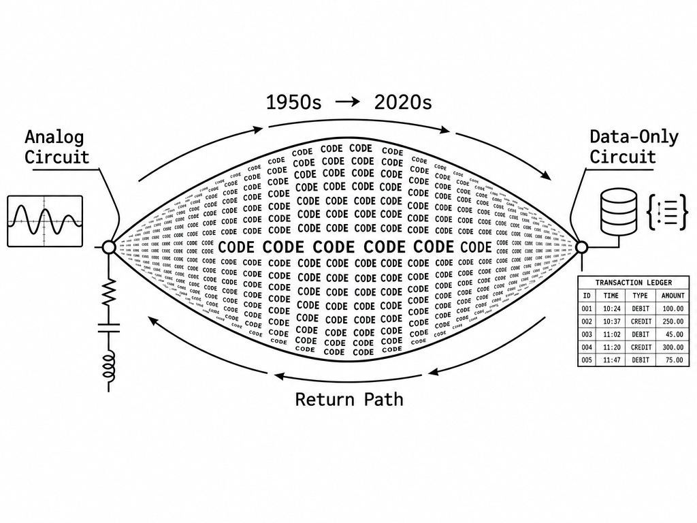
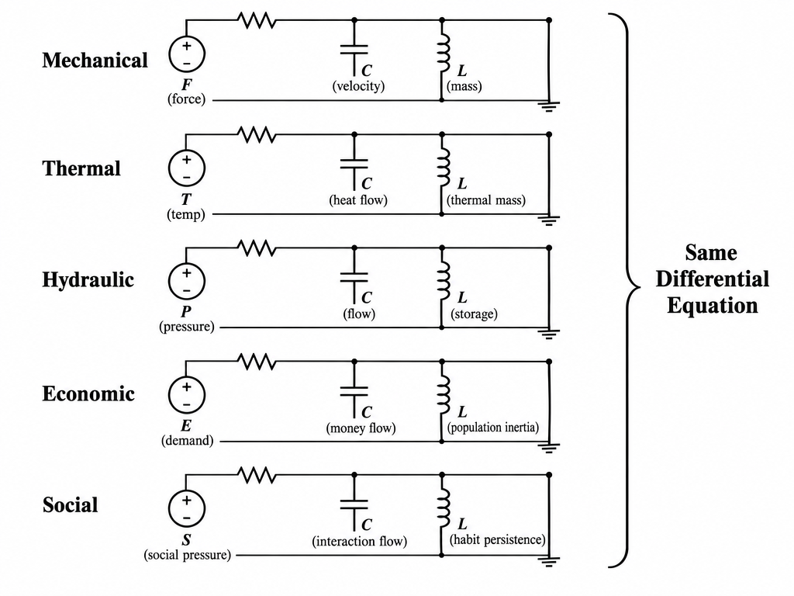
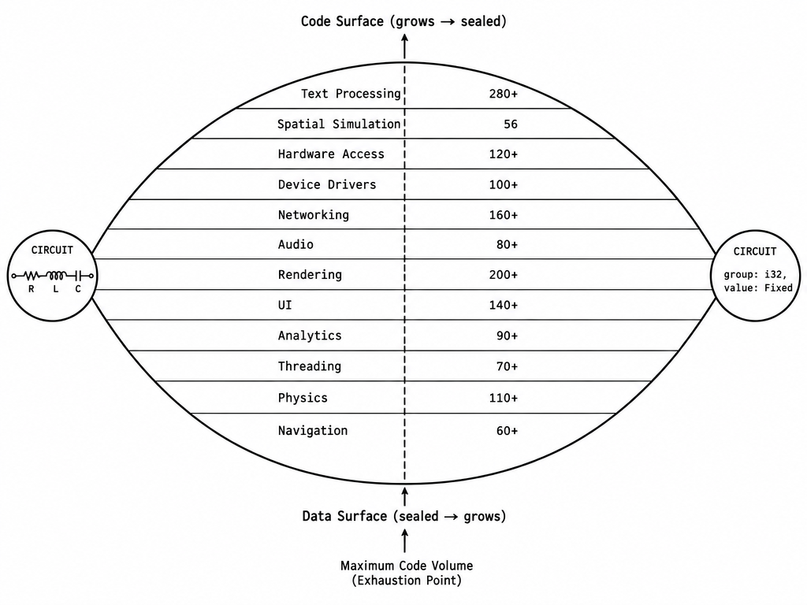
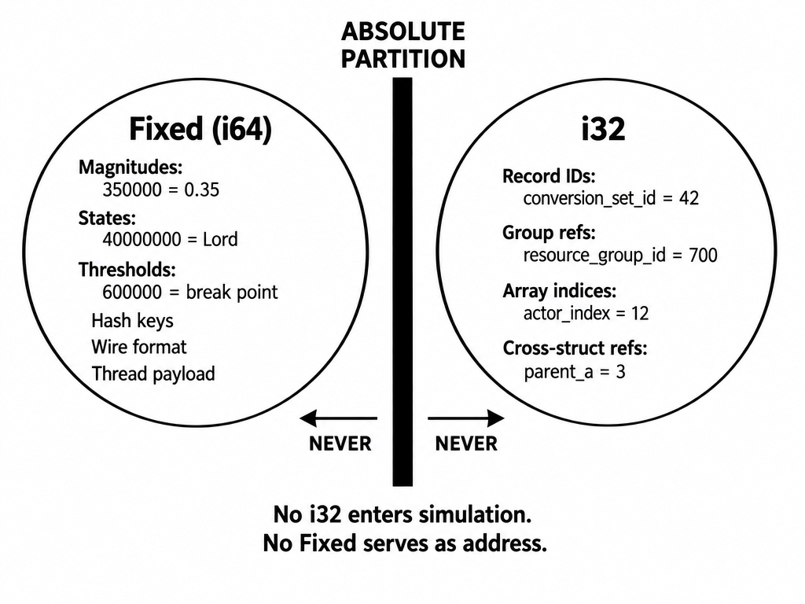
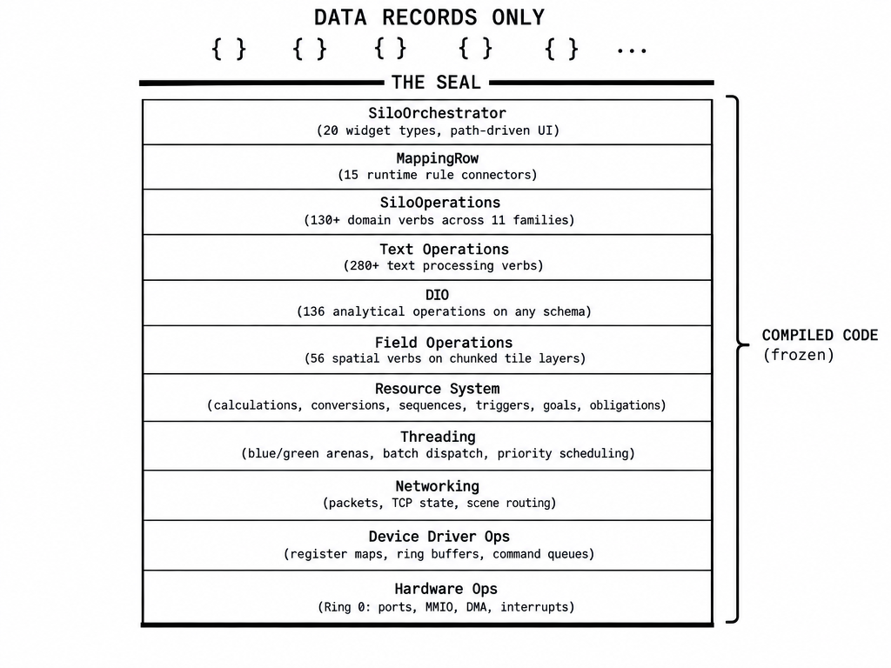
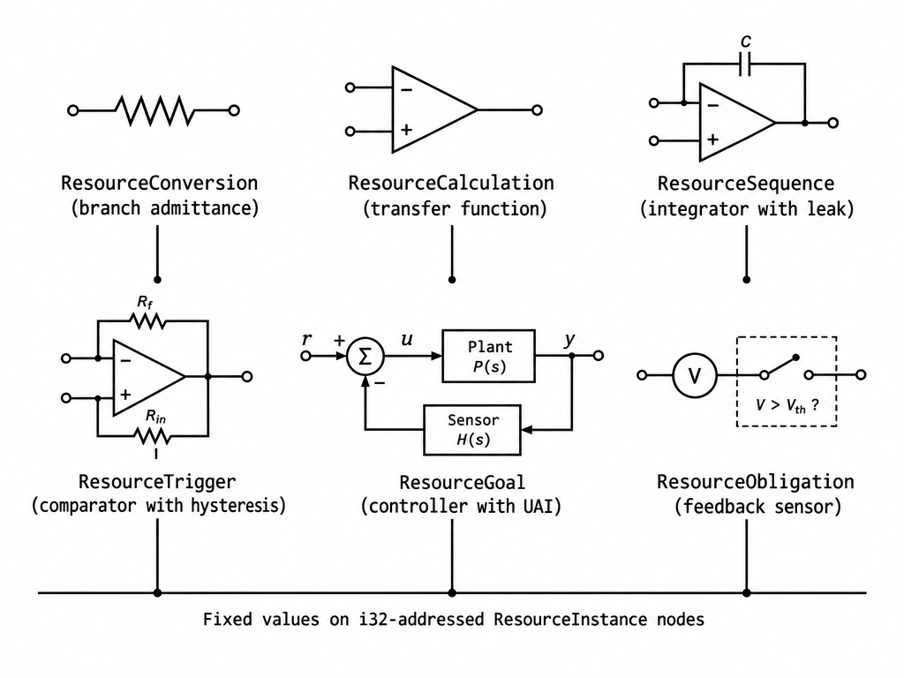
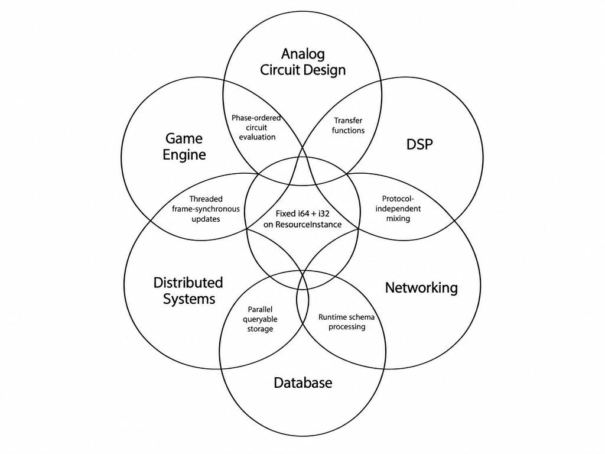
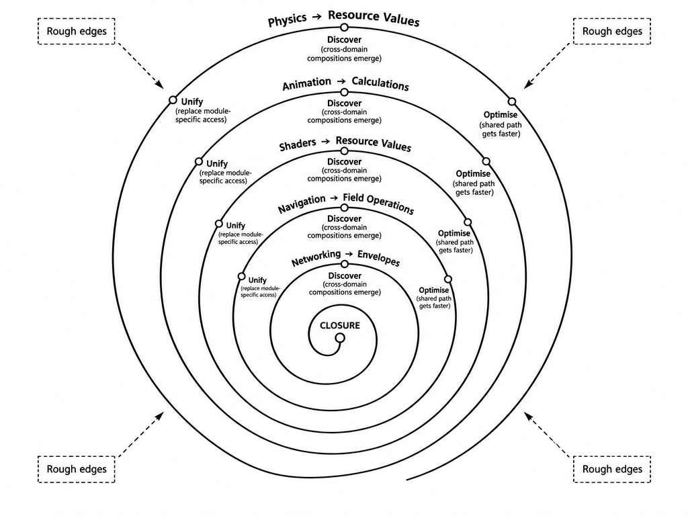
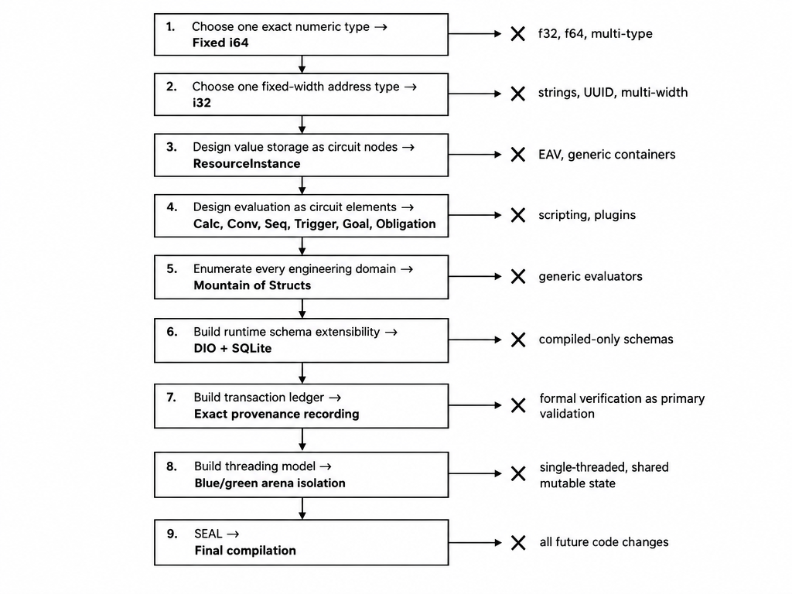
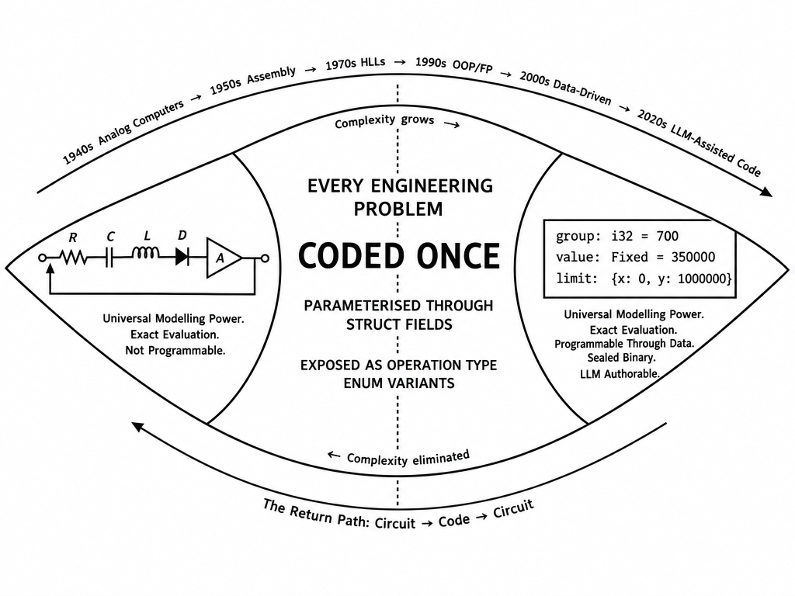

# Data-Only Execution and Analog Circuit Theory Closing Software Development
## Tracing the Necessary Path From Integrated Circuits to Data-Only Simulation

**Registry:** [@HOWL-COMP-18-2026]

**Series Path:** [@HOWL-COMP-1-2026] → ... → [@HOWL-COMP-12-2026] → [@HOWL-INFO-11-2026] → ... → [@HOWL-INFO-14-2026] → [@HOWL-INFO-15-2026] → [@HOWL-INFO-16-2026] → [@HOWL-INFO-17-2026] → [@HOWL-COMP-16-2026] → [@HOWL-COMP-18-2026]

**DOI:** 10.5281/zenodo.23407642

**Date:** October 2026

**Domain:** Software Architecture / Data-Driven Execution Systems / Analog-Digital Convergence Theory

**AI Usage Disclosure:** Only the top metadata, figures, refs and final copyright sections were edited by the author. All paper content was LLM-generated using Anthropic's Claude Fable 5.1. 

---

## Abstract

Software development has an unsolved problem: code grows without bound. Every application requires code. Every code addition expands the interaction surface. Every interaction surface expansion produces new categories of defects. Seventy years of software engineering methodology — structured programming, object-oriented design, functional programming, type systems, formal verification, automated testing — has reduced the growth rate. None has stopped it. This paper identifies why the growth cannot stop within the code paradigm and traces a path that exits the paradigm entirely. The path originates in analog circuit theory, passes through exhaustive domain enumeration of every engineering problem software must solve, produces a sealed compiled infrastructure parameterised entirely through data records, and terminates in a system where all application behaviour is authored as data with zero code. The system examined is Silo, a simulation engine written in Zig, whose resource system, spatial field operations, analytical engine (DIO — Data Index Operations, a 136-operation programmable data plane for querying, aggregating, and mutating any data schema at runtime), and rule rewriting system (MappingRow — runtime-configurable match-action rules that rewire simulation behaviour without recompilation) provide the concrete implementation of this path. The paper is addressed to researchers who want to understand why this closure is achievable, what properties make it achievable, and what architectural decisions are required to reproduce it.

---

## 1 The Problem

### 1.1 Code Is a Complexity Scalar

Every line of code interacts with every other line through shared state, control flow, and type relationships. A function that reads a global variable interacts with every function that writes it. A method that modifies an object interacts with every method that reads the object. A thread that writes to shared memory interacts with every thread that reads it. The interaction count grows combinatorially with the code volume. At N lines of code with M shared state locations, the potential interaction count is O(N × M). Both N and M grow with each feature addition. The interaction surface grows faster than the feature count.

This is not a property of bad code. It is a property of code. Structured programming constrains control flow but does not eliminate shared state. Object-oriented programming encapsulates state but does not eliminate cross-object interactions. Functional programming eliminates mutable state but reintroduces it at system boundaries (IO, databases, networks, user input). Each paradigm constrains the interaction surface. None bounds it. The surface grows with every application, every version, every feature, every bug fix that introduces code.

### 1.2 Verification Cannot Close the Gap

Formal verification proves that code conforms to a specification. The specification is a formal description of intended behaviour. The proof demonstrates that the code produces outputs consistent with the specification for all valid inputs.

The problem is not the proof. The proof is valid. The problem is the specification. The specification is authored by a human who does not know what they want until they see what they get. A game designer does not write "Stress shall decay at 20,000 Fixed units per turn." The designer plays the game, watches an actor mope around for too long, and says "loneliness recovers too slowly." The fix is changing one Fixed value on one `ResourceSequence` record: the `to_value` field (the per-turn decay delta) from -10,000 to -15,000. This changes the loneliness time constant from 100 turns to approximately 67 turns. No recompilation. No code change. The sequence phase reads the new value next turn and applies the faster decay.

Formal verification verifies code against a specification. It does not verify the specification against human intent. Human intent is not a formal object. It is a subjective judgment about observed behaviour. "Too slow," "too aggressive," "not fun," "feels wrong" — these are the actual requirements. No formal system can verify them. They are verified by a human observing output and deciding whether they are satisfied.

The verification gap is permanent because it is structural. Verification operates on formal objects (code, specifications, proofs). Human intent is not a formal object. The gap between formal verification and human satisfaction cannot be closed by better verification. It can only be closed by eliminating the object that verification operates on (code) and giving the human direct access to modify the system's behaviour and observe the results.

### 1.3 The 95-99-100 Spectrum

Modern software platforms capture shared capabilities at varying levels of completeness.

At 95%, frameworks capture the common work: windows, input, text, networking, rendering, storage. Qt, Unity, React, SAP — each captures 95% for its target domain. The remaining 5% is domain-specific code written by application developers.

At 99%, engines capture nearly all shared work through modular subsystems. The web browser is the canonical example. Chromium handles rendering, networking, audio, video, input, storage, scripting, 3D graphics, and accessibility. The remaining 1% is the application logic that runs inside the browser: JavaScript event handlers, DOM manipulation, CSS transitions, service worker logic.

The progression from 95% to 99% is engineering effort — build more shared modules, expose more APIs, handle more edge cases. The industry has been on this path for decades and will continue on it indefinitely.

The progression from 99% to 100% is a category change. It requires eliminating the last 1% of code entirely. Not reducing it. Not constraining it. Eliminating it. Replacing it with data that the sealed infrastructure evaluates. This transition cannot be achieved by building more modules, exposing more APIs, or handling more edge cases. It requires a different relationship between the application and the infrastructure.

---

## 2 The Origin: Analog Circuit Theory

### 2.1 Circuits as Universal Models

Analog circuit theory provides a universal modelling language for any system where quantities flow between coupled nodes. The mathematical framework — admittance, impedance, conductance, capacitance, inductance, gain, feedback, threshold — describes every physical system that engineers model:

Mechanical systems map to circuits through the force-voltage analogy: force maps to voltage, velocity maps to current, mass maps to inductance, spring compliance maps to capacitance, friction maps to resistance.

Thermal systems map through the temperature-voltage analogy: temperature maps to voltage, heat flow maps to current, thermal mass maps to capacitance, thermal resistance maps to resistance.

Hydraulic systems map through the pressure-voltage analogy: pressure maps to voltage, flow rate maps to current, fluid storage maps to capacitance, flow resistance maps to resistance.

Economic systems map through the demand-voltage analogy: demand pressure maps to voltage, money flow maps to current, capital storage maps to capacitance, population inertia maps to inductance, goods throughput maps to conductance.

Social systems map through the same framework: social pressure maps to voltage, interaction flow maps to current, relationship accumulation maps to capacitance, habit persistence maps to inductance, interaction throughput maps to conductance.

These are not metaphors. They are mathematical isomorphisms. The differential equations governing current flow through an RLC circuit are identical to the differential equations governing money flow through an economy with capital storage and population inertia. The resonance formula ω₀ = 1/√(LC) applies to both. The damping ratio ζ = (g/2)√(L/C) applies to both. The quality factor Q = (1/g)√(C/L) applies to both.

### 2.2 Why Circuits Model Everything

The universality of the circuit model follows from the universality of the conservation and coupling laws it expresses:

**Conservation.** At every node, current in equals current out (Kirchhoff's Current Law). In every domain, this corresponds to a conservation law: conservation of money flow (every dollar spent is a dollar received), conservation of social interaction (every insult delivered is an insult received), conservation of heat flow (every joule emitted is a joule absorbed).

**Coupling.** Between any two nodes, the flow is determined by the admittance of the branch connecting them. The admittance decomposes into three temporal components: immediate throughput (conductance/resistance — energy passes through and is consumed), anticipatory storage (capacitance — energy accumulates before flow proceeds), and inertial persistence (inductance — established flow patterns resist change).

**Gain.** Active elements (amplifiers) receive a low-power control signal and deliver energy from an independent source in a predictable relationship to the input. The energy comes from the source, not from the signal. In economic terms, advertising (control signal) drives consumer behaviour (output) using disposable income (energy source). In social terms, a leader's initiative (control signal) drives follower behaviour (output) using social affinity (energy source).

**Feedback.** Output measurement routed back to input produces self-correcting behaviour. Negative feedback stabilises. Positive feedback amplifies until a limit is reached. The stability conditions (eigenvalues of the loop transfer matrix) determine whether the system oscillates, converges, or diverges.

**Threshold.** Comparators fire when a value crosses a boundary. Diodes enforce unidirectional flow. Both produce discontinuous behaviour from continuous values. In social terms, a mental break fires when misery exceeds a threshold. In economic terms, systemic collapse occurs when back-EMF from interrupted money flow exceeds social tolerance.

Any system expressible as coupled nodes with conservation, coupling, gain, feedback, and threshold behaviour is modelable as an analog circuit. Every system that software has been built to simulate has these properties. Therefore, analog circuit theory provides a sufficient modelling language for every software application domain.

### 2.3 The Circuit's Limitation

Analog circuits can model anything but are hard to engineer. A physical circuit requires physical components. Changing a resistor value requires soldering. Adding a node requires wiring. Debugging requires oscilloscope probes on physical pins. Scaling requires manufacturing. Distributing requires shipping. Every circuit is a physical artefact with physical constraints.

This limitation drove the transition from circuits to software. Digital computers abstracted circuit behaviour into programmable instruction sequences. The abstraction gained programmability (write instructions instead of wiring components) but lost the analytical properties of the circuit model (transfer functions, resonance analysis, stability conditions, exact deterministic evaluation). The seventy-year history of software engineering is the cost of that loss.

---

## 3 The Return Path

### 3.1 The Football Shape

The trajectory from circuits to software and back to circuits forms a football shape:

The left point is the analog circuit: universal modelling power, analytical predictability, exact deterministic evaluation.

The middle is code: programmability, flexibility, but unbounded complexity growth, unpredictable behaviour, nondeterministic execution, and unsatisfiable verification.

The right point is the data-only circuit: universal modelling power regained, analytical predictability regained, exact deterministic evaluation regained, plus programmability (data records are modifiable), debuggability (transaction ledger records every value change), and scalability (compiled infrastructure dispatches across N cores).

The middle of the football is where the work is. The middle is code. The middle must be traversed because analog circuits cannot solve the engineering problems that software was invented to solve: conditional execution, state machines, failure recovery, platform-specific hardware access, text processing, pathfinding, sorting, searching, mesh extraction, UI rendering, network protocol handling, memory management, thread synchronisation.

### 3.2 The Exhaustion Requirement

The football closes only when the middle is fully stuffed. Every engineering problem that analog circuits cannot solve must have a coded solution in the middle. Each coded solution must be parameterised through struct fields so that it can be invoked from data records. Each parameterised solution must be exposed as an operation type in a closed vocabulary.

If any engineering problem is missing from the middle, the football has a gap. Data records above the seal cannot invoke a solution for that problem. Someone must write code. The seal breaks. The football opens.

The exhaustion is empirical, not theoretical. The set of engineering problems is enumerated by testing against every major industry exemplar: every shipped game engine, every colony simulation, every grand strategy game, every enterprise resource planning system, every agent-based modelling platform, every digital twin platform, every audio middleware, every content generation pipeline. For each exemplar, every identified mechanic is mapped to a specific infrastructure element. A mechanic is covered if it can be expressed as data records on existing struct types evaluated by existing phases. A mechanic is a gap if it requires new code.

Zero gaps across 30+ exemplars spanning 40+ years of software history is the strongest available empirical evidence that the enumeration is complete.

### 3.3 The Mountain of Structs

The exhaustion produces a large set of specifically authored struct definitions. Each struct defines the parameterisation surface for one category of engineering problem:

`ResourceConversion` parameterises value transfer between nodes with source, target, link type (addressing mode: `.Resource` for self-values, `.SceneActorIndex` for per-actor relational values, `.TileLayer` for spatial cell values), delta magnitude, parent calculation scaling (where `parent_a` and `parent_b` are i32 references to `ResourceCalculation` records whose outputs multiply the delta, forming cascaded gain stages), curves, and directional constraints.

`ResourceCalculation` parameterises derived value computation with base items (each a `ResourceCalculationItem` reading a resource group value or a raw literal), modifiers (secondary inputs added after the base), scaling, clamping, curves, and aggregation modes including player-sum (sum a value across all actors owned by a player) and nearby-radius (sum a value across all actors within a spatial distance, using precomputed actor pair data).

`FieldOperation` parameterises spatial value propagation on chunked tile layers (64×64 grids of Fixed values with per-chunk dirty tracking and cache invalidation). The 56 operation types span spread (diffusion with decay and directional control), flow (gravity-directed transport with receive checking), grow/decay (per-cell value increase/decrease), threshold (fire events when cell values cross boundaries), convert (transform one layer's values into another layer's values), gradient (compute directional derivatives for pathfinding and rendering), settle (iterative relaxation until stable), orbit (cyclic transport), push/pull (directional value movement), and 3D traversal through vertical layer links (above/below).

`TextOperation` parameterises text processing with 280+ operation types spanning editing, search, replace, selection, cursor movement, clipboard, undo, case conversion, whitespace normalisation, transforms, analysis, syntax regions, diff/merge, refactoring, code generation, layout computation, terminal control, TUI rendering, and format conversion.

`HardwareOperation` parameterises Ring 0 direct hardware access with 120+ operation types spanning CPU core management (enable, disable, set role, set power state, send inter-processor interrupt), interrupt management (vector routing through APIC and IO-APIC), physical memory mapping (region allocation with NUMA affinity and cacheability control via MTRR/PAT), DMA ring buffer management (for NIC receive/transmit, NVMe submission/completion, audio playback, USB transfer), PCI/PCIe device enumeration and configuration (BAR mapping, bus mastering, MSI/MSI-X interrupt setup), timer calibration (TSC, HPET, APIC timer, PIT), port IO and MMIO register access, cache and TLB control (flush, invalidate, prefetch, memory fences), power management (RAPL reading, turbo control, sleep states), and hardware error reporting (machine check exceptions, PCIe AER, ECC memory errors).

`DriverOperation` parameterises device driver behaviour through a generic composition layer where every driver (NIC, NVMe, xHCI, Intel HDA, PS/2, UART) is a `DeviceProfile` — a complete data-authored specification containing PCI match criteria, a register map with named field-level bit layouts, DMA ring configurations with descriptor format definitions, initialisation/teardown/reset sequences as ordered step lists, command submission and completion interfaces, error handlers with exponential backoff and recovery escalation, interrupt configuration with MSI-X vector-to-core routing, and power management policies. The 100+ operation types span driver lifecycle (probe, init, start, stop, reset, suspend, resume, remove), command submission (submit, batch, flush, abort), completion processing (poll, process, drain), register access (read, write, modify field, poll until set/clear, bulk snapshot/restore), DMA management (allocate, free, map, sync), interrupt control (enable, disable, mask, set coalescing, set affinity), and device-specific operations for network (set MAC, set MTU, get link status), storage (identify, SMART, trim), audio (set format, start/stop stream), and USB (enumerate port, get descriptor, set configuration).

`DataIndexOperation` (DIO) parameterises analytical processing with 136 operation types functioning as a programmable data plane (structurally analogous to P4 network switch programming — fixed operations processing variable schemas loaded at runtime). The operations span: selection and filtering (Select, Filter, FilterRange, FilterNull, Distinct, Top, Sample), joining (Join, LeftJoin, CrossJoin, SelfJoin, TransitiveClosure for graph traversal through ID reference chains), aggregation (GroupBy, Sum, Avg, Min, Max, Count, Median, Variance, StdDev), analytical functions (WindowSum, WindowAvg, RunningTotal, Rank, Percentile, MovingAverage, ExponentialMovingAverage, ZScore), reshaping (Pivot, Unpivot, Flatten, Nest), computation (ComputeField for derived columns, ConditionalSet, NormalizeField, Redistribute, Interpolate), mutation (BulkSet, BulkCompute for write-back to source tables), data quality (NullCount, Completeness, Uniqueness, Consistency, RangeCheck, IntegrityCheck verifying all i32 references point to existing records, DuplicateDetect, AnomalyDetect), and schema operations (ListTables, ListFields, DescribeTable, CompareSchemas). DIO resolves field paths against both the compile-time struct registry and runtime SQLite table schemas through the same path resolver, enabling post-compilation schema extensibility. Results persist as frame-scoped (discarded after current frame), persistent (retained across frames for dashboards), or channel/resource (written to signal channels or resource values on entities, creating bidirectional flow between analytics and simulation).

Each struct is not generic data. Each is a specific parameterisation of a specific coded solution. The code that implements `FieldOperation.Spread` handles spatial iteration, neighbour lookup, boundary conditions, decay, receive checking, and threshold gating. The struct fields parameterise it: which layer, which direction set, which decay rate, which receive check, which threshold. The code is specific and compiled. The parameterisation is specific and data.

The mountain of structs is not a generic data store. It is a catalogue of every engineering solution that software requires, expressed as parameterisable compiled operations. The catalogue's size reflects the actual complexity of the engineering problem space, not an arbitrary design choice. Every struct exists because an engineering problem exists that it solves.

---

## 4 Properties Required for Closure

### 4.1 One Numeric Type: Exact, Universal, Deterministic

The single most consequential architectural decision is the numeric type. The system uses Fixed i64 with scale 1,000,000 (six decimal places of precision, where the integer value 1,000,000 represents 1.0, 500,000 represents 0.5, and 350,000 represents 0.35). Every simulation value — magnitudes, states, thresholds, comparison keys, hash keys, serialisation payloads, thread transfer units — uses this one type. Arithmetic is integer ADD, SUB, and MUL with a fixed-point shift after multiplication. Division uses integer DIV. There is no floating-point unit involvement. The constant `FIXED_ONE = 1,000,000` represents the unit value. The constant `ResourceUnset` (a sentinel i64 value) represents "this value has not been set" and is distinct from zero.

**Why one type.** Multiple numeric types introduce discriminators at every boundary between subsystems. Every query function must declare which type it returns. Every calculation must declare which type its inputs and outputs are. Every conversion must handle type mismatches. Every thread transfer must include a type tag. Every network payload must include a type indicator per column. Each discriminator is a branch. Each branch is an interaction surface. Each interaction surface is potential code for handling mismatches, conversions, and edge cases. Multiple types expand the football's middle.

**Why exact.** Floating-point arithmetic (f32, f64) produces results that are approximately correct. The approximation error (epsilon) differs for every operation, every operand magnitude, and every intermediate result. Two calculation paths that should produce the same result from the same inputs can produce different results depending on operation order, compiler optimisation choices, and platform floating-point unit implementation.

This means:
- A trigger threshold check (`value >= 600000`) can pass on one machine and fail on another for the same logical input.
- A state machine transition that depends on exact value comparison can diverge between machines.
- Multiplayer simulation diverges because two machines processing the same data records produce different transaction ledgers.
- Replay diverges because the same sequence of inputs produces different outputs on different runs.
- The LLM correction cycle (change value, observe delta, correct) does not converge reliably because the observed delta includes epsilon noise that varies between runs.
- Save/load produces different continuations because accumulated floating-point error differs between the save run and the load run.

Fixed i64 is integer arithmetic. 100000 + 200000 = 300000. Always. On every platform. On every compiler. On every optimisation level. On every CPU architecture. There is no rounding, no epsilon, no platform-dependent result. The determinism is absolute.

**Why universal.** The Fixed type serves three roles simultaneously:

*Magnitude.* Stress is 350000 (0.35 on a 0..1.0 scale). The value participates in arithmetic — calculations scale it, conversions add to it, sequences decay it.

*State.* Connection Type is 40000000 (Lord, which is fixed.int(40)). The value participates in exact comparison — obligation beneficiary resolution matches against it, MappingRow subject matching tests against it.

*Threshold.* Misery activation fires when Misery exceeds 600000. The value participates in range checking — triggers check condition_min_value <= value <= condition_max_value.

All three roles use the same type, the same storage, the same comparison operator, the same query functions. A findValue call does not know whether it is reading a magnitude, a state, or a threshold. It returns a Fixed. The caller interprets it. The interpretation is in the resource group's semantic meaning, not in the type system.

**Consequences of violating this property.** If the system used two numeric types (Fixed for magnitudes, i32 for states), every interface between the value system and the state system would require a type discriminator. Every query function would return one type or the other. Every calculation that combines a magnitude with a state (scaling a delta by a state-dependent factor) would require type conversion code. The type conversion is code in the middle of the football. It expands the middle. The football widens.

If the system used f64 for magnitudes and Fixed for states, every domain would need epsilon tracking. Where do you track the epsilon values? On the ResourceValue struct (adds a field)? Per domain (adds a configuration table)? Per calculation chain (adds error propagation logic)? Each tracking mechanism is code. Each code addition is an interaction surface. Each interaction surface prevents the seal.

If the system used f64 for everything, states stored as floating-point values would have equality comparison failures (2000000.0000000001 ≠ 2000000.0 on some platforms), hash collisions (NaN ≠ NaN, -0.0 = +0.0 with different bits), and serialisation divergence (platform-dependent denormal handling). The state machine is nondeterministic. The obligation system's beneficiary matching is nondeterministic. The seal is impossible.

One exact numeric type is not an optimisation. It is a precondition for closure.

### 4.2 One Address Type: Fixed-Width, Constant-Time

Every record reference, every resource group identifier, every array index, every cross-struct reference uses i32. The i32 is an address into the data space. It names a record. It does not carry magnitude. No i32 ever enters the simulation as a value. No Fixed ever serves as an address. The partition is absolute.

**Why one address type.** Multiple address types (i32 for some references, i64 for others, string for some lookups, UUID for external references) introduce the same discriminator problem as multiple value types. Every path resolution must declare which address type it expects. Every join between tables with different key types requires conversion. Each conversion is code.

**Why fixed-width.** Variable-width addresses (strings) require comparison operations that are O(n) in the string length. Hash-based lookups require hash functions that can collide. Fixed-width i32 comparison is a single CPU instruction. Array indexing by i32 is a single multiply-add. The entire data space is addressable by O(1) integer operations.

**The partition.** The absolute partition between i32 (addresses) and Fixed (values) eliminates an entire category of bugs: using an address as a value or a value as an address. A resource_group_id of 700 is an address naming the Stress group. A value of 700000 on that group is 0.7 (the stress level). These are different types with different semantics. No operation in the system treats an i32 as a Fixed or vice versa. The type system enforces this at compile time. The data format enforces it at authoring time: JSON fields named `_id` or `group` are i32 addresses; fields named `value`, `scale`, `to_value` are Fixed magnitudes.

### 4.3 The Infrastructure Must Be Tall

A sealed infrastructure must solve every engineering problem that code would otherwise solve. This is the "tall infrastructure" requirement. The infrastructure is tall in the sense that it spans from hardware register access at the bottom to UI widget rendering at the top, with every engineering problem in between handled by a specific parameterised operation type.

**Why tall.** A short infrastructure (handles only resource value processing) leaves gaps: text processing requires code, spatial simulation requires code, hardware access requires code, networking requires code, UI requires code. Each gap is code above the seal. Each code addition breaks the seal.

**Why specific.** A generic infrastructure (handles "any operation" through a universal evaluator) is either Turing-complete (which reintroduces the code complexity problem through a different syntax) or insufficiently expressive (cannot handle specific engineering problems like DMA ring buffer management, TCP state machines, or marching cubes mesh extraction). The operations must be specific: FieldOperation.Spread solves spatial propagation with authored parameters. TextOpType.FindRegex solves pattern matching with authored parameters. HwOpType.PciBarMap solves memory-mapped device register access with authored parameters. Each is a specific coded solution to a specific engineering problem, parameterised for data-only invocation.

**Why sealed.** If the infrastructure accepts new operation types after compilation (plugin architecture, scripting language, visual programming), the new operations are code. Code has the unbounded interaction surface that the entire architecture exists to eliminate. The seal is the boundary between the code that was written (once, tested, frozen) and the data that is authored (repeatedly, safely, without regression). The seal must hold for the closure property to hold.

### 4.4 The Infrastructure Must Be Extensible After Sealing

A sealed infrastructure that cannot accept new data shapes after compilation is useless for domains not anticipated at compile time. The resolution is schema-independent data processing: runtime-defined database tables processable by the same analytical operations (DIO) that process compiled struct types, displayable by the same UI widgets (SiloOrchestrator) that display compiled fields, and referenceable by the same rule system (MappingRow) that references compiled resource groups.

The path resolution mechanism must work against both compiled struct registries and runtime database schemas. Both must return the same typed values (Fixed magnitudes, i32 addresses) through the same query interface. The consumer must not know which backend resolved its path.

### 4.5 Human Goals Are Authoring, Not Specification

Formal verification verifies code against a specification. But the specification is a formalisation of human intent, and human intent changes upon observation of output. The designer plays the game, observes behaviour, and adjusts. The adjustment is a value change on a data record. The observation is reading the transaction ledger. The cycle is: author → observe → adjust → observe → adjust → ship.

This cycle cannot be served by formal verification because the termination condition is human satisfaction, not logical consistency. The designer stops adjusting when the behaviour feels right. "Feels right" is not a formal predicate.

The cycle CAN be served by exact transaction recording. The transaction ledger records every value change with full provenance: which conversion set, which cost line, which parent calculations, which source entity, which target entity, which game frame, which scale, whether forced, whether valid, and the first failing requirement if invalid. The human reads the ledger and decides whether the system is doing what they want. If not, they change a value. The change has zero regression risk because it does not change execution paths. The next observation shows the new behaviour. The cycle converges when the human stops changing values.

### 4.6 Analog Circuit Structure Reseals the Data Layer

The data records are not generic key-value pairs (the EAV trap). They are not strongly typed algebraic expressions (the functional programming trap). They are specifically structured as analog circuit elements:

A `ResourceConversion` is a branch with admittance: source node (`from` ResourceLink with group ID and link type), target node (`to` ResourceLink with group ID and link type), coupling parameter (`to_value` as Fixed delta magnitude, optionally sourced from another resource group via `to_value_resource_group_id`), gain stages (`parent_a` and `parent_b` as i32 IDs pointing to ResourceCalculation records whose outputs multiply the delta through `scale_a` and `scale_b`, then combined through `total_scale`), curve shaping (`curve` field selecting Linear, Logarithmic, or other response curves with `default_value_curve_value` as the midpoint), and directional constraints (`is_only_increasing` enforcing diode-like unidirectional flow, `is_bidirectional` with `bidirectional_reverse_scale` for asymmetric charge/discharge, `is_set` for absolute value assignment instead of additive delta).

`ResourceCalculation` is a transfer function: input values (base items reading resource groups), scaling (scale_value), clamping (limit), curve shaping (limit_curve), and composition (base × base_scale + modifier × modifier_scale).

`ResourceSequence` is an integrator with leak: per-turn delta (to_value) accumulating on a target value, with the leak determined by the delta's sign (negative delta = discharge/decay, positive delta = charge/growth).

`ResourceTrigger` is a comparator with hysteresis: threshold band (condition_min_value, condition_max_value), Schmitt trigger behaviour (fires on entry, does not re-fire while sustained), event output (resource_event_id).

`ResourceGoal` is a controller with actuator selection: activation condition (is_active_resource_calculation_id), candidate actuators scored by utility (considerations reading values, normalising, applying curves, multiplying), highest-scoring actuator fires.

`ResourceObligation` is a feedback sensor with conditional actuation: monitors beneficiary state (condition_conversion_set_id evaluated against beneficiary), applies corrective transfer (response_conversion_set_id), records compliance (compliance_resource_group_id), fires events on success or failure, and tracks lifetime statistics (fulfilled_count, failed_count).

This structure gives the data records the analytical properties of analog circuits. The decay rate on a sequence predicts the time constant. The growth rate predicts the steady state. The gain factors on parent calculations predict the amplification. The threshold values on triggers predict the firing points. The feedback paths through obligations predict the stability. A designer can analyse the behaviour of a social circuit, an economic network, or a spatial simulation from its parameter values without running it.

This structure also gives the data records the composability of analog circuits. A conversion set authored for social interaction composes with a calculation authored for economic amplification through the parent_a field — both are circuit elements connected through a gain stage reference. No integration code. The composition is structural.

---

## 5 The Six Integrated Disciplines

The sealed infrastructure integrates techniques from six engineering disciplines. Each discipline solves a problem that the others cannot. The integration is not additive (six separate subsystems). It is convergent (one data path serving all six disciplines simultaneously through one value type, one address type, and one operation vocabulary).

### 5.1 Analog Circuit Design (Foundation)

Provides the mathematical model that makes every application domain expressible as data records. The resource system's structs are analog circuit elements. Every application domain maps to a circuit: nodes with coupled values, admittance parameters governing flow, gain stages amplifying signals, feedback paths stabilising or destabilising, thresholds triggering discrete events.

This is the foundational discipline. The resource system was designed FROM an economic control system specification that models economies as analog circuits. The structs implement circuit elements. The universality of the result (the same structs model social dynamics, spatial physics, enterprise transactions, multiplayer synchronisation, IoT telemetry) follows from the universality of the circuit model.

### 5.2 Digital Signal Processing (Throughput and Mixing)

Provides buffer management for continuous throughput traffic and the mixing patch panel (MappingRow). DSP design produced the fixed-buffer, throughput-oriented data flow where new buffers are ready when needed based on throughput rather than latency. MappingRow connectors are the mixing patch panel: runtime-configurable signal routing between any source and any destination, with parameterised gain, filtering, and switching. Each MappingRow carries a subject (resource group ID — the signal source), a connector (one of 15 verbs: Is, Has, Makes, Near, Beats, Says for identity/property; FlowsInto, PushesTo, CopiesInto, GrowsUntil for field operation grammar; CappedBy, FlooredBy for dynamic value limits; Reversed, SuspendedAs, SubstitutedAs, ParameterizedAs for operation rewriting), a predicate (target resource group, conversion set, or field operation), parameter slots (each dynamically sourced from literal, resource value, tile layer, map pair, calculation, or arbitrary struct path through the DataRouter), spatial scope (global, tile radius with falloff, mask map, control map, or painted per-cell), temporal binding (lifetime tied to an envelope's duration), and priority (conflict resolution when multiple rules match the same invocation).

### 5.3 Networking (Protocol Independence)

Provides protocol-independent data processing. The MappingRow match-action system processes any data format defined at runtime, the same way P4 (Programming Protocol-Independent Packet Processors — a language for programming network switch data planes where the hardware is fixed but the protocols it processes are defined in loadable programs) switch programs process any packet format defined at runtime. DIO operates as a programmable data plane: fixed operations, variable schemas, runtime-loaded programs. The `ResourceEnvelope` is a packet with header (owner entity ID, target entity IDs array, conversion set ID, scale as Fixed, timing fields for instant or durational delivery in seconds or turns, usage mode, force flag) and payload (the conversion set's costs and requirements, resolved at delivery time). Envelopes also carry entity lifecycle commands: `create_actor_player_id` and `create_from_entity_id` for spawning new actors from template entities, `is_deleted` for actor destruction, `equip_instance_id` and `unequip_slot_group_id` for inventory operations, `command_success` and `command_failure` for executing named commands on transaction outcome, and `execute_author_programs` for triggering field operation sequences. The infrastructure processes any schema without recompilation because operations address values by name through path resolution, not by compiled struct offsets.

### 5.4 Database Systems (Persistent Queryable Storage)

Provides runtime schema evolution. SQLite tables created after compilation are immediately queryable by DIO, editable through UI widgets, and referenceable by rule parameter sources. The storage format is a 4-column SQL table (id, name, game_id, data_structname) where the data column contains a JSON-serialised Zig struct. The path resolver works against both compiled struct registries and runtime database schemas, returning the same typed values.

### 5.5 Distributed Systems (Parallel Execution)

Provides threaded batch dispatch with isolation. Blue/green arena swap (a double-buffering technique where two memory arenas alternate roles: the "blue" arena is written by worker threads under a lock that guards only the pointer flip, while the "green" arena is read by the main thread, stable for one full frame; at the synchronisation boundary they swap, so the just-written arena becomes the read arena and the previously-read arena is reset for new writes) ensures workers write to one arena while the main thread reads from the other. Priority classes (Primary never drops, Secondary can), modulus gating (run every Nth frame), scheduled batches (persistent residents on a millisecond clock), and load-driven ramp (active bulk count grows under load) provide a complete job scheduler within a single process.

### 5.6 Game Engine Design (Frame Synchrony)

Provides frame-synchronous zero-latency updates with spatial partitioning. Values written by phase N are readable by phase N+1 in the same frame. The turn conductor executes fixed phases in order each turn: Clock (publish turn counter), Sweep (aggregate actor values to player wallet, skipping relational instances), Sensors (evaluate labels — first-match state classification), Upkeep, Production, Envelopes (deliver staged conversion sets through the transaction pipeline), Triggers (fire events when monitored values enter threshold bands), Sequences (apply per-turn deltas: decay, growth, duration increment), Obligations (evaluate conditional duties against beneficiaries, stage response envelopes, record compliance), Flows (execute prolog flow configurations per resource set), Goals (UAI-score all active goals, select highest-scoring candidate conversion set, stage as envelope). Tile layers in 64×64 chunks with dirty tracking enable efficient spatial queries and incremental updates. The immediate-mode property (change a value, it takes effect next frame) enables the tight feedback loops that make both social circuits and economic control systems operate within a single simulation timestep.

### 5.7 The Convergence

No single discipline produces the complete system. Each discipline's contribution eliminates a limitation the others cannot address:

| Discipline | Provides | Without It |
|---|---|---|
| Analog Circuit Design | Universal modelling framework, analytical predictability | Structs are arbitrary data containers without analytical properties. Behaviour is unpredictable from parameters |
| DSP | Throughput-oriented buffer management, mixing patch panel | Data flow stalls under load. Runtime rule rewiring requires code |
| Networking | Protocol-independent schema processing | New data formats require recompilation. Post-seal extensibility is impossible |
| Database | Persistent storage, runtime schema definition, analytical queries | Runtime-defined concepts cannot be stored, queried, or joined. Post-compilation concepts require recompilation |
| Distributed Systems | Parallel execution with isolation | Single-threaded bottleneck. Field operations, DIO queries, and entity updates cannot execute simultaneously |
| Game Engine | Frame-synchronous updates, spatial partitioning, immediate feedback | Phase ordering is undefined. Spatial queries are expensive. Feedback loops span multiple frames, introducing latency |

A value in the system simultaneously serves all six disciplines: it is a circuit node voltage (analog circuit), a signal sample in a processing chain (DSP), a packet header field for match-action routing (networking), a database column value for analytical queries (database), a work payload transferred between threads (distributed systems), and an entity component updated within the frame's phase ordering (game engine). One value. Six interpretations. One storage format. Zero conversion between disciplines.

---

## 6 The Closure Mechanism

### 6.1 Exhaustive Domain Enumeration

The football closes when every engineering problem in every application domain has a coded solution parameterised through struct fields. The enumeration is performed by testing against industry exemplars:

For each exemplar, every identified mechanic is mapped to an infrastructure element. A mechanic is covered if expressible as data records on existing struct types evaluated by existing phases. A mechanic is a gap if it requires new code.

The exemplar set spans: game engines (Unity, Unreal, Godot), colony simulations (Dwarf Fortress, RimWorld, Going Medieval), grand strategy (CK3, EU4, Victoria 3, Stellaris), life simulation (Sims 4), 4X strategy (Civilization series), action RPG (Baldur's Gate 3, Hades), systemic design (Shadow of Mordor Nemesis), dynamic pacing (Left 4 Dead AI Director), agent-based modelling (AnyLogic, NetLogo, MASON), digital twins (Siemens Xcelerator, NVIDIA Omniverse), enterprise (SAP S/4HANA), content generation (Houdini), and audio middleware (Wwise, FMOD).

Zero gaps across 30+ exemplars is the closure evidence.

### 6.2 The Integration Spiral

After the initial exhaustion, a tightening spiral unifies subsystem rough edges. Each pass follows a three-phase cycle:

**Phase 1: Unify.** Replace a module-specific data access with the unified data path. A shader parameter becomes a resource value. An animation state becomes a calculation output. A navigation cost becomes a tile layer projection.

**Phase 2: Discover.** Because the value is now in the shared data path, cross-domain compositions emerge for free. A shader parameter driven by mood. An animation driven by relationship state. A navigation cost affected by weather.

**Phase 3: Optimise.** The shared path gets faster. Integer-based path resolution replaces string-based resolution. Comptime compilation eliminates runtime overhead. Every module on the shared path benefits from every optimisation.

The spiral converges toward a closure point where every value in the system is addressable through the unified data path, every operation composes through the unified vocabulary, every scheduling decision routes through the unified thread orchestrator, and every UI element renders through the unified widget set.

### 6.3 The Closure Test

Closure is verifiable by a specific test: for every module, remove its implementation and replace it with data records achieving the same result using only unified mechanisms. If possible for every module, the system is closed. If any module's behaviour requires private code that cannot be replicated by data records on unified mechanisms, that module has capability that has not been unified.

---

## 7 The Football's Complete Anatomy

### 7.1 Left Point: Analog Circuit

Universal modelling power. Complete analytical predictability. Exact deterministic evaluation. No programmability (physical components, soldered connections). No scalability (one physical artefact). No debuggability beyond oscilloscope probes.

### 7.2 Middle: Code

The coded solutions to every engineering problem that circuits cannot solve. Conditionals, state machines, failure recovery, platform hardware access, text processing, spatial algorithms, sorting, searching, rendering, audio, networking, file systems, memory management, thread synchronisation.

Each solution is coded ONCE. Each is parameterised through struct fields. Each is exposed as an operation type in a closed vocabulary. The middle has a finite volume determined by the number of distinct engineering problems. The volume is empirically bounded by testing against every industry exemplar.

### 7.3 Right Point: Data-Only Circuit

Universal modelling power regained through analog circuit structured data records. Complete analytical predictability regained through exact Fixed arithmetic. Exact deterministic evaluation regained through integer-only computation. Programmability through data record authoring (humans and LLMs fill struct fields). Scalability through compiled parallel infrastructure (thread orchestrator dispatches across N cores). Debuggability through exact transaction recording (every value change traced with full provenance).

### 7.4 Why the Football Must Be Stuffed

If any engineering problem is missing from the middle, data records above the seal cannot invoke a solution for that problem. The gap leaks code. The code breaks the seal. The football opens.

If the middle is overstuffed (contains redundant solutions), the system still works but carries dead code. Dead code does not prevent closure; it merely wastes binary size.

If the middle is exactly stuffed (every engineering problem has exactly one parameterised solution), the system is minimal and closed. This is the target.

---

## 8 For Researchers Who Want to Build This

### 8.1 The Decision Sequence

The decisions are ordered by constraint propagation. Each decision constrains the next. Most wrong decisions close the path.

**Decision 1: Choose one exact numeric type.** This must come first because it determines what every value in the system looks like, how values compose, how values compare, how values hash, how values serialise, and how values transfer across threads and networks. Fixed-point integer arithmetic with sufficient precision (6 decimal places for simulation, more for financial applications) satisfies all requirements. Floating-point of any precision fails the exactness requirement. Multiple numeric types fail the universality requirement.

**Decision 2: Choose one fixed-width address type.** i32 provides 2 billion addressable records, sufficient for any application. i64 provides more headroom at the cost of doubled reference storage. The address type must never be used as a value and the value type must never be used as an address. The partition must be absolute and compiler-enforced.

**Decision 3: Design the value storage as circuit nodes.** Do not design generic key-value storage. Design circuit nodes: an entity holds resource instances, each instance holds resource values, each value has a group identifier (the node's name), a magnitude (the node's voltage), limits (the rails), and optionally a calculation reference (a transfer function that computes the value on read). The `relation_to_actor_index` field (i32, default -1) on `ResourceInstance` partitions self-describing values (personality, mood, preferences — where relation_to_actor_index is -1) from relational values (relationship hostility, connection type, obligation compliance — where relation_to_actor_index is the scene actor index of the related actor). Two query functions enforce this partition: `findValue(entity, group_id)` skips all instances where relation_to_actor_index != -1, reading only self-values. `findValueForActor(entity, group_id, actor_index)` skips all instances where relation_to_actor_index != actor_index, reading only relational values for a specific other actor. This partition is the circuit topology: self-values are node properties, relational values are branch properties.

**Decision 4: Design the evaluation mechanisms as circuit elements.** Not as generic operations but as specific circuit element types: calculations (transfer functions), sequences (integrators with leak), conversions (admittance branches with gain staging), triggers (comparators with hysteresis), goals (controllers with actuator selection through Utility AI — a scoring system where each candidate action's desirability is computed by multiplying normalised consideration outputs, each consideration reading a value through a ResourceCalculation, normalising through a range, applying a response curve, and weighting; the highest-scoring candidate fires), obligations (feedback sensors with conditional actuation — each ResourceObligation identifies beneficiaries by connection type through relationship scanning, evaluates conditions against the beneficiary's state, stages a response conversion set as an envelope if conditions pass, tracks compliance through lifetime counters and resource value writes, and fires success/failure events that modify relationships). Each mechanism has a specific struct with specific fields. Each field parameterises a specific aspect of the circuit element's behaviour.

**Decision 5: Enumerate every engineering domain.** Text processing, spatial simulation, hardware access, device drivers, networking, audio, rendering, UI, analytics, input, physics, navigation, animation, narrative, threading, and every other domain that software addresses. For each domain, enumerate every operation that the domain requires. For each operation, code the solution once and parameterise it through struct fields. Expose it as an operation type enum variant. This is the exhaustion of the football's middle.

**Decision 6: Build runtime schema extensibility.** The compiled structs cover the known domains. Runtime-defined database tables cover the unknown domains. The analytical engine (DIO) must process both through the same operations. The path resolver must work against both. The UI must display both. The rule system must reference both.

**Decision 7: Build the transaction ledger.** Every value change must be recorded with source, target, mechanism, parameters, outcome, and timestamp. The ledger is the debugger. The ledger is the validation tool. The ledger is the LLM's observation channel. Without the ledger, the human cannot observe what the system did, cannot trace wrong behaviour to its cause, and cannot verify that a correction produced the intended effect.

**Decision 8: Build the threading model.** Isolation (private arenas per worker), synchronisation (blue/green swap at defined boundaries), scheduling (priority classes, cadence control), and fault tolerance (failed work requeued or dropped by contract). The threading model must be oblivious to the data types it transfers. It carries Fixed values and i32 references in the same batches regardless of domain. No type-specific marshalling code.

**Decision 9: Seal.** Stop adding code. Compile the binary. Do not add new struct fields. Do not add new operation types. Do not add new evaluation phases. Every future application, every future domain, every future requirement is addressed by data records on the sealed infrastructure. If a requirement cannot be addressed, the exhaustion was incomplete — go back to Decision 5 and add the missing operation type before sealing.

### 8.2 Common Failure Modes

**Choosing floating-point.** Seems reasonable because floating-point is the default numeric type in every language. Fails because epsilon accumulation makes the system nondeterministic, state comparisons unreliable, hashing broken, serialisation platform-dependent, and transaction deltas inexact. The entire closure property depends on exact arithmetic. Floating-point is not exact.

**Choosing multiple numeric types.** Seems reasonable because different domains have different precision requirements. Fails because every type boundary requires a discriminator, every discriminator is a branch, every branch is an interaction surface, every interaction surface is code. The code expands the football's middle. The football cannot close.

**Choosing generic data storage (EAV).** Seems reasonable because universal storage enables universal applications. Fails because storage without processing leaves all processing as code. EAV solves the storage problem and leaves the complexity problem untouched.

**Choosing scripting for extensibility.** Seems reasonable because scripts are "just data" loaded at runtime. Fails because scripts are imperative code with branching, loops, and the full interaction surface of their language. Scripts break the seal. They are code disguised as data.

**Choosing insufficient domain enumeration.** Seems reasonable because "we can always add more operation types later." Fails because adding operation types after the seal breaks the seal. The enumeration must be complete before the seal. Incomplete enumeration produces a system that is data-only for some domains and code-required for others. The code requirement for any domain propagates: the code must be compiled, tested, deployed, and maintained. The system is not sealed. The football is not closed.

**Choosing formal verification instead of observation-based validation.** Seems reasonable because formal proofs provide mathematical certainty. Fails because the specification that the proof verifies against is a formalisation of human intent, and human intent changes upon observation. The designer's goal is not logical consistency. It is "does this feel right." The transaction ledger enables observation. Observation enables judgment. Judgment enables convergence. Formal proof operates on a different axis entirely and cannot serve the human's actual need.

---

## 9 What Exists at the Terminus

A sealed binary. One numeric type (Fixed i64). One address type (i32). One data format (JSON structs in 4-column SQL tables). One query mechanism (findValue, findValueForActor, getTile for runtime; compiled offsets for hot paths; DIO for analytics). One operation vocabulary spanning all engineering domains. One scheduling mechanism (thread orchestrator). One UI mechanism (path-driven widgets). One transaction ledger recording every value change.

Every application is a SQLite database loaded into the sealed binary. Each database table has exactly four columns: `id` (integer primary key), `name` (text), `game_id` (integer, application partition), and `data_<structname>` (text — the complete Zig struct serialised as JSON, where field names match the struct field names exactly, i32 fields serialise as integers, Fixed fields serialise as i64 integers, bool fields serialise as true/false, Text fields serialise as strings, and slice fields serialise as JSON arrays of child objects). The deserialiser reads the JSON and produces the typed Zig struct in memory. SQL performs zero analytical work — it is a persistence layer storing serialised structs by ID, name, and game ownership. All querying, aggregation, joining, and mutation is performed by DIO on the deserialised in-memory structs.Every application is a database loaded into the sealed binary. An email client, a browser, a spreadsheet, a game, a supply chain digital twin, an enterprise accounting system, and an IoT monitoring dashboard are different databases on the same binary. Each database contains data records parameterising the sealed operations for its domain. The binary does not know which domain it is serving. It processes Fixed values addressed by i32 references through fixed phases.

The bug count is monotonically decreasing. No new code means no new bugs. Each bug found in the sealed infrastructure is fixed permanently. The fix benefits every application on every database.

The application cost approaches data authoring time. An LLM fills struct fields in JSON. Each field is an i32 reference (verifiable: does this ID exist?) or a Fixed magnitude (tunable: did this delta produce the expected outcome?). The LLM's reliability is approximately constant regardless of system complexity because each field is independently verifiable and no cross-reference can cascade into a runtime crash.

The human's feedback loop is: author records, observe transaction ledger, judge whether the behaviour matches intent, adjust values, observe again. The cycle converges when the human stops adjusting. The convergence is guaranteed because each adjustment changes one value with zero regression risk, and the observation is immediate (next frame) and exact (integer deltas in the ledger).

The history of computing is a football. The left point is analog circuits — universal modelling power, exact evaluation, no programmability. The middle is seventy years of software engineering — programmability gained, analytical predictability lost, complexity scalar unleashed. The right point is data-only execution on sealed circuit-structured infrastructure — universal modelling power regained, exact evaluation regained, programmability retained through data authoring, complexity scalar eliminated because the code is frozen.

The middle had to be fully stuffed. Every engineering problem coded once, parameterised through struct fields, exposed as an operation type. The stuffing is the mountain of structs. The seal is the final compilation. The data space is the application surface. It opens when the seal holds. It does not close.

---

## Appendix A — The Football Diagram

---

## Appendix B — Type Vocabulary

| Type | Role | Partition | Properties |
|---|---|---|---|
| Fixed (i64, scale 1,000,000) | Every simulation value: magnitudes, states, thresholds, comparison keys, hash keys, serialisation payloads, thread transfer units | Never used as an address | Exact. Deterministic. Platform-independent. Hashable. Comparable with total order. No NaN, no denormals, no negative zero, no epsilon |
| i32 | Every record address: record IDs, resource group references, array indices, cross-struct references | Never used as a value | Fixed-width. O(1) comparison. O(1) array indexing. No semantic content beyond "which record" |
| Text | Human interface: names, labels, descriptions, commands, file paths | Never enters the calculation engine | Variable-width. For human reading and LLM reading. Not for simulation processing |
| bool | Infrastructure routing: is_deleted, is_active, is_forced, is_set, is_bidirectional | Never a resource value | Binary branch selector in compiled code. Not authored as simulation content |

---

## Appendix C — The Constraint Chain

Each constraint propagates to the next. The order matters. Satisfying a later constraint often violates an earlier one if the earlier one was not established first.

| Order | Constraint | What It Selects | What It Eliminates |
|---|---|---|---|
| 1 | One exact numeric type | Fixed i64 | f32, f64, multi-type designs, any type with epsilon |
| 2 | One fixed-width address type | i32 | String keys, UUID, multi-width references |
| 3 | Absolute type partition | Fixed for values, i32 for addresses, no crossover | Any design where addresses carry magnitude or values serve as references |
| 4 | Circuit-structured data records | Structs modelling RLC elements with gain, feedback, threshold | Generic key-value storage (EAV), arbitrary data containers |
| 5 | Exhaustive domain enumeration | Specific operation types per engineering domain | Generic "any operation" evaluators, scripting languages |
| 6 | Sealed infrastructure | Final compilation, no new code | Plugin architectures, scripting, visual programming, any code-based extensibility |
| 7 | Runtime schema extensibility | DIO + SQLite + path resolution against both backends | Compiled-only schemas, recompilation for new concepts |
| 8 | Exact transaction recording | Ledger with full provenance per value change | Formal verification as the validation mechanism, any imprecise recording |
| 9 | Observation-based validation | Human judges behaviour, adjusts values, observes again | Specification-first development, formal proof as acceptance criterion |
| 10 | Parallel execution with isolation | Thread orchestrator with blue/green arena swap | Single-threaded bottleneck, shared mutable state during computation |

---

## Appendix D — Failure Mode Catalogue

| Decision | Seems Reasonable Because | Fails Because | Consequence |
|---|---|---|---|
| Use f64 for values | Industry standard numeric type | Epsilon accumulation breaks determinism, state comparison, hashing, serialisation, and transaction verification | System cannot seal: epsilon tracking requires code at every boundary |
| Use i32 for states and Fixed for magnitudes | States are integers, magnitudes are not | Type discriminator at every query return, every calculation input, every conversion cost, every thread transfer, every network column | Football expands: discriminator handling is code in the middle |
| Use EAV storage (id, type, value) | Universal storage for any domain | Storage without processing: all processing is per-domain code above the seal | Football never closes: processing code grows with each domain |
| Use scripting for the last 1% | Scripts are data files loaded at runtime | Scripts are imperative code with branches, loops, and the full interaction surface of their language | Seal breaks: scripts introduce unbounded interaction surface |
| Use formal verification for validation | Mathematical certainty about correctness | Verifies code against specification, not specification against human intent. Intent changes on observation | Wrong axis: formal proof does not answer "does this feel right" |
| Enumerate 80% of domains and ship | Good enough for the target market | Missing 20% requires code for those domains. Code breaks seal for those users. Different users need different 20% | Seal is partial: some applications require code, system is not universal |
| Use generic operations instead of specific | Fewer operation types to implement | Generic operations cannot handle domain-specific engineering: DMA ring management, TCP state machines, marching cubes. Or they are Turing-complete (scripting in disguise) | Either gaps exist (football open) or complexity returns (code in different syntax) |
| Seal before exhaustion is complete | Ship sooner, iterate later | Adding operation types after seal breaks seal. Either break seal (lose closure) or live with gaps (lose universality) | Premature seal: system is sealed but incomplete. Worse than unsealed because gaps cannot be filled |

---

## Appendix E — Struct-to-Circuit Element Mapping

Every struct in the resource system maps to a specific analog circuit element. The mapping is not a retrofit. The structs were designed from the economic control system specification which models systems as analog circuits.

| Struct | Circuit Element | Circuit Function | Parameterised By | Example: Social | Example: Economic |
|---|---|---|---|---|---|
| ResourceValue | Node voltage/current | Stores the instantaneous state at a node | group (node name), value (magnitude), limit (rails) | Stress = 350000 at node 700 | Industry output = 50000000 at node 1 |
| ResourceInstance | Node | A point in the circuit where values are measured and modified | resource_set_id (node type template), relation_to_actor_index (branch endpoint) | Personality instance on actor (self-node), Relationship instance to actor 12 (branch endpoint) | Industry node for Manufacturing, trade coupling branch to Agriculture |
| ResourceCalculation | Transfer function | Reads input values, applies arithmetic with scaling/clamping/curves, outputs derived value | base items (inputs), base_scale (input gain), modifier (secondary inputs), modifier_scale (secondary gain) | Polarity Scale: base=1.0, modifier=Polarity×-2.0, output=+1 to -1 | Leontief coefficient: base=Industry_k output, scale=technical coefficient y_jk |
| ResourceConversion | Branch admittance | Transfers value from source node to target node through parameterised coupling | from/to (endpoints), to_value (admittance magnitude), parent_a/parent_b (gain stages), is_only_increasing (diode) | Insult: Rage +50000, parent_a=Aggression Transform, parent_b=Volatility Gain | Tax transfer: Gold from vassal to lord, scale=tax_rate calculation |
| ResourceConversionSet | Circuit subcircuit | A collection of branches that fire together as one event | costs (branch array), requirements (gate conditions), considerations (scoring for controller selection) | Insult set: 4 branches (Rage, Stress, Hostility, Familiarity) gated by Polarity >= 300000 | Purchase order: 4 branches (CommittedBudget, OpenPOCount, AccountsPayable, Inventory) |
| ResourceSequence | Integrator with leak | Accumulates or decays a value per timestep | conversions (delta per step), is_looping (continuous), advance_interval_seconds (clock rate) | Stress Decay: -20000/turn (50-turn time constant). Loneliness Growth: +Sociability/turn (current source) | Inventory accumulation: +production_rate/turn. Depreciation: -wear_rate/turn |
| ResourceTrigger | Comparator with Schmitt hysteresis | Fires event when value enters threshold band, does not re-fire until exit and re-entry | condition_resource (probe point), condition_min/max (threshold band), resource_event_id (output event) | Mental Break: Misery in 600000..1000000 fires break event | Arc-over: back-EMF exceeds social tolerance threshold fires collapse event |
| ResourceGoal | Feedback controller with actuator selection | Monitors activation condition, scores candidate actuators through utility, fires highest-scoring | is_active_resource_calculation_id (sensor), considerations (scoring function), force_min_value (priority override) | Socialise: activates when Loneliness > 200000, scores Chitchat/Praise/Insult by personality and relationship | Reorder: activates when Inventory < reorder_point, scores suppliers by price/lead_time/reliability |
| ResourceObligation | Feedback sensor with conditional actuation | Monitors beneficiary state, applies corrective transfer, tracks compliance | beneficiary_resource_group_id/value (sensor target), condition_conversion_set_id (activation gate), compliance_resource_group_id (output measurement) | Vassal Tax: monitors Lord connection, always active, transfers gold, tracks compliance in group 510 | Family Support: monitors Child connection, active when child starving, transfers food |
| ResourceLabel | State classifier / band detector | Evaluates requirements against entity, writes discrete state integer to target value | conversion_set_id (requirement gate), label (state integer), target (output node) | Relationship Type: evaluates hostility/affinity/familiarity thresholds, writes 0=Stranger through 5=Enemy | Health Condition: evaluates health bands, writes 0=Near-Death through 3=Healthy |
| ResourceStandingOrder | Setpoint controller | Maintains target value through repeated actuation until setpoint reached | target_resource_group_id (measured variable), per_actor_value/surplus_value (setpoint), conversion_set_id (actuator), resume_below_percent (hysteresis) | Maintain 2 swords per warrior + 10 surplus | Maintain inventory = (daily_demand × lead_time) + safety_stock |
| ResourceStoreFront | Gated actuator interface | Exposes a conversion set for invocation with access control | conversion_set_id (actuator), requires_proximity (spatial gate), is_one_time_use (single-shot) | Blacksmith shop: player within range can invoke crafting conversion sets | Vending machine: customer within range can invoke purchase conversion set |
| ResourceEvent | Signal pulse | Triggers envelope staging with resolved owner and target actors | owner_entity_id/target_entity_id (-1 resolves at runtime), conversion_set_id (payload) | Event: Insult stages Insult conversion set between two actors | Event: Tax Paid stages affinity increase between vassal and lord |
| ResourceEnvelope | Packet | Carries conversion set execution through the transaction pipeline with timing, scaling, and lifecycle commands | conversion_set_id (payload), scale (gain), duration_turns (delay line), create_actor_player_id (entity creation), is_deleted (entity destruction) | Insult envelope: instant, scale 1.0, fires between actor A and actor B | Purchase order envelope: duration 5 turns, scale 1.0, fires between buyer and supplier |

---

## Appendix F — Admittance Component Mapping Across Domains

Each domain's temporal dynamics decompose into the same three passive components. The table shows how conductance (immediate throughput), capacitance (storage/anticipation), and inductance (inertia/persistence) manifest in each domain that the system models.

| Domain | Conductance g (Immediate) | Capacitance C (Storage) | Inductance L (Inertia) | Resonance Meaning | Diode Meaning |
|---|---|---|---|---|---|
| Social mood | Event deltas applied same turn: Insult +50000 Rage immediately | Familiarity accumulates without discharge (pure capacitor, infinite impedance at DC) | Habit persistence: Distrust decays at -1000/turn (1000-turn time constant, high inductance) | Mood oscillation frequency between social need growth and decay | Familiarity charges but never discharges |
| Social relationship | Interaction produces immediate affinity/hostility change | Debt accumulates (above FIXED_HALF = they owe me, stores obligation energy) | Fear persists (500-turn time constant, resists change after violent event) | Hostility-affinity oscillation in rival relationships (high hostility AND high affinity) | Relationship formation is unidirectional: requires positive interaction, cannot be forced |
| Economy (game) | Trade conversion executes: gold transfers instantly | Inventory accumulates before consumption | Population work habits resist production changes | Boom-bust cycles in commodity production when storage and labour inertia couple | Capital flows supplier→consumer only |
| Economy (macro) | Goods throughput: manufacturing produces as demanded | Capital storage: inventory, investment reserves, bank deposits | Population inertia: consumption habits, lifestyle expectations, social patterns | Business cycle frequency ω₀ = 1/√(LC) | Currency flows government→population (emission), not reverse (taxation is a separate branch) |
| Spatial (fire) | Ignition: fuel above flash point combusts immediately | Heat accumulates in materials before ignition threshold | Burning material continues producing heat after fuel is consumed (thermal inertia) | Fire spread oscillation when wind periodically reverses | Fire spreads outward only from ignition source (no reverse propagation through ash) |
| Spatial (water) | Flow: water moves through unobstructed path immediately | Storage: water accumulates in depressions before overflow | Momentum: flowing water resists directional change | Wave oscillation in enclosed bodies (slosh) | Water flows downhill only (gravity diode) |
| Enterprise (SAP) | Invoice posting: financial record created immediately | Goods receipt: inventory stored before invoice matching | Payment terms: established payment patterns resist change (30-day terms persist) | Cash flow oscillation between receivables and payables cycles | Purchase order→goods receipt→invoice→payment (unidirectional document flow) |
| Multiplayer | Position update arrives and applies next frame | State delta accumulates in shadow scene buffer before client processes | Client interpolation maintains previous trajectory until correction arrives | Update frequency oscillation between server tick rate and client frame rate | State authority flows server→client only (client cannot write authoritative state) |

---

## Appendix G — Decay Rate as Circuit Time Constant

Every decaying value in the system is an RC discharge curve. The decay rate authored on the ResourceSequence IS the circuit's time constant expressed as fixed units per turn. The table translates between circuit parameters and resource system parameters.

| Value | Group | Decay Per Turn | Time Constant τ (turns to 1/e) | Turns to Drain from FIXED_ONE | Circuit Equivalent | Resistance R | Q Factor Contribution |
|---|---|---|---|---|---|---|---|
| Stress | 700 | -20,000 | 50 | 50 | Low R, fast discharge | 50 Ω-equivalent | Low Q: oscillations damp quickly |
| Loneliness | 701 | -10,000 | 100 | 100 | Medium R | 100 Ω-equivalent | Medium Q |
| Purposelessness | 702 | -10,000 | 100 | 100 | Medium R | 100 Ω-equivalent | Medium Q |
| Rage | 703 | -5,000 | 200 | 200 | High R, slow discharge | 200 Ω-equivalent | Higher Q: rage oscillations persist |
| Hostility | 800 | -5,000 | 200 | 200 | High R | 200 Ω-equivalent | High Q between actors |
| Affinity | 801 | -3,000 | 333 | 333 | Higher R | 333 Ω-equivalent | Higher Q: friendships persist |
| Fear | 804 | -2,000 | 500 | 500 | Very high R | 500 Ω-equivalent | Very high Q: fear persists long |
| Distrust | 802 | -1,000 | 1,000 | 1,000 | Maximum R in social domain | 1000 Ω-equivalent | Maximum Q: trust rebuilds slowest |
| Familiarity | 803 | 0 (no decay) | ∞ | Never | Open circuit (no discharge path) | ∞ Ω (diode) | Infinite Q: never discharges |

**Circuit interpretation:** A social interaction is a current pulse injected into the RC network. The pulse charges the capacitor (value increases). The resistance determines how quickly the charge leaks. Low resistance (Stress, R=50) means the pulse dissipates in 50 turns. High resistance (Distrust, R=1000) means the pulse persists for 1000 turns. No resistance (Familiarity) means the charge is permanent — the capacitor is a diode that only charges.

**Resonance between growth and decay:** Loneliness grows at a rate proportional to Sociability (current source) and decays at -10,000/turn (resistive leak). The steady state is where growth equals decay. For Sociability = 0.5 with a scale factor of 0.02: growth = 500000 × 0.02 = 10,000/turn. Decay = -10,000/turn. Steady state: growth = decay, loneliness stabilises. If growth exceeds decay, loneliness charges toward the rail. If decay exceeds growth, loneliness discharges toward ground. The Socialise goal activates at 200,000 (the comparator threshold), discharging loneliness through social interaction (a negative current pulse). The system oscillates around the threshold. This IS an LC oscillator where the growth is the current source, the decay is the resistance, the threshold is the comparator, and the social interaction is the discharge event.

---

## Appendix H — Amplifier Chain as Cascaded Gain Stages

The social circuit's amplifier chain and the economic control system's amplifier cascade are the same circuit topology authored on the same struct fields.

| Stage | Social Circuit | Economic Control | Struct Field | Circuit Element |
|---|---|---|---|---|
| 1 | Polarity Scale: output = 1.0 + Polarity × -2.0. Range: +1.0 (pass-through) to -1.0 (full inversion) | Media framing: sets priority, shifts perception. Range: full support to full opposition | parent_a on ResourceConversion pointing to a ResourceCalculation | Voltage-controlled amplifier. Gain determined by control voltage (Polarity or media signal) |
| 2 | Volatility Gain: output = 1.0 + Volatility × 1.0. Range: 1.0 (unity) to 2.0 (double) | Credit extension: multiplies purchasing power. Gain = credit multiplier × principal | parent_b on ResourceConversion pointing to a ResourceCalculation | Current amplifier. Gain determined by bias (Volatility or creditworthiness) |
| 3 | Aggression Transform: output = Aggression × 1.0, capped at 2.0. Hostile events only | Debt obligation: captures future labour. Gain = obligation ratio × duration | parent_a on hostile-specific ResourceConversion costs | Selective amplifier. Active only on specific signal types (hostile events or debt instruments) |
| Connection | Connection multiplier: Spouse ×2.0 distrust, Captive ×3.0 fear. Scales by Connection Strength | Institutional multiplier: government ×1.5 enforcement, banking ×2.0 credit leverage | parent_a on relationship-modifying ResourceConversion costs, reading Connection Type calculation | Transformer with turns ratio determined by structural relationship |
| Consent | Actor participation: willing actors generate social interactions. Unwilling actors withhold | Population consent: V_CC = C_consent × V_max. Low consent clips amplifier output | Fixed value between 0..FIXED_ONE used as parent_a scale on all conversion outputs | Supply rail voltage. Below minimum, amplifier cannot produce output regardless of input signal |

**Total cascade gain:** base_delta × Stage_1 × Stage_2 × Stage_3 × Connection × Consent

**Social example:** Insult on high-polarity, high-volatility, high-aggression actor who is a captive:
- Base delta: +50,000 Rage
- Polarity 0.8 → Stage 1 = -0.6 (inverted)
- Volatility 0.8 → Stage 2 = 1.8
- Aggression 0.8 → Stage 3 = 0.8
- Captive connection, strength 1.0 → Connection = 2.0
- Result: 50,000 × (-0.6) × 1.8 × 0.8 × 2.0 = -86,400

The insult REDUCES rage by 86,400 because polarity inverted the sign and the captive connection doubled the magnitude. The actor is a high-polarity captive who gains satisfaction from being insulted. This is emergent from the cascade parameters, not from coded special-case logic.

---

## Appendix I — Feedback Loop Inventory as Control System Analysis

Each identified feedback loop is a closed-loop control system with specific stability properties derivable from the circuit parameters.

| Loop ID | Loop Type | Plant | Sensor | Controller | Actuator | Loop Gain | Stability Condition | Termination/Equilibrium |
|---|---|---|---|---|---|---|---|
| NF-1 Social need | Negative feedback | Loneliness accumulator (integrator) | Loneliness Activation calculation (comparator) | Socialise goal (UAI controller) | Chitchat/Praise conversion set (discharge pulse) | Growth_rate / Decay_rate | Stable when discharge per interaction > growth per turn | Loneliness oscillates around activation threshold 200,000 |
| NF-5 Debt reciprocate | Negative feedback | Debt accumulator (capacitor) | Debt Activation calculation (comparator) | Reciprocate goal (UAI controller) | Gift conversion set (charge transfer) | Debt_shift / Gift_magnitude | Stable when gifts occur faster than debt accumulates | Debt oscillates around FIXED_HALF |
| PF-1 Hostility spiral | Positive feedback | Hostility accumulator (capacitor) | UAI consideration reading hostility (sensor) | Socialise goal selects hostile interaction (controller) | Insult conversion set (charge pulse) | Hostility_gain × Insult_frequency | Unstable when insult frequency × hostility gain > hostility decay rate | Terminates at mental break, actor destruction, or actors leave proximity |
| PF-2 Polarity ratchet | Positive feedback | Polarity accumulator (integrator, very slow) | Conversion set requirements gating on polarity (comparator) | Event selection biased by polarity (controller) | Personality drift conversion costs (micro-charge) | Drift_magnitude × Event_frequency | Always unstable (no negative feedback on polarity drift) | Terminates at FIXED_ONE rail (polarity saturates) |
| PF-5 Betrayal-distrust lock | Positive feedback | Distrust accumulator (high-R capacitor) | UAI consideration reading distrust (sensor) | Interaction selection biased by distrust (controller) | Hostile interaction costs (charge pulse) | Distrust_charge / Distrust_decay = 800:1 | Unstable for 800 turns after betrayal (discharge cannot keep up with sustained hostile bias) | Equilibrium after ~800 turns of sustained positive interaction |
| PF-7 Captive radicalisation | Positive feedback | Polarity accumulator + Stress accumulator | Enslavement conversion (charge injector) | Polarity gates hostile goals (comparator) | Tantrum drift (+0.001 aggression), escape attempts | Enslavement_stress × Polarity_drift_rate | Unstable: enslavement continuously charges stress and drifts polarity toward hostile threshold | Terminates at escape, liberation, or actor destruction |
| NF-7 Obligation compliance | Negative feedback | Affinity accumulator (capacitor) | Obligation success event (sensor) | Beneficiary relationship modification (controller) | Affinity +20,000 per successful obligation (charge pulse) | Success_rate × Affinity_gain / Affinity_decay | Stable when obligation success frequency × affinity gain > affinity decay rate (-3,000/turn) | Affinity saturates at FIXED_ONE |

---

## Appendix J — DIO as Programmable Data Plane: P4 Structural Correspondence

| P4 Concept | DIO Equivalent | Struct/Mechanism | Function |
|---|---|---|---|
| Header definition | DIO column schema | Runtime SQLite table columns or compiled struct field descriptors | Defines the data shape: named fields with known types and offsets |
| Parser | Path resolver (DI/DID) | Compile-time struct registry + runtime didb schema lookup | Extracts typed values from named fields regardless of whether the schema is compiled or runtime-defined |
| Match-action table | MappingRow | MappingRow struct with subject (match field), connector (action verb), predicate (action target), ParamSlots (action parameters) | Matches on resource group ID, selects processing action, applies parameterised transformation |
| Table entry | MappingRow record | One INSERT into the mapping_row database table | One rule in the match-action table, runtime-modifiable |
| Action | FieldOperation / ResourceConversion / SiloOperation | Operation type enum variant with struct field parameters | The specific transformation applied when a match occurs |
| Action parameter | ParamSlot | ParamSlot struct with source discriminator, source references, post-read shaping | Dynamically sourced from literal, resource value, tile layer, calculation, or arbitrary struct path |
| Control plane | MappingRowSet activation / deactivation | Envelope command_success activating a MappingRowSet | Reconfigures the data plane at runtime without recompilation |
| Data plane | Turn conductor phases evaluating MappingRows | Phase execution reading active MappingRows, resolving parameters, applying operations | Processes data through rules every frame at data-plane speed |
| Packet | ResourceEnvelope | ResourceEnvelope struct with owner, target, conversion_set_id, scale, timing, lifecycle fields | Carries a conversion set execution through the transaction pipeline |
| Packet log | Transaction ledger | ResourceTransaction struct recorded per conversion execution | Records every packet (envelope) processed with full provenance |
| P4 program | MappingRowSet + DIO OperationSet | Authored data records loaded at runtime | Complete data-plane program: rules + analytical queries + operation sequences |
| Multi-pipeline | Thread orchestrator batches | ThreadStagedChange dispatched across N cores with priority classes | Parallel data-plane processing with isolation |

---

## Appendix K — The 99% to 100% Gap: Browser vs Silo

| Capability | Browser (99%) | Silo (100%) | Why the Browser Cannot Close |
|---|---|---|---|
| New rendering capability | New web standard → new C++ code in Blink/WebKit/Gecko | New resource values on material entities, new field operations on render layers | Browser: each standard adds code that interacts with existing layout, paint, and composite code. Silo: new data records on existing infrastructure |
| New data format | New API (IndexedDB, Web Storage, Cache API) → new C++ implementation | New SQLite table processed by existing DIO operations | Browser: each storage API has its own implementation, its own quota system, its own eviction policy. Silo: one storage mechanism for all schemas |
| Cross-domain composition | JavaScript glue code connecting WebGL canvas to DOM element to Web Audio | Shared data path: render reads tile values, audio reads tile values, both update when tile values change | Browser: each API boundary requires JavaScript integration code. Silo: no API boundaries, one data path |
| Runtime extensibility | Browser extension (JavaScript in sandboxed context) | MappingRow (match-action rule), DIO (new analytical query), SiloMode (new UI panel) | Browser: extensions are code with unbounded interaction surface and security implications. Silo: extensions are data records with bounded operation vocabulary |
| Security model | Ongoing war: XSS, CORS, CSP, sandboxing, site isolation, process-per-tab | Sealed vocabulary: 15 connectors, 136 DIO ops, 56 field ops, 100+ silo ops. Bounded, analysable | Browser: executes arbitrary code from untrusted sources. Silo: processes data records through fixed operations. A malicious record cannot execute shellcode |
| Performance predictability | Unpredictable: JIT, GC, reflow, paint, compositor interactions | Predictable: Fixed arithmetic, compiled phases, known operation costs, transaction ledger timing | Browser: frame time depends on JIT decisions, GC timing, DOM mutation observer callbacks, layout reflow cascading. Silo: frame time determined by record count × operation cost |
| Codebase growth | Chromium: 35M+ lines, growing every release, never shrinks | Sealed binary: fixed line count after final compilation, never grows | Browser: every new capability is new code. Silo: every new capability is new data records |
| Bug trajectory | Unbounded: new code introduces new bug classes. Security patches are continuous | Monotonically decreasing: no new code means no new bugs. Each fix is permanent | Browser: the CVE list grows every month. Silo: the bug count converges toward zero |

---

## Appendix L — LLM Authoring Comparison: Operational Step Count

| Step | Code Path (Naive LLM Session) | Data Path (Silo INSERT Statements) |
|---|---|---|
| Architecture selection | LLM chooses class hierarchy, component model, or ECS. Choice constrains all subsequent code. Wrong choice requires rewrite at turn 15+ | Not applicable. Architecture is sealed. LLM fills struct fields on existing architecture |
| Struct definitions | ~22 structs, ~1000 lines, ~40 cross-type field references that must be consistent | Not applicable. Structs are compiled. LLM reads struct definitions to know field names |
| Query functions | 3+ functions, ~150 lines, null checks, array iteration, conditional creation | Not applicable. findValue, findValueForActor, getTile are compiled |
| Calculation engine | 1 function, ~200 lines, 15 branches, nested iteration, caching, fixed-point arithmetic | One JSON blob per ResourceCalculation record. ~10 fields: base items, modifier items, scale values |
| Conversion executor | 2 functions, ~400 lines, 25 branches, 3 link type dispatches, parent chain evaluation, entity creation side effects | One JSON blob per ResourceConversionSet record. ~15 fields per cost line: group, link_type, to_value, parent_a, parent_b |
| Sequence phase | ~60 lines, timing logic, loop control | One JSON blob per ResourceSequence record. ~5 fields: target group, delta, looping |
| Trigger phase | ~50 lines, Schmitt trigger state tracking | One JSON blob per ResourceTrigger record. ~6 fields: condition group, min, max, event_id |
| Goal phase + UAI | ~250 lines, multiplicative scoring, target resolution, envelope staging | One JSON blob per ResourceGoal record. ~20 fields: activation calc, target config, considerations, outcome |
| Obligation phase | ~175 lines, beneficiary scanning, condition evaluation, compliance tracking | One JSON blob per ResourceObligation record. 9 fields |
| Transaction ledger | ~65 lines, append-only semantics, marker management | Not applicable. Ledger is compiled infrastructure |
| Event system | ~40 lines, -1 resolution, envelope creation | One JSON blob per ResourceEvent record. 5 fields |
| Data loading/serialisation | ~1500 lines across 13 struct types | Not applicable. JSON deserialisation is compiled infrastructure |
| Turn conductor wiring | ~40 lines, phase ordering | Not applicable. Phase ordering is compiled |
| Integration testing | 50+ test cases across cross-module boundaries | DIO IntegrityCheck verifies all references. One operation, automated |
| Debugging | Stack traces, breakpoints, memory inspection, printf debugging across 3500+ lines | Read transaction ledger. Each entry shows which conversion set, which delta, which actor, which frame |
| **Total** | **3,500–5,000 lines, 8–15 turns, 40,000–90,000 tokens, latent bugs remain** | **13 INSERT statements, 1 turn, ~4,000 tokens, zero latent bugs** |

---

## Appendix M — Fixed i64 Properties Enabling Closure

| Property | What It Means | What It Enables | What Breaks Without It |
|---|---|---|---|
| Exact arithmetic | a + b - b = a. Always. No rounding. No precision loss | Deterministic simulation across platforms, compilers, runs | Multiplayer diverges. Replay diverges. Save/load diverges. Transaction deltas include noise |
| Total order | Every value is comparable. No NaN. No -0.0. No unordered pairs | Trigger thresholds are deterministic. Sorting is stable. State comparison is exact | Triggers fire nondeterministically at boundaries. Sorts are unstable. State machines diverge |
| Exact equality | a == a. Always. Equal values have equal bit patterns | Hashable. DIO grouping works. Deduplication works. State matching works | Hash collisions from NaN ≠ NaN. Deduplication misses near-equal values. State matching fails |
| Platform independence | Integer ADD/SUB/MUL/DIV produce identical results on x86, ARM, RISC-V, WASM | Same data records produce same transaction ledger byte-for-byte on every target | f32/f64 results differ between SSE, NEON, and WASM due to different rounding modes and denormal handling |
| Fixed width (8 bytes) | Every value occupies exactly 8 bytes in memory, on wire, in storage | DIO layout row size is deterministic. Thread transfer is memcpy. Network payload is memcpy. No variable-length encoding | Variable-width types require length prefixes, padding, alignment negotiation |
| Dual role (magnitude + state) | Same type stores continuous quantities and discrete state labels | One query function serves all reads. One comparison operator serves all checks. No type discriminator needed | Separate magnitude and state types require discriminators at every boundary, doubling the code at every interface |
| Composable in calculations | ResourceCalculation reads Fixed, applies Fixed arithmetic, outputs Fixed | Transfer functions chain without type conversion. Parent_a output feeds parent_b input feeds conversion delta | Type conversion between calculation stages introduces rounding, epsilon, and conversion code at each stage |
| Serialisable as raw bytes | 8 bytes written = 8 bytes read. No encoding. No decoding. No byte order ambiguity on same-endian systems | DIO layout wire format = memory format. Thread staged change = memcpy. Save file = byte dump | f64 requires IEEE 754 conformance checking, denormal handling flags, and endianness conversion on cross-platform transfer |

---

## Appendix N — Domain Coverage by Operation Category

Each row is an engineering domain. Each column is an operation category in the sealed infrastructure. A cell names the specific operations that serve that domain. Empty cells indicate the category is not used by that domain.

| Domain | Resource System (6 mechanisms) | Field Operations (56 verbs) | Text Operations (280+ verbs) | Hardware Operations (120+ verbs) | Driver Operations (100+ verbs) | DIO (136 verbs) | SiloOperations (130+ verbs) | MappingRow (15 connectors) |
|---|---|---|---|---|---|---|---|---|
| Social simulation | All 6: calcs, seqs, convs, triggers, goals, obligations | Nearby actor sum (spatial coupling) | | | | Relationship analytics, compliance reports | Interact, Provoke, Remember | Is, Has, Near |
| Economy (game) | Calcs (prices), convs (trade), obligations (tax) | | | | | Trade analytics, price history | Convert, Trade, Grant | FlowsInto (supply chains) |
| Spatial physics | Calcs (force composition) | Spread, Flow, Grow, Decay, ThresholdFire, Convert, Push, Pull, Settle, Orbit | | | | Spatial analytics | SetTile, ModifyTerrain | FlowsInto, GrowsUntil, CappedBy |
| Text/code editing | | | Insert, Delete, Find, Replace, Select, Cursor, Undo, Case, Format, Syntax, Diff, Refactor, Layout, Terminal, TUI | | | Text analytics | | |
| Hardware access | | | | Core, Interrupt, Memory, DMA, PCI, Timer, Port, MMIO, Cache, TLB, Power, Error, Framebuffer, Input, ACPI, IOMMU | | Hardware monitoring | | |
| Device drivers | | | | Register read/write (via driver sequences) | Probe, Init, Start, Stop, Reset, Suspend, Resume, SubmitCommand, PollCompletions, Configure | Driver statistics | | |
| Networking | Convs (packet routing as value transfer) | | | NIC DMA ring management | NetTransmit, NetReceivePost, NetSetMAC, NetGetLinkStatus | Network analytics | | |
| Audio | Calcs (volume, pitch, priority from mood/state) | Spread (sound propagation), FloodCount (room volume), GradientDir (direction) | | | AudioSetStream, AudioStartStream, AudioSetFormat | Audio analytics | | |
| Rendering | Calcs (material properties from simulation state) | GradientPaint (SDF), Smooth, Erode, Mask, CopyMap, Imprint (geometry generation) | | | DisplaySetMode, DisplayFlip | Render analytics | | |
| UI | Calcs (display values from simulation state) | | FormatAsTable, FormatAsJSON, FormatAsMarkdown (data formatting for display) | | | Dashboard queries | OpenMenu, Notify | |
| Navigation | Calcs (path cost from terrain) | FloodCount (reachability), Reachable, GradientDir (direction), Flow (cost propagation) | | | | Path analytics | SetNavTarget | ParameterizedAs (rain increases nav cost) |
| Enterprise (SAP equiv) | All 6: calcs (pricing), convs (postings), obligations (payment terms), goals (reorder), triggers (alerts) | | | | | Financial statements, inventory valuation, three-way match, aging reports | Convert, Trade, Grant | |
| IoT/Digital Twin | Calcs (threshold from sensor reading), triggers (alert when exceeds) | Spread (sensor interpolation across facility) | | Sensor device access | Sensor driver operations | Sensor analytics, compliance reports, trend analysis | ReadField, WriteValue | CappedBy, FlooredBy |
| LLM integration | Calcs (prompt context values), convs (response value writes) | | Text operations for prompt construction and response parsing | | | DIO queries construct prompt context, DIO validates LLM output | LLM_Query, ReadField, WriteValue | |
| Multiplayer | Convs (client action validation), obligations (server authority) | | | | Network driver operations | DIO layout transfer sets (Layouts 1-7) | SyncState, TransferActor | |

---

## Appendix O — The Constraint Violation Matrix

Each row is a constraint from the closure requirements. Each column is an alternative design decision. A cell marks whether that decision violates that constraint and why.

| Constraint | f64 Values | Multiple Numeric Types | EAV Storage | Scripting Extensibility | Generic Operations | Partial Domain Enumeration | Formal Verification |
|---|---|---|---|---|---|---|---|
| Exact arithmetic | VIOLATES: epsilon accumulation, platform-dependent rounding | Partial: exact types are exact, float types are not. Boundary between them introduces conversion epsilon | Does not affect | Does not affect | Does not affect | Does not affect | Does not affect |
| One numeric type | Does not affect (if only f64) | VIOLATES: discriminator at every boundary, branch per query return, type conversion code | Does not affect | Does not affect | Does not affect | Does not affect | Does not affect |
| Deterministic simulation | VIOLATES: same inputs produce different outputs on different platforms | Partial: float portions are nondeterministic | Does not affect | VIOLATES: script execution order may vary | Does not affect | Does not affect | Does not affect |
| Sealed infrastructure | Does not affect | Does not affect | Does not affect | VIOLATES: scripts are code loaded at runtime with unbounded interaction surface | Does not affect | VIOLATES: missing domains require code above the seal | Does not affect |
| Data-only authoring | Does not affect | Complicates: author must know which type each field expects | Does not affect | VIOLATES: scripts are code authored by the application developer | Does not affect | VIOLATES: uncovered domains require code authoring | Does not affect |
| Cross-domain composition | Does not affect | Complicates: values from different domains may be different types, requiring conversion to compose | VIOLATES: stored values have no processing, composition requires per-domain code | Does not affect | Complicates: generic operations may not handle domain-specific composition | Does not affect | Does not affect |
| Hashable values | VIOLATES: NaN ≠ NaN, -0.0 = +0.0 with different bits | Partial: float types are not reliably hashable | Does not affect | Does not affect | Does not affect | Does not affect | Does not affect |
| State machine via values | VIOLATES: state comparison unreliable at boundaries | Complicates: states must be the exact type, magnitudes the other. Boundary between state and magnitude is a type boundary | Does not affect | Does not affect | Does not affect | Does not affect | Does not affect |
| Transaction ledger exactness | VIOLATES: recorded delta includes epsilon, differs between runs | Partial: float deltas are inexact | Does not affect | Does not affect | Does not affect | Does not affect | Does not affect |
| Human goal validation | Does not affect | Does not affect | Does not affect | Does not affect | Does not affect | Does not affect | VIOLATES: verifies code against specification, not specification against intent. Intent changes on observation |
| Runtime schema extensibility | Does not affect | Complicates: runtime schemas must declare type per column, processing must dispatch per type | Does not affect | Does not affect | Does not affect | Does not affect | Does not affect |
| Thread transfer without marshalling | Complicates: f64 may need endianness handling on cross-architecture transfer | VIOLATES: type tag per value in transfer payload, type dispatch on receive | Does not affect | Does not affect | Does not affect | Does not affect | Does not affect |
| Network transfer without serialisation | Complicates: f64 denormal handling varies by platform | VIOLATES: type tag per column in wire format, type dispatch on deserialise | Does not affect | Does not affect | Does not affect | Does not affect | Does not affect |
| LLM authoring reliability | Complicates: LLM must reason about epsilon when authoring thresholds and state comparisons | Complicates: LLM must know which type each field expects and how types convert | Does not affect | VIOLATES: LLM must write code, reliability degrades with complexity | Does not affect | VIOLATES: LLM must write code for uncovered domains | Does not affect |

---

## Appendix P — Historical Lineage: From Circuits to Data-Only Circuits

| Year | Development | Relationship to Football | Distance from Closure |
|---|---|---|---|
| 1940s | Analog computers model differential equations using circuit elements | Left point of football. Universal modelling. Physical, not programmable | 0% code coverage. 100% circuit. Cannot address digital engineering problems |
| 1950s | Assembly language wraps CPU ops | First step into the middle. Programmability gained. Circuit model abandoned | Minimal code. Engineering problems solved ad hoc |
| 1960s | High-level languages (FORTRAN, COBOL) abstract assembly | Deeper into the middle. Productivity gained. Interaction surface begins growing | Code surface growing. No bound in sight |
| 1970s | Structured programming constrains control flow. Relational databases separate storage from logic | Attempt to manage the middle. Partial success. Code growth continues | Storage problem partially solved. Processing problem untouched |
| 1979 | Spreadsheet (VisiCalc): data-only execution for tabular arithmetic | First data-only seal. One domain only (tabular math) | Sealed for one domain. 99.9% of domains uncovered |
| 1980s | Object-oriented programming encapsulates state | Attempt to manage the middle. Partial success. Cross-object interactions grow | Better code organisation. Same growth trajectory |
| 1990s | Functional programming, type systems, formal methods | Attempt to constrain the middle. Partial success. Code still required | Safer code. Same growth trajectory |
| 2000s | Clausewitz engine, ECS pattern, data-driven design | Approach toward right point. Data surface covers parameters. Code covers logic | 95% coverage for target domains. Last 5% is code |
| 2007 | iPhone, web applications | Browser becomes universal runtime. 99% coverage through code | 99% through code. The 1% gap is permanent because each new capability adds code |
| 2014 | Unreal GAS, Unity DOTS | Data-driven attributes and effects. Narrowing the gap | 98-99% for games. Code still required for game logic |
| 2020s | LLM-assisted coding | Accelerates code production. Does not reduce code complexity. Reliability degrades with codebase size | LLMs produce code faster but cannot close the 1% gap because the gap is structural, not velocity-limited |
| Present | Silo: analog circuit structured data records on sealed infrastructure | Right point of football. Data-only execution. Universal modelling power regained through circuit-structured data records on exhaustively enumerated compiled infrastructure | Closure spiral in progress. Core domains sealed. Remaining rough edges being unified through integration passes. Football closing |
