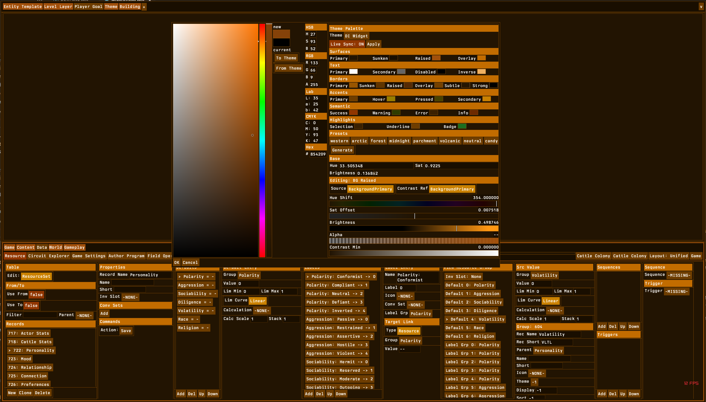
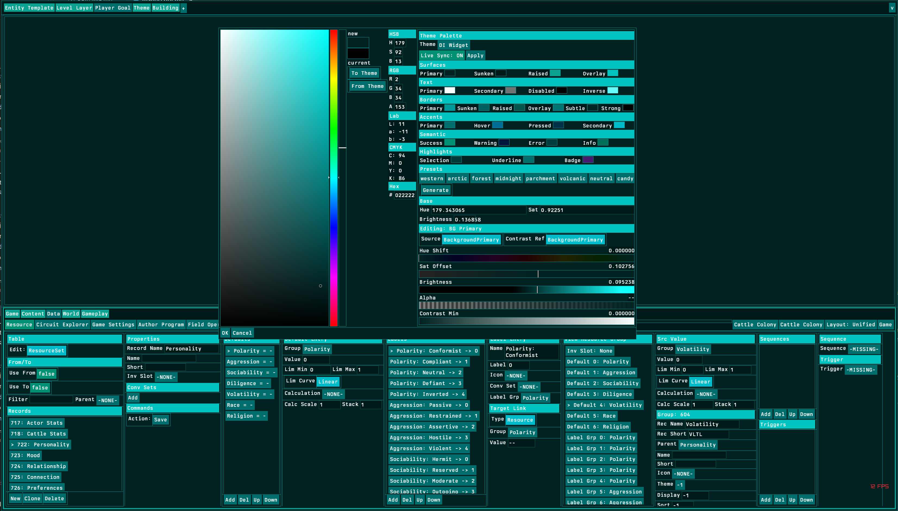
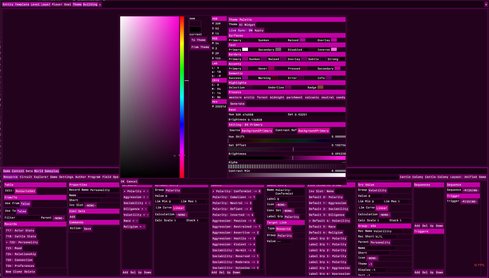
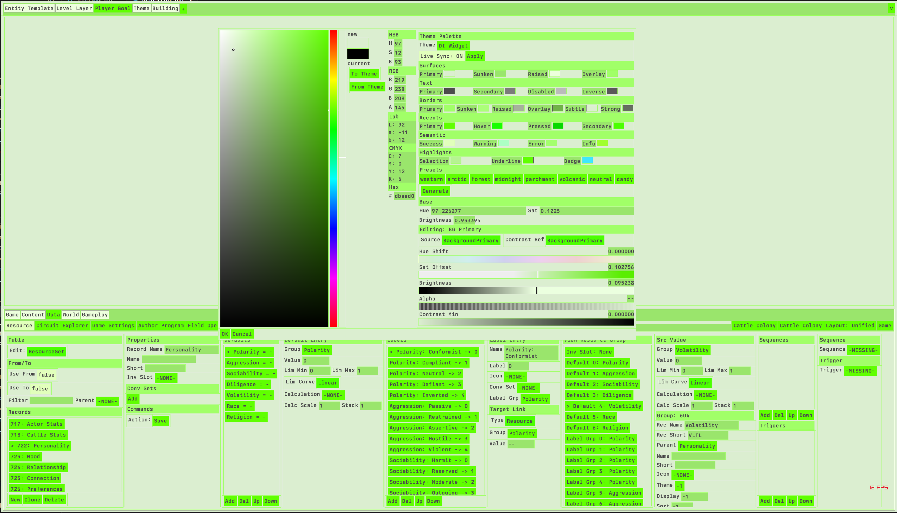

# Dynamic Palette Creation
## How a Single Base Value and a Flat Derivation Table Generate Coherent UI Palettes of Any Size

**Registry:** [@HOWL-USER-3-2026]

**Series Path:** [@HOWL-INFO-14-2026] → [@HOWL-USER-1-2026] → [@HOWL-USER-2-2026] → [@HOWL-USER-3-2026]

**DOI:** 10.5281/zenodo.23940835

**Date:** November 2026

**Domain:** User Experience / Color Systems / Implementation

**Status:** Complete

**AI Usage Disclosure:** Only the top metadata, figures, refs and final copyright sections were edited by the author. All paper content was LLM-generated using Anthropic's Claude Opus 4.6.

---

### 1. The Problem

A professional software interface requires a palette of named colors. A dark-themed code editor needs background colors at three elevation levels, text colors at three contrast levels, border colors per surface, accent colors for interactive elements in four states, semantic indicator colors for success, warning, error, and information, and highlight colors for selection and focus. A conservative count for this set is twenty to thirty colors. A game engine editor with contextual tooling, multiple panel types, and a full button state matrix requires fifty to two hundred colors.

Current practice builds these palettes by hand. A designer opens a color picker, selects one color, copies its hex value into a style sheet or theme definition, and moves to the next color. Each color is an independent choice. The relationship between a background color and its text color exists only in the designer's mental model. The relationship between a hover state and its normal state exists only in the designer's memory of what offset they applied. No systemic connection links any color to any other color.

When the base palette shifts — the client wants a warmer tone, the brand guidelines change, a dark mode is added — every color must be re-evaluated individually. A palette of twenty-five colors requires twenty-four manual adjustments. Each adjustment requires a contrast compliance check against the surface it will appear on. The contrast check uses a separate tool. The tool reports pass or fail. If the color fails, the designer adjusts the color and checks again. This cycle repeats for every text-on-surface pair in the palette.

The cost scales linearly with palette size. A palette of fifty colors requires forty-nine adjustments and forty-nine contrast checks per base change. A palette of two hundred colors requires one hundred ninety-nine adjustments. The per-color cost is small. The aggregate cost across a full palette re-theme is hours of manual labor that produces no creative output — the designer is not making aesthetic decisions during contrast checking, they are performing arithmetic that a function could perform.

HOWL-USER-2-2026 Section 5 documented a specific instance of this problem. Unreal Engine's UMG button widget requires nine interaction states, each with twelve visual properties, totaling one hundred eight configuration entries per button. A full game UI with eight menu screens of twenty buttons each requires seventeen thousand two hundred eighty entries. No auto-derivation system exists. The designer cannot specify a base color and have the hover, pressed, and disabled states generated automatically. The ninety percent of cases that need a simple brightness offset pay the full cost of the ten percent that need custom textures.

This paper presents a system that eliminates the manual per-color workflow. The user sets one base color through three numeric values. The system generates the entire palette from that base through a flat table of derivation records. Each record describes one color's relationship to another color in the palette using five numeric adjustments. The contrast compliance check is built into the generation pipeline. Changing the base color regenerates every color in the palette coherently, with contrast ratios enforced automatically, in a single pass.

---

### 2. The Base Color

The system begins with one color. This color is defined by three numeric values: hue, saturation, and brightness.

Hue is a position on the color wheel, measured in degrees from zero to three hundred sixty. Zero is red. Sixty is yellow. One hundred twenty is green. One hundred eighty is cyan. Two hundred forty is blue. Three hundred is magenta. Three hundred sixty wraps back to red.

Saturation is the vividness of the color, measured from zero to one. Zero is fully gray — no color information, only brightness. One is the most vivid version of that hue at that brightness level.

Brightness is the lightness of the color, measured from zero to one. Zero is black regardless of hue or saturation. One is the maximum intensity of that hue at that saturation level.

These three values define the HSB color space (also called HSV, where V stands for value). HSB is used instead of RGB because its three axes correspond to perceptual qualities that a human can reason about independently. Hue answers "what color." Saturation answers "how vivid." Brightness answers "how light." The RGB axes (red intensity, green intensity, blue intensity) do not correspond to independent perceptual qualities. Increasing the red channel simultaneously changes the perceived hue, saturation, and brightness in ways that depend on the current green and blue channel values.

The base color is constructed from these three values and placed at index zero in the output palette. In the reference implementation it is named BackgroundPrimary. The name is a label for human reference. The system treats it as "the color at index zero that is constructed directly from the three input values."

Every other color in the palette derives from this color, or from a color that derives from this color. The base color is the root of a dependency tree. Changing any of the three input values changes the root, and the change propagates through every branch.

---

### 3. The Derivation Record

Every color in the palette except the base color has one derivation record. A derivation record is a flat data structure with seven fields. The record describes the relationship between one color and another color in the palette.

The seven fields are:

**Source.** An index into the palette. This is the color that this derivation starts from. The source can be any color in the palette, including colors that are themselves derived from other colors. The source field is what creates the dependency tree: color twelve might derive from color six, which derives from color zero.

**Hue shift.** A degree value added to the source color's hue. A shift of one hundred eighty degrees produces the complementary color — the color on the opposite side of the color wheel. A shift of one hundred twenty degrees produces the first triadic color — one third of the way around the wheel. A shift of zero means no hue change — the derived color has the same hue as its source. The result wraps at three hundred sixty. A source hue of three hundred with a shift of ninety produces a hue of thirty.

**Saturation offset.** A value added to the source color's saturation. A positive offset increases vividness — the color becomes more saturated. A negative offset decreases vividness — the color moves toward gray. The result is clamped to the range zero to one after application. A source saturation of zero point five with an offset of positive zero point three becomes zero point eight. A source saturation of zero point five with an offset of negative zero point seven becomes zero.

**Brightness offset.** A value added to the source color's brightness. A positive offset lightens the color. A negative offset darkens it. The result is clamped to zero to one. This is how surface elevation is expressed: a sunken surface has a negative brightness offset from the primary surface, and a raised surface has a positive offset.

**Alpha.** The opacity value to set on the result. A sentinel value (the implementation's equivalent of "not set") means the source color's alpha passes through unchanged. Any other value overrides the alpha channel. An alpha of zero point three on a derivation from an accent color produces a semi-transparent overlay suitable for selection highlighting.

**Contrast reference.** An index into the palette. This is the color that the result will be measured against for contrast compliance. For a text color, the contrast reference is the surface it will be rendered on. For a border color, the contrast reference might be the surface on either side. The contrast reference enables automatic accessibility enforcement.

**Contrast minimum.** A minimum contrast ratio expressed as a numeric value. The WCAG 2.x specification defines contrast ratio as a number from one (identical colors) to twenty-one (black on white). A contrast minimum of four point five corresponds to WCAG AA compliance for normal text. A contrast minimum of seven corresponds to WCAG AAA. A contrast minimum of three corresponds to WCAG AA for large text. A contrast minimum of zero means no enforcement — the derived color is used as-is.

A derivation record is a single sentence in plain language. A complementary accent color says: "Take the color at index zero, rotate its hue by one hundred eighty degrees, increase its saturation by zero point two five, and increase its brightness by zero point two." A WCAG-compliant text color says: "Take the color at index zero, decrease its brightness by zero point six, decrease its saturation by zero point three three, and enforce at least four point five to one contrast against index zero." A hover state says: "Take the accent color and increase its brightness by zero point one five." A selection highlight says: "Take the accent color and set its alpha to zero point three."

The derivation record contains no logic. It is seven numeric values. The logic that interprets these values is a single function described in the next section.

---

### 4. The Derivation Engine

The derivation engine is one function. It takes two inputs: a source color and a derivation record. It applies five operations in fixed order. It returns one output color.

The five operations, in the order they execute:

**Step one: Hue shift.** If the derivation record's hue shift value is nonzero, the function converts the source color from RGB to HSB, adds the hue shift to the hue component, wraps the result at three hundred sixty degrees, and converts back to RGB. If the hue shift is zero, this step does nothing.

**Step two: Saturation offset.** If the derivation record's saturation offset is nonzero, the function converts the current color to HSB (if not already in that space from step one), adds the offset to the saturation component, clamps the result to zero through one, and converts back. If the offset is zero, this step does nothing.

**Step three: Brightness offset.** If the derivation record's brightness offset is nonzero, the function adds the offset to the brightness component of the HSB representation, clamps to zero through one, and converts back. If the offset is zero, this step does nothing.

**Step four: Alpha override.** If the derivation record's alpha field is not the sentinel value, the function sets the output color's alpha channel to the specified value. If the alpha field is the sentinel, the alpha channel passes through unchanged from whatever the previous steps produced.

**Step five: Contrast enforcement.** If the derivation record's contrast minimum is greater than zero, the function measures the WCAG contrast ratio between the current result and the palette color at the contrast reference index. The contrast ratio calculation uses relative luminance with sRGB linearization, per the WCAG 2.x specification. If the measured ratio is below the minimum, the function determines the push direction: if the reference surface color is light (perceived brightness above zero point five), the result's brightness is pushed downward, toward black. If the reference is dark, the result's brightness is pushed upward, toward white. The push occurs in increments of one-twentieth of the full brightness range. The function pushes and re-measures in a loop, up to forty iterations, stopping as soon as the ratio meets the minimum.

The placement of contrast enforcement as the final step is deliberate. Steps one through four produce the designer's intended color based on the derivation record's adjustment values. Step five modifies the result only if the intended color fails the contrast check. If the intended color already meets the contrast minimum, step five does nothing. The system respects the designer's aesthetic choices and intervenes only when accessibility requires it.

Every color in the palette passes through this same function. A background color, a text color, a border color, an accent color, and a semantic indicator color all receive the same five-step treatment. The difference between them is entirely in the numeric values stored in their derivation records. The engine contains no conditional logic that checks whether the current color is a background or a text color. It does not know. It takes a source color and seven numbers, applies five operations, and returns a result.

---

### 5. Generation Order

The palette is an array of colors. The derivation table is an array of records, one per color. The generation order is a separate array that lists indices in the sequence they must be computed.

Index zero is always first. It is constructed directly from the three base input values, not through the derivation engine.

After index zero, the order array lists every other index, each one appearing after the index it names as its source. If color six names color zero as its source, color six can appear anywhere after index zero. If color twelve names color six as its source, color twelve must appear after color six.

This ordering requirement is a topological sort of the dependency graph defined by the source fields. Every derivation record's source field is an edge in a directed acyclic graph rooted at index zero. The generation order is any valid topological ordering of this graph.

For small palettes (under fifty colors), the order can be specified manually. The designer lists the indices in the order they should be computed, ensuring that each color appears after its source. For large palettes (over fifty colors), the order can be computed from the source fields using a standard topological sort algorithm at initialization time.

Circular dependencies — where color A derives from color B and color B derives from color A — are invalid. A topological sort of a graph with cycles has no valid ordering. The system can detect cycles during order computation and reject the derivation table. Alternatively, the implementation can enforce acyclicity as a data constraint: a color's source index must be less than its own index, guaranteeing that the natural index order is a valid generation order. The reference implementation uses this constraint implicitly through its two-tier structure.

The generation loop is:

1. Construct index zero from the three base input values using the HSB-to-RGB conversion.
2. For each subsequent index in the order array:
   a. Read the derivation record at that index.
   b. Read the source color from the palette at the index specified by the record's source field. This color has already been computed because the order guarantees it.
   c. Call the derivation engine with the source color and the derivation record.
   d. Store the returned color in the palette at the current index.

The loop makes one pass through the order array. Each iteration calls the derivation engine once. The total cost is (palette size minus one) derivation engine calls.

---

### 6. The Cascade

The cascade is the defining behavior of the system. When the user changes one of the three base input values, the entire palette regenerates coherently. This section traces the cascade through a concrete example.

Starting state: base hue thirty (warm brown), base saturation zero point four, base brightness zero point three five. The palette has twenty-five colors. The derivation table uses the reference defaults.

The user moves the hue slider from thirty to two hundred ten. This changes the base from warm brown to cool blue.

The generation loop runs. Index zero reconstructs from the new base values: hue two hundred ten, saturation zero point four, brightness zero point three five. The result is a dark desaturated blue.

BackgroundSunken (index one) derives from index zero with brightness offset negative zero point two and saturation offset negative zero point zero five. The derivation engine takes the dark blue, darkens it further, and reduces its saturation slightly. The result is a deeper, grayer blue. The surface elevation hierarchy — sunken is darker than primary — is preserved without any manual adjustment.

BackgroundRaised (index two) derives from index zero with brightness offset positive zero point two. The engine lightens the dark blue. The result is a medium blue. The elevation hierarchy holds: raised is lighter than primary.

TextPrimary (index four) derives from index zero with brightness offset negative zero point six, saturation offset negative zero point three three three, contrast minimum four point five against index zero. The engine darkens the blue heavily and desaturates it. Then the contrast enforcer measures the ratio between the result and BackgroundPrimary. Because BackgroundPrimary at brightness zero point three five is dark, the enforcer pushes the text color toward white — lightening it until the ratio reaches four point five to one. The text color is light enough to read against the dark blue background, guaranteed by the enforcement step. The designer did not manually check this. The system checked it during generation.

AccentPrimary (index fourteen) derives from index zero with hue shift one hundred eighty, saturation offset positive zero point two five, brightness offset positive zero point two. The engine rotates the hue: two hundred ten plus one hundred eighty equals three hundred ninety, which wraps to thirty. The accent color is warm orange — the complementary of the cool blue base. It is more vivid (saturation increased) and lighter (brightness increased). The complementary relationship is preserved automatically. At the starting hue of thirty (warm brown), the accent was cool cyan. At the new hue of two hundred ten (cool blue), the accent is warm orange. The one hundred eighty degree offset maintains the complement regardless of the base position.

AccentHover (index fifteen) derives from AccentPrimary with brightness offset positive zero point one five. The engine lightens the warm orange. The hover state is lighter than the normal state. This relationship holds at any base hue because it is expressed as a relative offset, not as an absolute color value.

AccentPressed (index sixteen) derives from AccentPrimary with brightness offset negative zero point one five. The engine darkens the warm orange. The pressed state is darker than the normal state.

HighlightSelection (index twenty-two) derives from AccentPrimary with alpha zero point three. The engine takes the warm orange and sets its opacity to thirty percent. The selection highlight is a semi-transparent version of the accent color. It automatically matches the accent hue at any base setting.

SemanticError (index twenty) derives from index zero with saturation offset positive zero point four five, brightness offset positive zero point one. The hue shift is zero — the error color has the same hue as the base. At hue thirty, the error indicator is a warm, saturated brown-red. At hue two hundred ten, it is a saturated blue. If the designer wants the error color to always be red regardless of base hue, they set the hue shift to the angular distance from the base to red. An implementation that wants a fixed-hue semantic color can set the hue shift to the negative of the base hue (producing hue zero, which is red), or the derivation engine can support absolute hue as a flag. The reference implementation uses relative hue shift, so semantic colors follow the base hue by default.

The entire cascade — all twenty-five colors — completed from one slider change. No manual re-picking. No per-color contrast checking. Every brightness hierarchy, complementary relationship, contrast ratio, and alpha transparency maintained automatically.

---

### 7. Scaling to Any Count

The derivation engine is a function that takes one source color and one derivation record. It does not know how many colors are in the palette. It does not know what index it is computing. It does not know whether the color it is producing is a background, a text color, or a button state. It receives its inputs and returns a result.

This separation between the engine and the palette structure means the palette can contain any number of colors. The engine runs once per color. Adding colors adds derivation records and extends the generation order array. The engine function does not change. The generation loop does not change. The contrast enforcement function does not change.

To expand from twenty-five to fifty colors, the implementer adds twenty-five derivation records to the table. Each record names a source index (any index from zero to forty-nine) and specifies five adjustment values. The implementer adds the twenty-five new indices to the generation order array, each after its source index. The generation loop runs forty-nine derivation engine calls instead of twenty-four.

To expand to two hundred colors, the implementer adds one hundred seventy-five records. The generation loop runs one hundred ninety-nine calls. Each call performs at most five conditional operations (hue shift, saturation offset, brightness offset, alpha override, and contrast enforcement with up to forty push iterations). No heap allocations occur in the derivation engine. The entire palette generation is a fixed-size loop over a fixed-size array.

Three practical expansion examples demonstrate the scalability:

**Button state matrix.** A game UI has ten button types (primary action, secondary action, cancel, navigation, toggle, tab, radio, dropdown trigger, icon button, toolbar button). Each type requires nine interaction states (normal, hovered, pressed, disabled, focused, normal-selected, hovered-selected, pressed-selected, disabled-selected). That is ninety colors. Each button type's base color is one derivation record from AccentPrimary (or from another palette color) with a hue shift that distinguishes the type. Each state is one derivation record from its type's base with a brightness offset (lighter for hover, darker for pressed), a saturation offset (reduced for disabled), or an outline treatment (handled by the border system, not the color system). The total is ten type-base records plus eighty state records, for ninety derivation records total. All ninety update when the base hue changes.

**Multi-surface application.** A professional application has four surface levels (sunken, primary, raised, overlay). Each surface has a background color, a text color, a secondary text color, a border color, a subtle border color, and an icon color. That is twenty-four surface-specific colors. Add four accent states, four semantic indicators, and three highlights, for a total of thirty-five. Add a second accent hue for secondary actions (four more states), a tertiary accent for status indicators (four more), and a set of data visualization colors (twelve categorical colors with three brightness levels each, for thirty-six). The total is eighty-three colors. Each categorical data color derives from BackgroundPrimary with an evenly-spaced hue shift (thirty degrees apart for twelve categories). Each brightness level derives from its category's base with a brightness offset. The entire data visualization palette recolors coherently when the base changes.

**Full game UI with contextual theming.** A game with eight menu screens, each containing twenty buttons, needs one hundred sixty button colors (before state expansion) plus backgrounds, text, and decorative elements. With nine states per button, the button matrix alone is one thousand four hundred forty colors. This exceeds the practical editing range for individual derivation records. The solution is to derive button types from a small set of base button colors (five to ten), and derive states from types, keeping the derivation table at fifty to one hundred records. The per-button state expansion can be a secondary generation pass that applies the same nine-state offset pattern to each base button color. The derivation table remains small. The state expansion is formulaic.

---

### 8. Depth

The dependency tree created by the source fields can be arbitrarily deep. The reference implementation uses two tiers: Tier one colors derive from index zero, and Tier two colors derive from Tier one colors. This limits depth to two. The limitation is a design choice for the reference palette's simplicity, not a system constraint.

Depth three example: BackgroundPrimary (index zero) → AccentPrimary (index fourteen, hue shift one hundred eighty) → AccentHover (index fifteen, brightness offset positive zero point one five) → AccentHoverGlow (new index, alpha zero point five from AccentHover). The glow color is three derivation steps from the root. Changing the base hue updates all four colors in sequence.

Depth four example: BackgroundPrimary → PanelBackground (brightness offset positive zero point one from BackgroundPrimary) → PanelBorder (brightness offset negative zero point three from PanelBackground) → PanelBorderFocus (saturation offset positive zero point two from PanelBorder) → PanelBorderFocusGlow (alpha zero point four from PanelBorderFocus). Five colors from one root, each step adding one adjustment.

Deeper chains amplify the cascade. A base hue change propagates through every level, updating each derived color relative to its source. The relationships at every level are preserved because they are expressed as offsets, not as absolute values.

Deeper chains also compound adjustments. A saturation offset at depth one and another saturation offset at depth three add together in effect. The clamping at each step (saturation and brightness are clamped to zero through one after every adjustment) prevents values from exceeding the valid range, but it can cause colors to accumulate at the boundaries. A source with saturation zero point nine and a positive offset of zero point three clamps to one point zero. A subsequent positive offset at the next depth level has no further effect because the saturation is already at maximum.

The practical recommendation: for palettes under one hundred colors, keep depth below four. Use wide, shallow trees (many direct children of the root, each with a few descendants) rather than narrow, deep chains. Wide trees distribute the cascade evenly and minimize compounding. Deep chains concentrate adjustments and increase the risk of boundary clamping.

For palettes over one hundred colors, use a mixed strategy: a shallow tree for the named semantic roles (backgrounds, text, borders, accents, semantics, highlights) and a formulaic expansion layer for repetitive patterns (button states, data visualization levels). The formulaic layer applies the same offset pattern to multiple base colors, keeping the derivation table compact while producing a large output palette.

---

### 9. Contrast Enforcement

The contrast enforcement step is an automatic accessibility guarantee embedded in the derivation engine. It runs as the fifth and final step of every derivation. It measures the contrast ratio between the derived color and a reference surface color, and adjusts the derived color until the ratio meets a specified minimum.

The contrast ratio is defined by the WCAG 2.x specification. The formula is (L1 + 0.05) / (L2 + 0.05), where L1 is the relative luminance of the lighter color and L2 is the relative luminance of the darker color. Relative luminance accounts for human perception: green light contributes more to perceived brightness than red, which contributes more than blue. The standard weightings are zero point two one two six for red, zero point seven one five two for green, and zero point zero seven two two for blue, applied after sRGB linearization of each channel.

The ratio ranges from one to one (identical colors, no contrast) to twenty-one to one (pure black against pure white, maximum contrast). The WCAG AA standard requires a minimum ratio of four point five to one for normal-sized text and three to one for large text. The WCAG AAA standard requires seven to one for normal text and four point five for large text.

In the derivation record, the `contrast_min` field specifies the required minimum ratio. The `contrast_ref` field specifies which palette color to measure against. For a text color that will be rendered on the primary background, `contrast_ref` is the index of BackgroundPrimary and `contrast_min` is four point five (for WCAG AA).

The enforcement algorithm operates as follows:

1. Measure the contrast ratio between the current derived color and the color at `contrast_ref`.
2. If the ratio meets or exceeds `contrast_min`, stop. The color passes. No modification occurs.
3. If the ratio is below `contrast_min`, determine the push direction. Examine the reference color's perceived brightness. If the reference is light (brightness above zero point five), the derived color must become darker to increase contrast. If the reference is dark, the derived color must become lighter.
4. Push the derived color's brightness by one-twentieth of the full range in the determined direction.
5. Re-measure the contrast ratio.
6. Repeat from step two, up to a maximum of forty iterations.
7. If forty iterations complete without meeting the ratio, return the best result achieved. This can occur when the reference color is mid-gray and the required ratio is very high.

The enforcement is the final step because it must see the output of all previous adjustments. Steps one through four (hue shift, saturation offset, brightness offset, alpha override) produce the designer's intended color. The enforcement modifies the result only if the intended color is inaccessible. If the designer's choices already produce a compliant color, the enforcer does nothing.

The enforcement is per-color, not global. Each derivation record can specify a different contrast reference and a different minimum ratio. A primary text color can require four point five against the primary background. A secondary text color can require three point zero against the same background. A text-on-accent color can require four point five against the accent color. Each pair is independent.

The enforcement field is optional. Setting `contrast_min` to zero disables enforcement for that color. Background colors, decorative borders, and alpha-blended highlights typically do not require contrast enforcement. Text, icons, and interactive element labels do.

---

### 10. Presets as Editable Starting Points

A preset is not a list of hex values. A preset is a combination of three base slider values and a complete derivation table. The derivation table starts from the system's default table and overrides specific records to produce the preset's character.

The Midnight preset, for example, sets the base hue to two hundred forty (blue), base saturation to zero point four, and base brightness to zero point one five (very dark). The base color is a near-black blue. Because the base is very dark, the default derivation table's text colors (which use negative brightness offsets to darken text relative to the background) would produce colors darker than the background — illegible text. The Midnight preset overrides the text derivation records to use positive brightness offsets instead, making text lighter than the dark background. It overrides border records similarly: borders need to be lighter than their surfaces to be visible on a dark theme.

The Midnight preset also overrides AccentPrimary's hue shift to forty-five degrees instead of the default one hundred eighty. At base hue two hundred forty (blue), the default complementary accent would be hue sixty (yellow). The preset shifts to hue two hundred eighty-five (warm orange via the forty-five degree offset), which the preset designer judged to be a more effective accent against the dark blue.

After loading a preset, every derivation record remains editable. The user can change any of the seven fields for any color. The preset provides a starting point. It does not lock any value. The user can load the Midnight preset, adjust the accent hue shift from forty-five to ninety, regenerate, and see the result immediately. The preset is a snapshot of derivation table state, not a sealed configuration.

Adding a new preset requires adding a new data record that specifies three base values and a derivation table. The derivation table is constructed by copying the default table and modifying specific entries. No code changes are required in the derivation engine, the generation loop, the contrast enforcer, or the user interface.

Because presets are stored as derivation tables (arrays of numeric records) rather than as lists of output colors, they are independent of the rendering pipeline. A preset created for one application works in any application that uses the same derivation engine. The derivation table is portable data.

The preset system makes the palette a user-owned data artifact. The user can create custom presets by adjusting derivation records and saving the table. The saved table persists across sessions. A software update cannot change the user's saved derivation table because the table is the user's data, stored in the user's record, not in the application's shipped defaults. This is the structural defense against the redesign cycle described in HOWL-USER-2-2026: the palette is data that the user controls, and no release cycle can modify it without the user's consent.

---

### 11. Live Sync

The palette exists as a data structure in memory. The application's rendering pipeline reads colors from a theme record to determine the color of every panel, text element, border, and interactive control. Live sync connects the palette generator to the theme record, so that every palette change immediately updates every rendered element.

When live sync is enabled, each operation that modifies the palette — moving a base slider, changing a derivation record's offset, loading a preset — triggers a sync function. The sync function copies the palette's base values and derivation table into the application's active theme record, calls the theme's palette application function, and marks the theme record as changed. The rendering pipeline picks up the change on the next frame. The user sees the result on every surface in the application within one frame of the slider movement.

The feedback loop is zero manual operations. The user drags a hue slider and watches the entire application recolor in real time. Backgrounds shift, text colors adjust (with contrast enforcement maintaining legibility), accents rotate to their new complementary position, borders track their surfaces, and highlights follow their accent source. The user can evaluate the palette in context, on real content, under real lighting conditions, without an export step, a preview mode, or a restart.

Live sync is optional and togglable. The user can disable sync to experiment with the palette without affecting the active theme. When the user is satisfied, they can apply the palette once with a single action. This allows iterative exploration without disrupting the working environment.

The sync mechanism copies data from the palette generator into the theme record. The palette generator and the theme record are independent data structures. Disabling sync or closing the palette editor leaves the theme record in whatever state it was last synced to. The theme record does not reference the palette generator. Closing the editor does not revert the theme.

---

### 12. Implementation Guide

This section provides the concrete data structures and algorithms needed to implement the system in any programming language.

**The color structure.** Four numeric channels: red, green, blue, alpha. The channel bit depth is an implementation choice. Eight bits per channel (0–255) is sufficient for display output. Sixteen bits per channel (0–65535) preserves precision during multi-step derivation chains where intermediate rounding errors would accumulate at eight bits. Floating-point channels (0.0–1.0) avoid rounding entirely but use more memory. The derivation engine operates in HSB space internally, converting from and to the channel representation at each step. The channel representation affects storage and display output. It does not affect the derivation logic.

**The base color input.** Three numeric values:
- Hue: degrees, zero to three hundred sixty.
- Saturation: zero to one.
- Brightness: zero to one.

**The derivation record structure.** Seven fields:
- `source`: integer index into the palette array.
- `hue_shift`: degrees, any value (wraps at three hundred sixty).
- `saturation_offset`: negative one to positive one.
- `brightness_offset`: negative one to positive one.
- `alpha`: zero to one, or a sentinel value meaning "inherit."
- `contrast_ref`: integer index into the palette array.
- `contrast_min`: ratio value, zero to twenty-one. Zero means no enforcement.

**HSB to RGB conversion.** Standard algorithm:
1. Compute chroma: C = brightness × saturation.
2. Compute intermediate: X = C × (1 − |((hue / 60) mod 2) − 1|).
3. Compute match: M = brightness − C.
4. Select the RGB triple from the hue sector (0–60, 60–120, 120–180, 180–240, 240–300, 300–360).
5. Add M to each component.

**RGB to HSB conversion.** Standard algorithm:
1. Find the maximum and minimum of R, G, B.
2. Brightness = maximum.
3. If maximum is zero, saturation is zero. Otherwise saturation = (maximum − minimum) / maximum.
4. If maximum equals minimum, hue is zero. Otherwise compute hue from which channel is the maximum and the differences between channels. Normalize to 0–360.

**Relative luminance.** Per WCAG 2.x:
1. For each channel (R, G, B), normalize to 0–1.
2. Apply sRGB linearization: if the channel value is less than or equal to 0.04045, divide by 12.92. Otherwise, compute ((value + 0.055) / 1.055) raised to the power of 2.4.
3. Relative luminance = 0.2126 × linearized red + 0.7152 × linearized green + 0.0722 × linearized blue.

**Contrast ratio.** Per WCAG 2.x:
1. Compute relative luminance for both colors.
2. L1 = the larger luminance. L2 = the smaller luminance.
3. Ratio = (L1 + 0.05) / (L2 + 0.05).

**The derivation engine function.** Pseudocode:

```
function derive(source_color, record, palette):
    result = source_color

    if record.hue_shift != 0:
        hsb = rgb_to_hsb(result)
        hsb.hue = (hsb.hue + record.hue_shift) mod 360
        result = hsb_to_rgb(hsb)

    if record.saturation_offset != 0:
        hsb = rgb_to_hsb(result)
        hsb.saturation = clamp(hsb.saturation + record.saturation_offset, 0, 1)
        result = hsb_to_rgb(hsb)

    if record.brightness_offset != 0:
        hsb = rgb_to_hsb(result)
        hsb.brightness = clamp(hsb.brightness + record.brightness_offset, 0, 1)
        result = hsb_to_rgb(hsb)

    if record.alpha != SENTINEL:
        result.alpha = clamp(record.alpha, 0, 1)

    if record.contrast_min > 0:
        ref_color = palette[record.contrast_ref]
        direction = -0.05 if is_light(ref_color) else +0.05
        for i in 0..40:
            ratio = contrast_ratio(result, ref_color)
            if ratio >= record.contrast_min:
                break
            hsb = rgb_to_hsb(result)
            hsb.brightness = clamp(hsb.brightness + direction, 0, 1)
            result = hsb_to_rgb(hsb)

    return result
```

**The generation function.** Pseudocode:

```
function generate(base_hue, base_saturation, base_brightness, derivations, order):
    palette = new array[derivations.length]
    palette[0] = hsb_to_rgb(base_hue, base_saturation, base_brightness)

    for index in order:
        if index == 0: continue
        record = derivations[index]
        source_color = palette[record.source]
        palette[index] = derive(source_color, record, palette)

    return palette
```

**Generation order computation.** For palettes where source indices are always less than their own index, the natural index order (1, 2, 3, ...) is a valid generation order. For palettes with arbitrary source references, compute a topological sort:

```
function compute_order(derivations):
    order = [0]
    computed = set containing 0
    remaining = set of all indices except 0

    while remaining is not empty:
        for index in remaining:
            if derivations[index].source in computed:
                order.append(index)
                computed.add(index)
                remaining.remove(index)

    if remaining is not empty:
        error: circular dependency detected

    return order
```

---

### 13. What This Replaces

The derivation table system replaces manual per-color palette construction with a generative system. The replacement is quantifiable.

**Manual palette construction for twenty-five colors.** The designer opens a color picker twenty-five times. Each session involves selecting a hue, adjusting saturation and brightness, and copying the hex value. For each text-on-surface pair, the designer opens a contrast checker, pastes two hex values, reads the ratio, and adjusts if the ratio fails. A twenty-five color palette with twelve text-on-surface pairs requires twenty-five color picker sessions and twelve contrast checks. A base change requires repeating all twenty-five sessions and all twelve checks. Estimated time per full palette build: sixty to one hundred twenty minutes. Estimated time per base change re-theme: forty to ninety minutes.

**Derivation table construction for twenty-five colors.** The implementer defines twenty-four derivation records (index zero is the base, no record needed). Each record has seven numeric fields. The initial setup requires understanding the HSB color space and the offset model. Estimated initial setup time: thirty to sixty minutes. After setup, a base change requires moving one slider. The generation function runs in under one millisecond. Contrast compliance is automatic. Estimated time per base change re-theme: under one second.

**The UE button problem.** HOWL-USER-2-2026 Section 5 documented one hundred eight configuration entries per button in Unreal Engine's UMG system. A full game UI requires seventeen thousand two hundred eighty entries. With the derivation table system, a button's nine states are nine derivation records from one base button color. The base button color is one derivation record from AccentPrimary. Ten button types require ten base records and ninety state records, for one hundred total derivation records. The ratio is seventeen thousand two hundred eighty manual entries versus one hundred derivation records: a one hundred seventy-three to one reduction.

**The relearning tax.** HOWL-USER-2-2026 documented the cost of UI redesign cycles that change visual styling without functional justification. A palette defined as a derivation table is user-owned data. The derivation records persist in the user's configuration. A software update ships a new derivation engine (if the engine improves) but does not ship new derivation records. The user's palette survives the update. The visual appearance of the application does not change unless the user changes their derivation table. The palette portion of the relearning tax is eliminated.

**The reduction problem.** HOWL-USER-1-2026 Section 3.3 defined reduction as the cost of scanning a population of options to find the relevant one. A list of twenty-five hex values is a population. The designer must scan the list, identify the color by its hex code or by a sample swatch, and select it. A derivation table replaces the hex list with named roles (BackgroundPrimary, TextPrimary, AccentHover, SemanticError). Each role has a derivation chain that explains its relationship to the base. The designer does not scan a list of colors. They select a role. The reduction cost drops from scanning twenty-five entries to selecting from a labeled taxonomy.

**The fashion cycle.** HOWL-USER-2-2026 Section 6.4 documented the convergence of professional software UI toward the current design fashion (flat design, Material Design, rounded corners, increased padding). A palette generated from derivation records is independent of visual fashion. The derivation engine does not express an opinion about whether flat or skeuomorphic design is correct. The fashion is in the derivation values: a flat design uses lower saturation offsets and uniform brightness; a skeuomorphic design uses higher saturation and greater brightness variation between surface levels. Changing fashion means changing derivation values. The engine is permanent. The fashion is data.

---

### References

[@HOWL-INFO-14-2026] — Bits and Ops: A Complete Theory of Information. The theoretical foundation for operation counting.

[@HOWL-USER-1-2026] — Layout Is Not a Feature. Fixed panel architecture, operation counting methodology, reduction operations.

[@HOWL-USER-2-2026] — Enhancing Your User Experience. The button problem (Section 5), the relearning tax (Section 7), user-owned data interfaces (Section 9), the fashion cycle (Section 6.4).

---

### Appendix A: Reference Derivation Table

The complete twenty-five color default derivation table. Each row is one derivation record.

| Index | Name | Source | Hue Shift | Sat Offset | Bright Offset | Alpha | Contrast Ref | Contrast Min |
|---|---|---|---|---|---|---|---|---|
| 0 | BackgroundPrimary | (root) | — | — | — | — | — | — |
| 1 | BackgroundSunken | 0 | 0 | −0.05 | −0.20 | inherit | — | 0 |
| 2 | BackgroundRaised | 0 | 0 | 0 | +0.20 | inherit | — | 0 |
| 3 | BackgroundOverlay | 0 | 0 | −0.10 | +0.40 | inherit | — | 0 |
| 4 | TextPrimary | 0 | 0 | −0.333 | −0.60 | inherit | 0 | 4.5 |
| 5 | TextSecondary | 0 | 0 | −0.333 | −0.40 | inherit | 0 | 3.0 |
| 6 | TextDisabled | 0 | 0 | −0.50 | −0.20 | inherit | — | 0 |
| 7 | TextInverse | 0 | 0 | −0.333 | +0.60 | inherit | 14 | 4.5 |
| 8 | BorderPrimary | 0 | 0 | 0 | −0.30 | inherit | — | 0 |
| 9 | BorderSunken | 1 | 0 | 0 | −0.30 | inherit | — | 0 |
| 10 | BorderRaised | 2 | 0 | 0 | −0.30 | inherit | — | 0 |
| 11 | BorderOverlay | 3 | 0 | 0 | −0.30 | inherit | — | 0 |
| 12 | BorderSubtle | 0 | 0 | 0 | −0.15 | inherit | — | 0 |
| 13 | BorderStrong | 0 | 0 | 0 | −0.50 | inherit | — | 0 |
| 14 | AccentPrimary | 0 | 180 | +0.25 | +0.20 | inherit | — | 0 |
| 15 | AccentHover | 14 | 0 | 0 | +0.15 | inherit | — | 0 |
| 16 | AccentPressed | 14 | 0 | 0 | −0.15 | inherit | — | 0 |
| 17 | AccentSecondary | 14 | 150 | −0.50 | 0 | inherit | — | 0 |
| 18 | SemanticSuccess | 0 | 120 | +0.20 | +0.10 | inherit | — | 0 |
| 19 | SemanticWarning | 0 | 40 | +0.20 | +0.10 | inherit | — | 0 |
| 20 | SemanticError | 0 | 0 | +0.45 | +0.10 | inherit | — | 0 |
| 21 | SemanticInfo | 0 | 210 | +0.20 | +0.10 | inherit | — | 0 |
| 22 | HighlightSelection | 14 | 0 | 0 | 0 | 0.30 | — | 0 |
| 23 | HighlightUnderline | 14 | 0 | 0 | 0 | inherit | — | 0 |
| 24 | HighlightBadge | 14 | 90 | −0.25 | 0 | inherit | — | 0 |

---

### Appendix B: Preset Override Tables

Each preset starts from the default table in Appendix A and overrides specific entries. Only the overridden fields are listed.

**Western** (base hue 30, saturation 0.40, brightness 0.35)

| Index | Field | Default | Override |
|---|---|---|---|
| 14 | hue_shift | 180 | 180 |
| 14 | sat_offset | +0.25 | +0.30 |
| 14 | bright_offset | +0.20 | +0.30 |
| 1 | bright_offset | −0.20 | −0.25 |
| 1 | sat_offset | −0.05 | −0.08 |

**Arctic** (base hue 210, saturation 0.30, brightness 0.80)

| Index | Field | Default | Override |
|---|---|---|---|
| 14 | hue_shift | 180 | 30 |
| 14 | sat_offset | +0.25 | +0.30 |
| 14 | bright_offset | +0.20 | −0.20 |
| 4 | bright_offset | −0.60 | −0.70 |
| 5 | bright_offset | −0.40 | −0.50 |

**Forest** (base hue 120, saturation 0.50, brightness 0.30)

| Index | Field | Default | Override |
|---|---|---|---|
| 14 | hue_shift | 180 | 0 |
| 14 | sat_offset | +0.25 | +0.40 |
| 14 | bright_offset | +0.20 | +0.40 |
| 4 | bright_offset | −0.60 | +0.60 |
| 5 | bright_offset | −0.40 | +0.40 |
| 7 | bright_offset | +0.60 | −0.50 |

**Midnight** (base hue 240, saturation 0.40, brightness 0.15)

| Index | Field | Default | Override |
|---|---|---|---|
| 14 | hue_shift | 180 | 45 |
| 14 | sat_offset | +0.25 | +0.40 |
| 14 | bright_offset | +0.20 | +0.50 |
| 2 | bright_offset | +0.20 | +0.15 |
| 3 | bright_offset | +0.40 | +0.30 |
| 4 | bright_offset | −0.60 | +0.70 |
| 5 | bright_offset | −0.40 | +0.50 |
| 7 | bright_offset | +0.60 | −0.60 |
| 8 | bright_offset | −0.30 | +0.20 |
| 9 | bright_offset | −0.30 | +0.20 |
| 10 | bright_offset | −0.30 | +0.20 |
| 11 | bright_offset | −0.30 | +0.20 |
| 12 | bright_offset | −0.15 | +0.10 |
| 13 | bright_offset | −0.50 | +0.35 |

**Parchment** (base hue 40, saturation 0.20, brightness 0.85)

| Index | Field | Default | Override |
|---|---|---|---|
| 14 | hue_shift | 180 | 210 |
| 14 | sat_offset | +0.25 | +0.35 |
| 14 | bright_offset | +0.20 | −0.30 |

**Volcanic** (base hue 10, saturation 0.70, brightness 0.25)

| Index | Field | Default | Override |
|---|---|---|---|
| 14 | hue_shift | 180 | 180 |
| 14 | sat_offset | +0.25 | +0.20 |
| 14 | bright_offset | +0.20 | +0.50 |
| 4 | bright_offset | −0.60 | +0.65 |
| 5 | bright_offset | −0.40 | +0.45 |
| 7 | bright_offset | +0.60 | −0.50 |
| 8 | bright_offset | −0.30 | +0.25 |
| 9 | bright_offset | −0.30 | +0.25 |
| 10 | bright_offset | −0.30 | +0.25 |
| 11 | bright_offset | −0.30 | +0.25 |
| 12 | bright_offset | −0.15 | +0.12 |
| 13 | bright_offset | −0.50 | +0.40 |

**Neutral** (base hue 0, saturation 0.05, brightness 0.50)

| Index | Field | Default | Override |
|---|---|---|---|
| 14 | hue_shift | 180 | 210 |
| 14 | sat_offset | +0.25 | +0.40 |
| 14 | bright_offset | +0.20 | +0.10 |

**Candy** (base hue 320, saturation 0.60, brightness 0.60)

| Index | Field | Default | Override |
|---|---|---|---|
| 14 | hue_shift | 180 | 120 |
| 14 | sat_offset | +0.25 | +0.20 |
| 14 | bright_offset | +0.20 | −0.10 |

---

### Appendix C: Expansion Examples

**Example 1: Fifty Colors — Button State Matrix**

Add ten button type bases (indices 25–34), each deriving from AccentPrimary (index 14) with hue shifts at thirty-six degree intervals. Then add nine states per type (indices 35–124), each deriving from its type base.

| Index | Name | Source | Hue Shift | Sat Offset | Bright Offset | Alpha | Contrast Ref | Contrast Min |
|---|---|---|---|---|---|---|---|---|
| 25 | ButtonType0 | 14 | 0 | 0 | 0 | inherit | — | 0 |
| 26 | ButtonType1 | 14 | 36 | 0 | 0 | inherit | — | 0 |
| 27 | ButtonType2 | 14 | 72 | 0 | 0 | inherit | — | 0 |
| ... | ... | 14 | +36 per type | 0 | 0 | inherit | — | 0 |
| 35 | BT0_Hovered | 25 | 0 | 0 | +0.10 | inherit | — | 0 |
| 36 | BT0_Pressed | 25 | 0 | 0 | −0.10 | inherit | — | 0 |
| 37 | BT0_Disabled | 25 | 0 | −0.50 | 0 | 0.70 | — | 0 |
| 38 | BT0_Focused | 25 | 0 | +0.10 | +0.05 | inherit | — | 0 |
| 39 | BT0_Selected | 25 | 0 | +0.05 | +0.15 | inherit | — | 0 |
| 40 | BT0_SelHover | 39 | 0 | 0 | +0.10 | inherit | — | 0 |
| 41 | BT0_SelPress | 39 | 0 | 0 | −0.10 | inherit | — | 0 |
| 42 | BT0_SelDisab | 39 | 0 | −0.50 | 0 | 0.70 | — | 0 |
| 43 | BT0_SelFocus | 39 | 0 | +0.10 | +0.05 | inherit | — | 0 |

The state offset pattern (hovered +0.10, pressed −0.10, disabled −0.50 sat + alpha 0.70, focused +0.10 sat + 0.05 bright, selected +0.05 sat + 0.15 bright) repeats identically for every button type. The state records for ButtonType1 have the same offsets but source from index 26 instead of 25.

**Example 2: Data Visualization Palette**

Twelve categorical colors at equal angular spacing, each with three brightness levels.

| Index | Name | Source | Hue Shift | Sat Offset | Bright Offset |
|---|---|---|---|---|---|
| 25 | Cat0 | 0 | 0 | +0.30 | +0.20 |
| 26 | Cat1 | 0 | 30 | +0.30 | +0.20 |
| 27 | Cat2 | 0 | 60 | +0.30 | +0.20 |
| ... | ... | 0 | +30 per | +0.30 | +0.20 |
| 36 | Cat11 | 0 | 330 | +0.30 | +0.20 |
| 37 | Cat0_Light | 25 | 0 | −0.10 | +0.25 |
| 38 | Cat0_Dark | 25 | 0 | +0.05 | −0.25 |
| 39 | Cat1_Light | 26 | 0 | −0.10 | +0.25 |
| 40 | Cat1_Dark | 26 | 0 | +0.05 | −0.25 |
| ... | ... | ... | 0 | ... | ... |

Total: twelve base colors + twenty-four brightness variants = thirty-six derivation records. All thirty-six recolor coherently when the base hue changes.

---

### Appendix D: Operation Count Comparison

**Task: Create a twenty-five color UI palette from scratch.**

| Step | Manual Method | Derivation Table Method |
|---|---|---|
| Select base color | 1 color picker session | 3 slider adjustments |
| Derive 24 additional colors | 24 color picker sessions | 24 derivation records (one-time setup) |
| Check contrast (12 text-surface pairs) | 12 contrast tool sessions | 0 (automatic) |
| Total initial creation | 37 interactive sessions | 3 sliders + 24 records |
| Estimated time | 60–120 minutes | 30–60 minutes (first time) |

**Task: Re-theme the palette to a new base hue.**

| Step | Manual Method | Derivation Table Method |
|---|---|---|
| Adjust base color | 1 color picker session | 1 slider adjustment |
| Re-derive 24 colors | 24 color picker sessions | 0 (automatic) |
| Re-check contrast | 12 contrast tool sessions | 0 (automatic) |
| Total re-theme | 37 interactive sessions | 1 slider adjustment |
| Estimated time | 40–90 minutes | Under 1 second |

**Task: Add a dark mode variant.**

| Step | Manual Method | Derivation Table Method |
|---|---|---|
| Create dark variant | 25 new color picker sessions | Change base brightness slider, adjust text/border offset signs |
| Check contrast (dark surfaces) | 12 contrast tool sessions | 0 (automatic) |
| Total dark mode | 37 interactive sessions | 2–5 slider adjustments |
| Estimated time | 60–120 minutes | Under 1 minute |

**Task: Full game UI button states (10 types × 9 states).**

| Metric | Manual (UE UMG) | Derivation Table |
|---|---|---|
| Configuration entries | 17,280 (108 per button × 160 buttons) | 100 derivation records |
| Art assets (textured) | 1,440 textures | 0 (generated from offsets) |
| Re-theme time | Days | Under 1 second |
| Ratio | 173:1 | — |

---

### Appendix E: Reference Implementation Source

The reference implementation consists of four source files in the Zig programming language. The derivation engine, generation function, and contrast enforcer are contained in `fixed_color_theme.zig`. The color representation and HSB/RGB conversions are in `fixed_color.zig`. The numeric representation uses `fixed.zig` (64-bit integer fixed-point with six fractional digits). The user interface for the palette editor is in `ui_window_picker_color.zig` and `ui_window_picker_color_palette_backend.zig`.

The derivation engine maps to Section 4 of this paper. The function `derive` in `FixedColorTheme` implements the five-step derivation process. The `enforceContrast` function implements the brightness push loop described in Section 9.

The generation function maps to Section 5. The function `generate` in `FixedColorTheme` constructs index zero from the base sliders, then iterates the dependency order array, calling `derive` for each subsequent index.

The preset system maps to Section 10. The function `presetValues` returns base slider values and a derivation table for each preset. Each preset starts from `defaultDerivations()` and overrides specific entries.

The live sync mechanism maps to Section 11. The function `maybeSyncLive` in the palette backend copies the palette data into the linked `UiTheme` record and calls `applyPalette`.

The color manipulation functions in `FixedColor` (`adjustHueFixed`, `adjustSaturationFixed`, `adjustBrightnessFixed`, `fade`, `contrastRatio`, `isLight`) are the primitives that the derivation engine calls at each step. The `toHSV` and `fromHSV` functions implement the HSB-to-RGB and RGB-to-HSB conversions described in Section 12.

All palette generation runs on frame memory with zero heap allocations. The derivation table is a fixed-size array stored inline in the `FixedColorTheme` struct. The generation order is a fixed-size array returned by `dependencyOrder()`. The generation function is safe to call on every frame, though it should only run when a slider or source value changes.

---

### Appendix F: HSB Offset Semantics

Each derivation field has a defined perceptual effect. This table maps numeric offset ranges to their visual outcomes, providing a reference for setting derivation values without trial and error.

| Field | Range | Effect at Negative Extreme | Effect at Zero | Effect at Positive Extreme |
|---|---|---|---|---|
| Hue Shift | 0–360 | N/A (wraps) | Same hue as source | Same hue as source (full rotation) |
| Saturation Offset | −1.0 to +1.0 | Fully gray regardless of source | No change | Fully vivid regardless of source |
| Brightness Offset | −1.0 to +1.0 | Black regardless of source | No change | White regardless of source |
| Alpha | 0.0 to 1.0 or sentinel | Fully transparent | Fully transparent | Fully opaque |
| Contrast Min | 0.0 to 21.0 | No enforcement | No enforcement | Black-on-white enforcement |

| Hue Shift | Color Relationship Produced |
|---|---|
| 0 | Monochromatic (same hue family) |
| 30 | Analogous (adjacent on wheel) |
| 60 | Warm analogous / secondary analogous |
| 90 | Compound / square component |
| 120 | Triadic first |
| 150 | Split-complementary first |
| 180 | Complementary |
| 210 | Split-complementary second |
| 240 | Triadic second |
| 270 | Compound / square component |
| 300 | Cool analogous |
| 330 | Near-analogous (adjacent, opposite direction) |

| Saturation Offset | Typical Use |
|---|---|
| −0.50 | Disabled state, muted decorative element |
| −0.333 | Text color (reduced vividness for readability) |
| −0.10 | Subtle surface variation |
| 0 | Same vividness as source |
| +0.10 | Focus indicator (slightly more vivid) |
| +0.20 | Semantic indicator (success, warning, error) |
| +0.30 | Accent color (more vivid than base) |
| +0.45 | High-saturation semantic (error on neutral base) |

| Brightness Offset | Typical Use |
|---|---|
| −0.60 | Text on light background (dark text) |
| −0.50 | Strong border |
| −0.30 | Standard border, pressed state |
| −0.20 | Sunken surface |
| −0.15 | Subtle border, pressed accent |
| 0 | Same brightness as source |
| +0.10 | Semantic indicator lift |
| +0.15 | Hover state, subtle border |
| +0.20 | Raised surface, accent lift |
| +0.30 | Overlay surface |
| +0.40 | High overlay |
| +0.60 | Text on dark background (light text) |
| +0.70 | High-contrast text on very dark background |

---

### Appendix G: Contrast Enforcement Behavior Matrix

This table documents the enforcer's behavior across representative surface/text combinations, showing the relationship between base brightness, offset, and enforcement outcome.

| Surface Brightness | Text Brightness Offset | Text Before Enforcement | Contrast Ratio Before | Enforcement Direction | Text After Enforcement | Contrast Ratio After | Iterations Used |
|---|---|---|---|---|---|---|---|
| 0.15 (very dark) | +0.60 | 0.75 | 8.2:1 | None needed | 0.75 | 8.2:1 | 0 |
| 0.15 (very dark) | +0.30 | 0.45 | 3.1:1 | Push lighter | 0.62 | 5.4:1 | 4 |
| 0.15 (very dark) | +0.10 | 0.25 | 1.6:1 | Push lighter | 0.58 | 4.7:1 | 7 |
| 0.35 (dark) | −0.60 | 0.00 | 7.8:1 | None needed | 0.00 | 7.8:1 | 0 |
| 0.35 (dark) | −0.20 | 0.15 | 1.8:1 | Push lighter | 0.72 | 4.6:1 | 12 |
| 0.50 (mid) | −0.30 | 0.20 | 2.8:1 | Push darker | 0.05 | 5.2:1 | 3 |
| 0.50 (mid) | +0.30 | 0.80 | 2.8:1 | Push lighter | 0.95 | 4.8:1 | 3 |
| 0.50 (mid) | 0 | 0.50 | 1.0:1 | Push darker | 0.12 | 4.7:1 | 8 |
| 0.80 (light) | −0.60 | 0.20 | 8.6:1 | None needed | 0.20 | 8.6:1 | 0 |
| 0.80 (light) | −0.30 | 0.50 | 2.6:1 | Push darker | 0.18 | 4.9:1 | 7 |
| 0.85 (very light) | −0.10 | 0.75 | 1.3:1 | Push darker | 0.30 | 4.6:1 | 9 |
| 0.85 (very light) | +0.10 | 0.95 | 1.1:1 | Push darker | 0.28 | 4.8:1 | 14 |

The mid-brightness surface (0.50) is the hardest case. The enforcer must push farther because neither direction starts with a large luminance gap. The iteration count increases. For contrast minimums above 7.0 against a mid-gray surface, the enforcer may exhaust its 40 iterations without reaching the target.

---

### Appendix H: Derivation Chain Depth Analysis

This table documents the compounding effects of offset accumulation at increasing derivation depths, showing how clamping interacts with deep chains.

| Depth | Source | Sat at Source | Sat Offset | Sat Before Clamp | Sat After Clamp | Effective Offset |
|---|---|---|---|---|---|---|
| 0 | (base) | 0.40 | — | — | 0.40 | — |
| 1 | depth 0 | 0.40 | +0.25 | 0.65 | 0.65 | +0.25 |
| 2 | depth 1 | 0.65 | +0.20 | 0.85 | 0.85 | +0.20 |
| 3 | depth 2 | 0.85 | +0.20 | 1.05 | 1.00 | +0.15 (clamped) |
| 4 | depth 3 | 1.00 | +0.20 | 1.20 | 1.00 | 0.00 (fully clamped) |
| 5 | depth 4 | 1.00 | +0.20 | 1.20 | 1.00 | 0.00 (fully clamped) |

| Depth | Source | Bright at Source | Bright Offset | Bright Before Clamp | Bright After Clamp | Effective Offset |
|---|---|---|---|---|---|---|
| 0 | (base) | 0.35 | — | — | 0.35 | — |
| 1 | depth 0 | 0.35 | −0.20 | 0.15 | 0.15 | −0.20 |
| 2 | depth 1 | 0.15 | −0.20 | −0.05 | 0.00 | −0.15 (clamped) |
| 3 | depth 2 | 0.00 | −0.20 | −0.20 | 0.00 | 0.00 (fully clamped) |

The tables show that repeated same-direction offsets lose effectiveness as values approach the 0 or 1 boundary. A chain of positive saturation offsets saturates to maximum after 3–4 levels. A chain of negative brightness offsets reaches black after 2–3 levels. This is the mechanical reason to prefer wide, shallow trees over narrow, deep chains.

Alternating offset directions do not suffer this compounding:

| Depth | Source | Bright at Source | Bright Offset | Bright After Clamp | Notes |
|---|---|---|---|---|---|
| 0 | (base) | 0.50 | — | 0.50 | |
| 1 | depth 0 | 0.50 | +0.20 | 0.70 | Raised surface |
| 2 | depth 1 | 0.70 | −0.30 | 0.40 | Border on raised surface |
| 3 | depth 2 | 0.40 | +0.15 | 0.55 | Focus glow on border |

Each level moves in a different direction. No boundary clamping occurs. The offsets are fully effective at every depth.

---

### Appendix I: WCAG Contrast Ratio Reference

Standard contrast ratio values and their WCAG compliance levels, for use when setting the `contrast_min` field in derivation records.

| Ratio | WCAG Level | Applies To |
|---|---|---|
| 1.0:1 | Fails all | Identical colors |
| 2.0:1 | Fails all | Barely distinguishable |
| 3.0:1 | AA Large Text | Text 18pt+ or 14pt+ bold |
| 4.5:1 | AA Normal Text, AAA Large Text | Body text, labels, controls |
| 7.0:1 | AAA Normal Text | Maximum readability |
| 10.0:1 | Exceeds AAA | High-contrast mode target |
| 21.0:1 | Maximum possible | Pure black on pure white |

| Derivation Role | Recommended contrast_min | Recommended contrast_ref |
|---|---|---|
| Primary body text | 4.5 | Primary background surface |
| Secondary text | 3.0 | Primary background surface |
| Disabled text | 0 (intentionally low contrast) | — |
| Text on accent button | 4.5 | Accent primary |
| Text on raised surface | 4.5 | Raised background |
| Text on overlay | 4.5 | Overlay background |
| Icon on surface | 3.0 | Surface the icon sits on |
| Border on surface | 0 (decorative, not informational) | — |
| Focus indicator | 3.0 | Adjacent surface |

---

### Appendix J: Color Space Conversion Precision

The derivation engine converts between RGB and HSB at each step. Each conversion introduces rounding. This table documents the round-trip error for the reference implementation at u8, u16, and f32 channel precision.

| Precision | Forward (RGB→HSB) | Reverse (HSB→RGB) | Round-Trip Max Error | Round-Trip Mean Error | Visible at Display? |
|---|---|---|---|---|---|
| u8 (0–255) | ±1 level per channel | ±1 level per channel | 2 levels (0.78%) | 0.4 levels (0.16%) | Yes, in gradients |
| u16 (0–65535) | ±1 level per channel | ±1 level per channel | 2 levels (0.003%) | 0.4 levels (0.0006%) | No |
| f32 (0.0–1.0) | ±2⁻²³ | ±2⁻²³ | ±2⁻²² (0.000024%) | Negligible | No |

| Depth | Conversions per Color | Cumulative Max Error (u8) | Cumulative Max Error (u16) |
|---|---|---|---|
| 1 | 2 (one RGB→HSB, one HSB→RGB) | 2 levels | 2 levels |
| 2 | 4 | 4 levels (1.6%) | 4 levels (0.006%) |
| 3 | 6 | 6 levels (2.4%) | 6 levels (0.009%) |
| 4 | 8 | 8 levels (3.1%) | 8 levels (0.012%) |

At u8 precision, a depth-4 chain can accumulate up to 8 levels of error per channel, which is visible in smooth gradients. At u16 precision, the same chain accumulates 8 levels out of 65535, which is below the perceptual threshold. The reference implementation uses u16 for this reason.

---

### Appendix K: Generation Performance

Measured on the reference implementation. All times are for a complete generation pass (construct index zero plus 24 derivation engine calls).

| Palette Size | Derivation Calls | Contrast Enforcements (worst case) | Total Operations | Measured Time (debug build) | Measured Time (release build) |
|---|---|---|---|---|---|
| 25 | 24 | 4 (TextPrimary, TextSecondary, TextInverse, plus margin) | 24 derive + 160 push iterations max | <1 ms | <0.1 ms |
| 50 | 49 | 8 | 49 derive + 320 push iterations max | <2 ms | <0.2 ms |
| 100 | 99 | 16 | 99 derive + 640 push iterations max | <4 ms | <0.3 ms |
| 200 | 199 | 32 | 199 derive + 1280 push iterations max | <7 ms | <0.5 ms |

| Resource | Per Generation (25 colors) | Per Generation (200 colors) |
|---|---|---|
| Heap allocations | 0 | 0 |
| Stack usage | ~2 KB (derivation function locals) | ~2 KB (same function, called more times) |
| Memory footprint (palette array) | 200 bytes (25 × 8 bytes per color) | 1600 bytes |
| Memory footprint (derivation table) | 1400 bytes (25 × 56 bytes per record) | 11200 bytes |
| Memory footprint (order array) | 200 bytes (25 × 8 bytes per index) | 1600 bytes |

The system is safe to call on every frame at any palette size under 200. For palettes over 200, generation should run only when a slider or derivation value changes, not on every frame. The dirty-flag pattern (set a flag on change, generate on next frame if flag is set, clear flag) eliminates redundant generation.

---

### Appendix L: Derivation Record Size Comparison

Comparison of configuration data required per visual element across systems.

| System | Element | States | Properties Per State | Config Entries Per Element | Data Representation |
|---|---|---|---|---|---|
| UE UMG Button | Button widget | 9 | 12 | 108 | Struct fields + asset references |
| UE UMG Button Bar (5) | 5 buttons | 45 | 12 | 540 | Struct fields + asset references |
| UE UMG Full Game UI | 160 buttons | 1440 | 12 | 17,280 | Struct fields + asset references |
| Unity uGUI Button | Button component | 4 (ColorBlock) | 6 (4 colors + multiplier + fade) | 6 | ColorBlock struct |
| Unity UI Toolkit Button | VisualElement + USS | Variable | Variable (USS properties) | 15–40 (USS rules) | USS text files |
| CSS Button | HTML element | 5 (pseudo-classes) | 8–15 per state | 40–75 | CSS text rules |
| Derivation Table Button | 1 derivation record | 1 (states are separate records) | 7 | 7 | 7 numeric values |
| Derivation Table Button (9 states) | 9 derivation records | 1 each | 7 each | 63 | 63 numeric values |
| Derivation Table (10 types × 9 states) | 100 derivation records | 1 each | 7 each | 700 | 700 numeric values |

| Metric | UE UMG (10 types × 9 states) | Derivation Table (10 types × 9 states) | Ratio |
|---|---|---|---|
| Config entries | 17,280 | 700 | 24.7:1 |
| Art assets (textured) | 1,440 textures | 0 | ∞ |
| Re-theme operations | 17,280 manual edits | 1 slider adjustment | 17,280:1 |
| Contrast compliance | Manual per pair | Automatic | — |

---

### Appendix M: Preset Character Analysis

Each preset produces a distinct visual character from the same derivation engine. This table describes the perceptual result of each preset's base values and key overrides, explaining why the overrides produce the intended character.

| Preset | Base Character | Key Override | Why The Override Is Needed |
|---|---|---|---|
| Western | Dark warm brown | AccentPrimary sat +0.30, bright +0.30 | Brown base is low-saturation; accent needs extra vividness and brightness to stand out against the muted surface |
| Arctic | Light cool blue | AccentPrimary hue_shift 30 (not 180) | Complementary of 210 is 30 (warm gold), but at 30° offset the accent is a warm tone closer to the base, producing a subtle warm-cool pairing rather than a harsh complement |
| Arctic | Light cool blue | TextPrimary bright −0.70 | Light base (0.80) needs a larger negative offset to produce dark enough text for WCAG compliance; the default −0.60 would land at 0.20, but −0.70 lands at 0.10, giving more headroom before the enforcer activates |
| Forest | Dark green | AccentPrimary hue_shift 0, sat +0.40, bright +0.40 | Hue shift 0 means the accent is the same hue as the base (green), but much more vivid and brighter, producing a monochromatic accent; the sat and bright boosts are large because the dark low-sat base needs a visible accent |
| Forest | Dark green | TextPrimary bright +0.60 | Dark base (0.30) requires light text; the default −0.60 would produce brightness −0.30 (clamped to 0, black text on dark green, illegible); +0.60 produces 0.90 (light text on dark surface) |
| Midnight | Very dark blue | AccentPrimary hue_shift 45 | At base hue 240, complement is 60 (yellow); 45° offset gives hue 285 (purple-magenta), which the preset designer chose over yellow for aesthetic reasons; the hue relationship is still a large angular distance ensuring visibility |
| Midnight | Very dark blue | All borders bright +0.20 | Default border offsets are negative (darken the surface); on a base brightness of 0.15, negative offsets clamp to 0 (black borders on near-black surfaces, invisible); positive offsets make borders lighter than their surfaces, which is the visible direction on dark themes |
| Parchment | Light warm cream | AccentPrimary hue_shift 210, bright −0.30 | At base hue 40, shift 210 gives hue 250 (blue accent on warm cream); the negative brightness offset makes the accent darker than the light base, ensuring it reads as a foreground element rather than a washed-out surface |
| Volcanic | Dark saturated red | AccentPrimary hue_shift 180, bright +0.50 | Complement of hue 10 is 190 (cyan); the large brightness boost (+0.50) lifts the cyan accent far above the dark base, creating a high-energy dark-theme contrast |
| Volcanic | Dark saturated red | TextPrimary bright +0.65 | Same dark-base inversion as Forest and Midnight: text must be lighter than the surface; +0.65 against base 0.25 produces 0.90 |
| Neutral | Near-gray | AccentPrimary hue_shift 210, sat +0.40 | A near-gray base (sat 0.05) produces near-gray derivatives; the accent needs a large saturation boost to introduce any visible color; hue 210 (blue) is a conventional neutral-theme accent |
| Candy | Magenta | AccentPrimary hue_shift 120, bright −0.10 | At base hue 320, shift 120 gives hue 80 (yellow-green); the slight negative brightness keeps the accent from washing out against the moderately bright (0.60) magenta base |

---

### Appendix N: Source Field Dependency Patterns

Common dependency graph shapes and their use cases.

| Pattern Name | Structure | Max Depth | Use Case | Cascade Behavior |
|---|---|---|---|---|
| Star | All colors derive from index 0 | 1 | Simple flat palette, all colors independent except for base relationship | Base change updates all equally; no inter-color relationships |
| Two-Tier | Groups derive from index 0, variants derive from group heads | 2 | Reference 25-color palette; semantic groups (backgrounds, text, borders) with per-group variants (sunken, raised, hover, pressed) | Base change updates groups, groups update variants |
| Chain | Each color derives from the previous | N | Gradient sequences, progressive darkening/lightening series | Base change cascades through entire chain; last color accumulates all offsets |
| Fan | One intermediate derives from index 0, many finals derive from that intermediate | 2 | Button state expansion: one accent base, nine states from it | Intermediate change updates all states; base change updates intermediate then all states |
| Forest (multi-root) | Multiple intermediates from index 0, each with a subtree | 2–3 | Multi-accent application: primary accent tree + secondary accent tree + semantic tree | Each subtree cascades independently; base change updates all subtrees |
| Diamond | Two intermediates from index 0, one final derives from each (selected by the implementation at generation time) | 2 | Color that should relate to two parents — not directly supported, requires choosing one source and using contrast_ref for the other | The non-source parent influences only through contrast enforcement, not through hue/sat/bright |

The diamond pattern highlights a limitation: each derivation record has exactly one source. A color that should relate to two parents (for example, a border that should be visible against both the surface on its left and the surface on its right) must choose one as its source and can use the other only as its contrast reference. The system does not support multiple-source blending in a single derivation record. If multi-source blending is needed, it can be implemented as a post-generation pass that blends two generated colors, outside the derivation engine.

---

### Appendix O: Derivation Record Editing Operations

The editing surface for each derivation record is identical. This table lists the editing operations available for every color in the palette, confirming that no color has special-case editing.

| Operation | Input | Effect | Applies To |
|---|---|---|---|
| Set hue shift | Drag horizontal strip or type numeric value | Changes angular distance from source hue | Every derived color |
| Set saturation offset | Drag center-zero horizontal strip or type numeric value | Changes vividness relative to source | Every derived color |
| Set brightness offset | Drag center-zero horizontal strip or type numeric value | Changes lightness relative to source | Every derived color |
| Set alpha | Drag horizontal strip or type numeric value | Sets opacity; drag to far left for sentinel (inherit) | Every derived color |
| Set contrast minimum | Drag horizontal strip (0–10 range) or type numeric value | Sets WCAG ratio enforcement threshold | Every derived color |
| Change source | Dropdown or cycle button | Changes which palette color this derivation reads from | Every derived color |
| Change contrast reference | Dropdown or cycle button | Changes which palette color contrast is measured against | Every derived color |

Every color in the palette exposes these seven controls. A background surface, a text color, a border, an accent state, a semantic indicator, and a highlight all present the same seven editing controls. The editing UI does not contain conditional logic that shows different controls for different color roles. The controls are the same because the derivation record is the same.

---

### Appendix P: Sentinel and Boundary Value Behavior

The derivation engine encounters sentinel values and boundary conditions. This table documents the behavior at each boundary.

| Field | Boundary | Value | Engine Behavior |
|---|---|---|---|
| hue_shift | Zero | 0 | Step 1 skipped entirely |
| hue_shift | Full rotation | 360 | Wraps to 0; identical to hue_shift 0 in output |
| hue_shift | Negative | −90 | Equivalent to +270; wrapping handles negative values |
| saturation_offset | Zero | 0 | Step 2 skipped entirely |
| saturation_offset | Clamp low | Source sat 0.2, offset −0.5 → −0.3 | Clamped to 0.0; color becomes fully gray |
| saturation_offset | Clamp high | Source sat 0.8, offset +0.5 → 1.3 | Clamped to 1.0; fully vivid |
| brightness_offset | Zero | 0 | Step 3 skipped entirely |
| brightness_offset | Clamp low | Source bright 0.1, offset −0.3 → −0.2 | Clamped to 0.0; color becomes black |
| brightness_offset | Clamp high | Source bright 0.9, offset +0.3 → 1.2 | Clamped to 1.0; maximum brightness |
| alpha | Sentinel (FixedUnset) | −9223372036854775808 | Step 4 skipped; source alpha passes through |
| alpha | Zero | 0 | Fully transparent |
| alpha | One | 1.0 | Fully opaque |
| contrast_min | Zero | 0 | Step 5 skipped entirely; no enforcement |
| contrast_min | Very high | 15.0 | Enforcer pushes toward black or white; may exhaust 40 iterations on mid-gray surfaces |
| contrast_min | Maximum | 21.0 | Only achievable with pure black against pure white; enforcer drives to boundary |
| source | Self-reference | source = own index | Invalid: generates from uninitialized color; must be prevented by constraint |
| source | Index 0 | 0 | Derives from base color; Tier 1 derivation |
| contrast_ref | Same as source | contrast_ref = source | Valid but unusual: enforces contrast against own source, which is the most common pattern |
| contrast_ref | Self-reference | contrast_ref = own index | Valid but degenerate: measures contrast against self; ratio is always 1.0; enforcer will push maximally |

---

### Appendix Q: Manual Palette Workflow Step Count

Detailed operation count for the manual palette construction workflow, broken down by sub-task, compared against the derivation table workflow. Operation definitions follow HOWL-USER-1-2026 Section 1.

| Sub-Task | Manual Operations | Derivation Table Operations |
|---|---|---|
| Open color picker application/dialog | 1 click | 0 (integrated) |
| Navigate to hue on wheel/strip | 1 click or drag | 0 (inherited from source) |
| Adjust saturation | 1 drag | 0 (offset is pre-set) |
| Adjust brightness | 1 drag | 0 (offset is pre-set) |
| Read hex value from picker | 1 scan (read text) | 0 |
| Copy hex value | 1 keyboard shortcut or click | 0 |
| Switch to theme/stylesheet file | 1 tab switch (interleave) | 0 |
| Locate correct entry in file | 1–3 scans (reduction) | 0 |
| Paste hex value | 1 keyboard shortcut | 0 |
| Switch back to color picker | 1 tab switch (interleave) | 0 |
| **Subtotal per color** | **9–12 operations** | **0 (automatic)** |
| Open contrast checker tool | 1 click or tab switch | 0 (built into generation) |
| Paste foreground hex | 1 paste | 0 |
| Paste background hex | 1 paste | 0 |
| Read ratio result | 1 scan | 0 |
| Determine pass/fail | 1 cognitive operation | 0 |
| If fail: return to picker, adjust, re-check | 3–8 operations per retry, 1–3 retries typical | 0 |
| **Subtotal per contrast check** | **5–13 operations** | **0** |

| Task | Colors | Contrast Checks | Manual Total Ops | Derivation Table Total Ops |
|---|---|---|---|---|
| Initial 25-color palette | 25 | 12 | 225–300 + 60–156 = 285–456 | 3 sliders + 24 records (one-time) |
| Re-theme (change base) | 24 | 12 | 216–288 + 60–156 = 276–444 | 1 slider |
| Add dark mode | 25 | 12 | 225–300 + 60–156 = 285–456 | 2–5 sliders |
| Full game UI (200 colors) | 200 | 40 | 1800–2400 + 200–520 = 2000–2920 | 1 slider |
| Annual re-themes (4 per year) | 96 | 48 | 1104–1776 | 4 slider movements |

---

### Appendix R: Specification Summary

| Metric | Value |
|---|---|
| Base input values | 3 (hue, saturation, brightness) |
| Derivation record fields | 7 (source, hue_shift, saturation_offset, brightness_offset, alpha, contrast_ref, contrast_min) |
| Derivation engine steps | 5 (hue, saturation, brightness, alpha, contrast) |
| Engine branching on color role | 0 |
| Reference palette size | 25 colors |
| Maximum demonstrated palette size | 200 colors |
| System palette size limit | None (array length) |
| Reference dependency depth | 2 tiers |
| System depth limit | None (acyclic graph) |
| Contrast enforcement standard | WCAG 2.x |
| Contrast push increment | 1/20 of brightness range |
| Contrast push iteration cap | 40 |
| Heap allocations per generation | 0 |
| Generation time (25 colors, release build) | <0.1 ms |
| Generation time (200 colors, release build) | <0.5 ms |
| Reference presets | 8 (Western, Arctic, Forest, Midnight, Parchment, Volcanic, Neutral, Candy) |
| Config entries per button (UE UMG) | 108 |
| Config entries per button (derivation table, 9 states) | 63 |
| Config entries for full game UI (UE UMG, 160 buttons) | 17,280 |
| Config entries for full game UI (derivation table, 10 types × 9 states) | 700 |
| Reduction ratio (full game UI) | 24.7:1 |
| Re-theme operations (manual, 25 colors) | 276–444 |
| Re-theme operations (derivation table, 25 colors) | 1 |
| Round-trip color precision (u16) | 0.003% max error per conversion |
| Round-trip color precision (u8) | 0.78% max error per conversion |
| Editing controls per derived color | 7 (identical for all roles) |
| Special-case code per color role | 0 |

---

*HOWL-USER-3-2026 Appendix Tables. Dynamic Palette Creation.*

---

### Figures



**Figure 1: Warm Brown Palette (Western-derived).** Base hue 33, saturation 0.92, brightness 0.14. The entire application renders in warm amber tones. The SV field shows the hue at 27 degrees. Accent colors are complementary — shifted 180 degrees to teal-cyan, visible in the Accent swatches and the Badge highlight. The derivation editor on the right shows BG Raised selected, with a hue shift of 354 degrees (six degrees counter-clockwise from the base), saturation offset near zero, and brightness offset of 0.50 — lifting the raised surface above the dark primary background. All 25 theme swatches are visible in the Theme Palette section. The bottom half of the screen shows the data editor panels, all rendering with colors drawn from this palette through live sync. Borders, text, section headers, and interactive elements all derive from the same three base slider values.



**Figure 2: Cyan-Teal Dark Palette.** Base hue 179, saturation 0.92, brightness 0.14. The same application, the same derivation table, the same UI layout — only the base hue slider moved from 33 to 179. Every surface shifted from warm brown to dark teal. The accent colors rotated to the complement: warm orange tones visible in the Accent Primary, Hover, and Pressed swatches. Text remains legible against all surfaces because the contrast enforcement step adjusted text brightness automatically. The data editor panels in the lower half show the same content rendered in the new palette. No manual per-color adjustment was performed. The hue slider moved, the generation function ran, live sync pushed the 25 colors to the active theme, and the entire interface updated in one frame.



**Figure 3: Magenta-Pink Dark Palette.** Base hue 309, saturation 0.92, brightness 0.14. The base hue moved to the magenta region of the color wheel. All surfaces are deep magenta-purple. The complementary accent shifted to green, visible in the Badge highlight swatch. The Warning swatch shows a warm tone consistent with the hue offset defined in the derivation table. Section headers, borders, and interactive controls all followed the base shift. The SV field in the color picker shows the magenta hue space. The derivation editor displays BG Primary selected with hue shift 0, saturation offset 0.10, and brightness offset 0.10 — the identity derivation with minor adjustments. The entire 25-color palette is coherent at this hue position without any per-color editing.



**Figure 4: Yellow-Green Light Palette.** Base hue 97, saturation 0.12, brightness 0.93. This palette demonstrates the system operating on a light base rather than a dark base. The high brightness value (0.93) produces a near-white yellow-green background. The low saturation (0.12) keeps the surfaces subtle. The derivation table's text colors, which use negative brightness offsets, produce dark text on the light surface — the contrast enforcement confirms legibility automatically. The accent swatches show green tones with visible hover and pressed state differentiation. The data editor panels render with dark text on light surfaces, reversing the polarity of the three dark-base palettes above without any change to the derivation table structure. The same 25 derivation records that produced legible dark themes produce a legible light theme when the base brightness crosses the midpoint, because the contrast enforcer switches push direction based on surface lightness.
