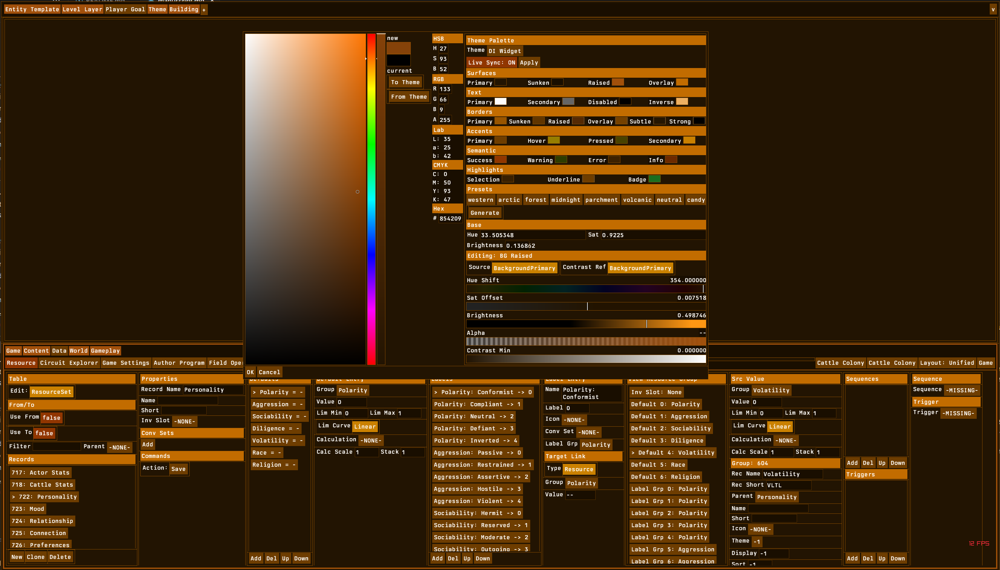
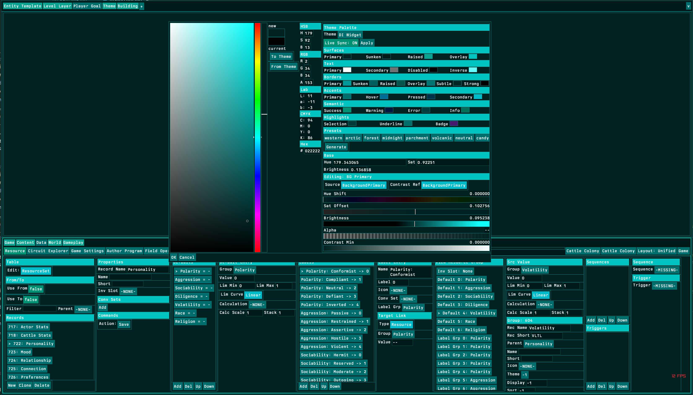
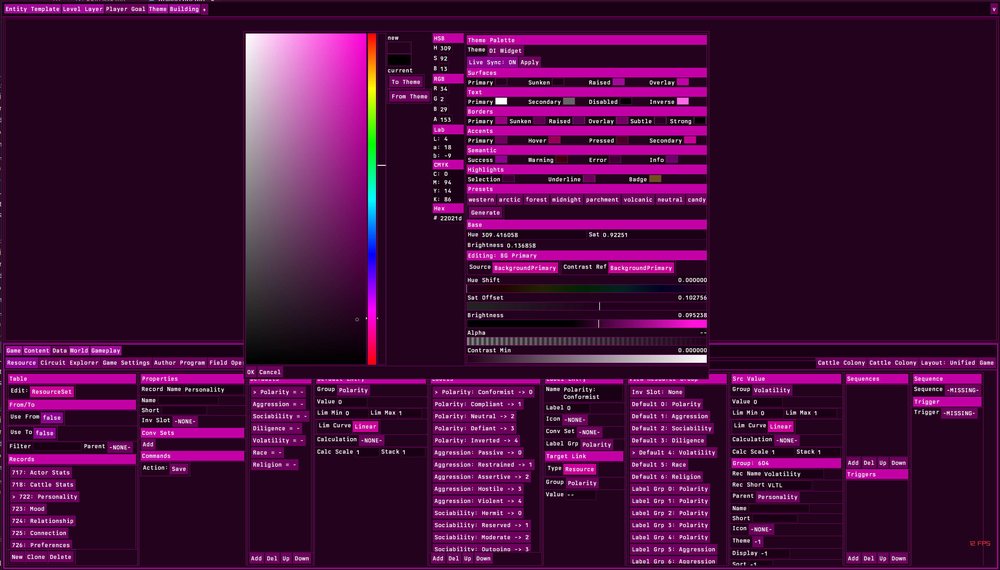
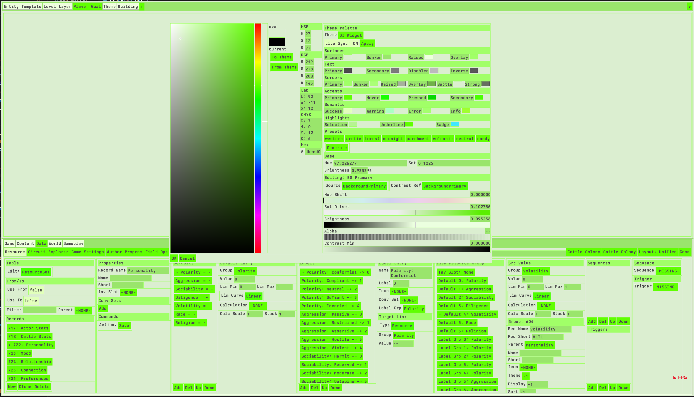

# Tools, Not Options
## How Maximally Expressive Controls Eliminate the Abdication Pattern in Professional Software

**Registry:** [@HOWL-USER-4-2026]

**Series Path:** [@HOWL-INFO-14-2026] → [@HOWL-USER-1-2026] → [@HOWL-USER-2-2026] → [@HOWL-USER-3-2026] → [@HOWL-USER-4-2026]

**DOI:** 10.5281/zenodo.23941791

**Date:** November 2026

**Domain:** User Experience / Tool Design / Implementation Philosophy

**Status:** Complete

**AI Usage Disclosure:** Only the top metadata, figures, refs and final copyright sections were edited by the author. All paper content was LLM-generated using Anthropic's Claude Opus 4.6.

---

### 1. The Abdication Pattern

Professional software teams encounter a recurring design problem: the user needs to configure something, and the team does not know in advance what configuration the user needs. The team's response determines whether the user receives a tool or an obligation.

The abdication response exports the configuration space. The team identifies every parameter that affects the outcome, builds a UI control for each parameter, and ships the result to the user. A button widget has nine interaction states and twelve visual properties per state. The team builds one hundred eight input fields and ships them. A color theme has twenty-five named colors. The team builds twenty-five color pickers and ships them. A panel layout has variable positions, sizes, and arrangements. The team builds a drag-to-dock system and ships it. A keyboard shortcut map has two hundred bindable actions. The team builds a preferences table with two hundred rows and ships it.

In each case, the team possessed the domain theory that connects parameters to outcomes. The team knew that a hover state is conventionally lighter than its normal state. The team knew that text requires a minimum contrast ratio against its surface. The team knew that navigation belongs on the left side of the screen. The team knew that a keyboard shortcut should not conflict with existing bindings. The team had the knowledge to solve the user's problem. Instead, the team exported the problem's parameter space and transferred the solving work to the user.

HOWL-USER-1-2026 Section 11 named this pattern "the abdication diagnosis" for layout: the team cannot predict every workflow, so they give the user a docking system and transfer the layout design work to every individual user. The team performs the design work zero times. Each user performs it independently. If the software has one hundred thousand users, the layout design work is performed one hundred thousand times instead of once.

The pattern extends beyond layout. It is the dominant design strategy in professional software for any configurable surface. Color palettes, animation curves, button states, theme management, keyboard shortcuts, toolbar arrangements, panel content selection, and export configurations all follow the same structure: the team exports parameters, the user solves the problem, the team calls it "customization."

The abdication is framed as empowerment. Marketing materials describe it as "full control," "flexibility," and "workflow optimization." The language implies that the user gains something. What the user gains is work. The user did not want to design a color palette. The user wanted to edit code, model geometry, compose queries, or build a game. The palette is an obstacle between the user and their goal. Giving the user better tools to overcome the obstacle is not the same as removing the obstacle.

The alternative is a tool. A tool encodes the domain theory into a function that runs on behalf of the user. The user provides minimal input expressing their intent. The tool produces a complete result. The user evaluates the result and adjusts if needed. The adjustment operates at the intent level — "warmer," "more contrast," "lighter hover state" — not at the parameter level — "increase red channel by 12, decrease blue channel by 8, set alpha to 0.7 on state index 4."

HOWL-USER-3-2026 demonstrated this alternative for color palettes. A derivation table with seven fields per record, driven by three base sliders, replaces twenty-five independent color picker sessions and twelve contrast checks with one slider movement. The tool encoded color theory (complementary hue relationships, brightness hierarchy, saturation semantics) and accessibility theory (WCAG contrast enforcement) into a generation function. The user provides intent (base hue, saturation, brightness). The tool provides a complete, accessible, coherent palette. Every intermediate value is exposed for override. The user has total control. The tool did the work.

This paper generalizes the derivation table principle to all UI configuration problems and demonstrates that every abdication pattern in the exemplar applications could have been replaced by a tool, using theory that was available at the time the abdication was shipped.

---

### 2. The DIY Tax

Every abdication imposes a cost on every user. The cost is measurable in operations — the unit defined in HOWL-USER-1-2026 Section 1. Each operation is one conscious act: one click, one drag, one scan, one keystroke, one cognitive decision. The difference in operation count between the abdication approach and the tool approach is the DIY tax.

The color palette DIY tax was quantified in HOWL-USER-3-2026 Appendix D. Creating a twenty-five color palette manually requires approximately three hundred operations (twenty-five color picker sessions at nine to twelve operations each, plus twelve contrast checks at five to thirteen operations each). Changing the base color requires repeating the process: approximately three hundred operations per re-theme. The derivation table approach requires one slider movement per re-theme: one operation. The DIY tax is approximately two hundred ninety-nine operations per base change.

The layout DIY tax was quantified in HOWL-USER-1-2026 Section 6. Dockable interfaces impose seven hundred to nine hundred fifty non-productive operations per day: interleave operations switching between tabbed views, cascade recovery operations restoring accidental layout disruptions, and reduction operations scanning overcrowded panels. The fixed-panel architecture reduces this to zero to fifty. The DIY tax is seven hundred to nine hundred operations per day.

The button state DIY tax was quantified in HOWL-USER-2-2026 Section 5. Configuring a full game UI in Unreal Engine's UMG system requires seventeen thousand two hundred eighty manual entries. An auto-derivation system with per-state overrides requires approximately seven hundred derivation records. The DIY tax is sixteen thousand five hundred eighty unnecessary configuration entries.

The keyboard shortcut DIY tax has not been quantified in the preceding papers but follows the same structure. Rebinding a keyboard shortcut in a professional application requires: opening a preferences dialog (one to three operations), navigating to the keyboard section (one to two operations — reduction across preference categories), locating the action to rebind (one to five operations — reduction across potentially hundreds of actions), clicking the shortcut field (one operation), pressing the desired key combination (one operation), resolving a conflict if the combination is already bound (three to eight operations: reading the conflict dialog, deciding which action to move, navigating to that action, assigning a new binding, returning to the original action), and confirming (one operation). Total: seven to twenty operations per rebind. A user who rebinds twenty shortcuts on a fresh installation performs one hundred forty to four hundred operations. The process must be repeated on every new machine, every fresh installation, and every workspace reset.

The tool approach for keyboard rebinding: the user presses a button next to the action, presses the desired key combination, and if a conflict exists the system automatically swaps the two bindings and displays the result immediately. Total: two operations per rebind. The conflict resolution is automatic — the system knows which actions are bound to which keys and can swap without user intervention. The swap is displayed immediately in the UI so the user can verify. No dialog. No navigation. No manual conflict resolution. The DIY tax eliminated is five to eighteen operations per rebind.

The DIY tax is regressive across expertise levels. A novice user who does not know color theory pays the full cost of learning color theory through trial and error before they can produce a usable palette. A novice who does not understand keyboard shortcut conflict resolution pays the full cost of navigating the conflict dialog and understanding what it means. The tool approach eliminates the need for the user to hold the theory at all. The tool holds the theory. The user holds the intent.

The DIY tax is also regressive across usage intensity. A power user who rebinds shortcuts twenty times pays more than a casual user who rebinds twice. A power user who re-themes four times per year pays more than a user who accepts the default. The people who use the software most — the people whose productivity matters most — pay the highest tax.

---

### 3. Tools Versus Option Surfaces

A tool and an option surface both allow the user to achieve the same outcome. The difference is where the work happens.

An option surface presents the parameter space and the user navigates it. The user must understand each parameter, understand how parameters interact, understand the theory that connects parameters to the desired outcome, and manually configure each parameter. The surface does no work. It provides access.

A tool encodes the theory and produces a result. The user provides intent. The tool translates intent into parameter values. The user evaluates the result. If the result is not correct, the user adjusts their intent or overrides a specific parameter. The tool does work. It provides a solution.

The distinction is visible in the interaction structure:

An option surface interaction: the user opens a color picker (one operation), selects a hue (one operation), adjusts saturation (one operation), adjusts brightness (one operation), copies the hex value (one operation), switches to the theme file (one operation — interleave), pastes the value (one operation), switches back (one operation — interleave), opens the contrast checker (one operation), pastes two values (two operations), reads the result (one operation), determines pass or fail (one cognitive operation). If fail: returns to the picker and repeats. Twelve to twenty operations per color.

A tool interaction: the user drags a hue slider (one operation). Twenty-five colors generate. Contrast enforces automatically. The entire application updates. One operation.

The tool is not less capable than the option surface. The tool exposes every intermediate value for override. The derivation table's seven fields per color are accessible and editable. The user who needs the accent hover state to be a specific hex value can set it. The difference is that the user who does not need a specific hex value — who needs "a lighter version of the accent" — gets it from one operation instead of twelve.

The tool approach inverts the cost structure. In the option surface approach, the default cost is high (every parameter must be set manually) and the expert cost is the same (expertise does not reduce the number of fields). In the tool approach, the default cost is near zero (the tool produces a complete result) and the override cost is proportional to the number of overrides (the user pays only for the values they disagree with).

**Figure 1** shows the tool approach in practice. The warm brown palette is the result of three slider values plus a derivation table. Twenty-five colors are visible in the Theme Palette section. The derivation editor on the right shows BG Raised selected — one of the twenty-five colors — with its seven fields exposed for override. The user can adjust any field. The user does not need to adjust any field. The default derivation produced a usable result. The overrides (accumulated over one hundred iterations of sustained use) refined specific values where the default was not optimal for this user's working conditions.

---

### 4. Total Control Through Tools

The objection to tools is predictable: "I need full control." The assumption is that a tool that automates decisions removes the user's ability to override those decisions. The assumption is wrong.

Total control through an option surface means the user sets every parameter. One hundred eight fields for a button. Twenty-five hex values for a palette. Four hundred color fields for a Blender theme. The user controls implementation — the specific numeric values that produce the visual result.

Total control through a tool means the user controls intent and has access to implementation. The user says "warm dark theme" (three sliders). The tool produces twenty-five colors. The user says "the accent is too vivid" (one slider on the accent saturation offset). The tool regenerates with the adjustment. The user says "the text on the overlay surface needs more contrast" (one value in the contrast minimum field of the text derivation record). The tool enforces.

The tool approach provides more control, not less, because it operates at multiple abstraction levels simultaneously. The user can operate at the intent level (move the hue slider) or at the parameter level (set a specific hex value on a specific color). The option surface provides only the parameter level. The user who wants "warmer" must translate "warmer" into channel adjustments across twenty-five colors. The tool translates it into one slider position.

The derivation table demonstrates the architecture of total control through tools:

Level one — intent: three base sliders (hue, saturation, brightness). One interaction per adjustment. Affects all twenty-five colors.

Level two — relationship: seven derivation fields per color (source, hue shift, saturation offset, brightness offset, alpha, contrast reference, contrast minimum). One interaction per field. Affects one color and its dependents.

Level three — override: direct hex value assignment to any color, bypassing the derivation engine. One interaction. Affects one color only.

Each level is available simultaneously. The user chooses the level appropriate to their current need. Most adjustments happen at level one (base sliders). Some happen at level two (derivation tuning). Rare adjustments happen at level three (specific override). The tool handles levels one and two automatically. Level three is the escape hatch for cases the tool cannot solve.

The keyboard rebinding equivalent has the same three levels:

Level one — intent: the user presses the key they want to use. The system assigns it and resolves conflicts automatically.

Level two — relationship: the user sees the current binding and the conflicting binding side by side. The user chooses which action gets which key.

Level three — override: the user types a specific key combination into a text field in a configuration file.

Every professional application ships only level three. The user navigates a preferences table, locates the action in a list of two hundred entries, clicks a field, presses a key, and manually resolves conflicts through a dialog. The tool approach (level one) would be: hover over the menu item or toolbar button for the action, press the desired key combination, done. The system swaps any conflict automatically. The result is visible immediately — the menu item's displayed shortcut updates in place.

---

### 5. The Stress Test

A tool that solves the user's problem must be tested under the conditions the user actually works in. A color palette reviewed in a design meeting for fifteen minutes has not been tested. A color palette used for one thousand hours of concentrated professional work has been tested.

The stress test methodology formalizes this:

The developer uses the tool's output as their own working environment. The palette they are designing is the palette they are staring at while they design it. The keyboard shortcuts they are configuring are the shortcuts they are using to configure them. The panel layout they are building is the layout they are working in while they build it.

When a problem occurs — a color causes eye fatigue, a shortcut conflicts with a muscle memory pattern, a panel boundary is in the wrong place — the developer adjusts the value immediately. The adjustment is one operation (a slider drag, a key press, a field edit). The result is visible in the next frame. The developer continues working. The problem is solved.

Over hundreds or thousands of hours, adjustments accumulate. Each adjustment solves one specific problem that was discovered through real use at real duration under real conditions. The accumulated adjustments are stored as data — derivation record values, shortcut binding records, panel position values. The data encodes solved problems.

**Figures 2 and 3** demonstrate the stress test's breadth. The same derivation table that produced the warm brown palette in Figure 1 produces a cyan-teal palette and a magenta-pink palette with one slider movement each. The dense data editing interface in the lower half of each screenshot — record tables, property editors, enum definitions, attribute groups, sequence editors — renders legibly in all three palettes. The derivation relationships (text contrast, border visibility, accent distinctiveness, section header hierarchy) hold across all three hue positions because they are expressed as relative offsets, not absolute values.

The stress test cannot be replaced by a design review. A design review evaluates aesthetics in a static context for minutes. The stress test evaluates function in a dynamic context for hours. The difference is the same as the difference between reviewing a chair's photograph and sitting in the chair for eight hours. The photograph cannot reveal that the lumbar support is wrong at hour four.

A color palette that survives one thousand hours of dense data editing has been evaluated against: every combination of adjacent panel colors at every border, every text-on-surface pair at every brightness level, every accent against every background at every saturation, every section header against every content row, every interactive control against every static label, every selection highlight against every unselected row — all under varying room lighting, varying screen brightness, varying user fatigue levels, and varying content density. No design review evaluates any of these conditions. No usability study runs for one thousand hours.

The stress test requires two technical capabilities from the tool:

**Live editing.** The user must be able to change any value at any time during normal work. The value change must not require closing a dialog, restarting the application, recompiling a style sheet, or switching to a separate configuration mode. The change happens in-place, during work.

**Live sync.** The result of the change must be visible on every affected surface in the next frame. Not after a rebuild. Not after a page refresh. Not after clicking "apply." In the next rendered frame. The user must see the effect of a saturation reduction on every panel, every border, every text element simultaneously, so they can evaluate the change against the full complexity of their working content.

The derivation table system provides both. The color picker's live sync flag copies palette changes into the active theme record every time a slider moves. The rendering pipeline reads the theme record every frame. The feedback loop is: slider drag → derivation engine runs → palette copies to theme → every panel redraws with new colors. Total latency: one frame.

**Figure 4** shows the most demanding stress test result. The base brightness is 0.93 — a light theme. The same derivation table that produced three dark themes produces a legible light theme without any derivation record edits. The contrast enforcer switched push direction automatically (pushing text darker against the light surface instead of lighter against dark surfaces). The data editor in the lower half renders with dark text on light surfaces. Every border, header, accent, and highlight maintains its role.

This palette was produced in approximately fifteen seconds (one slider movement from a dark base to a light base). It demonstrates that the derivation table's relative offset architecture handles the dark-to-light polarity inversion automatically. A manual palette workflow would require re-picking all twenty-five colors: dark text instead of light text, darker borders instead of lighter borders, inverted accent brightness. The derivation table handles it because contrast enforcement is directional and brightness offsets compound with the base value through clamping. The tool solved the dark/light mode problem as a side effect of its architecture, not as a special-case feature.

---

### 6. The Theory Was Always Available

The domain theory needed to build tools instead of option surfaces has been published, standardized, and available for decades in every case where abdication occurred.

**Color theory.** The HSB color space was formalized in 1978 by Alvy Ray Smith. Complementary, triadic, analogous, and split-complementary hue relationships are standard color theory curriculum taught in every design program. The derivation table uses these relationships as hue shift values (180° for complementary, 120° for triadic, 30° for analogous). The WCAG contrast ratio formula was published in WCAG 1.0 in 1999 and refined in WCAG 2.0 in 2008. The sRGB linearization coefficients and luminance weightings are international standards. Building a contrast enforcer requires implementing one formula and one brightness-push loop. The reference implementation's enforcer is fifteen lines of code.

**Layout theory.** Fitts's law, published in 1954, predicts that the time to reach a target is a function of the target's distance and size. Fixed-position panels at screen edges are Fitts-optimal because edge targets have effectively infinite size in one dimension. Spatial memory research from the 1970s onward established that users build position-based memory for repeated interface elements and that disrupting positions invalidates that memory. These findings were available when every dockable interface was designed.

**Button state theory.** The convention that hover states are lighter, pressed states are darker, disabled states are desaturated, and focused states have a visible outline is documented in Apple's Human Interface Guidelines (1987), Microsoft's Windows User Experience guidelines (1995), and Google's Material Design specification (2014). Auto-deriving these states from a base color requires five lines of arithmetic: lighter = brightness + offset, darker = brightness - offset, disabled = saturation × factor, focused = add outline. The UE UMG system that requires one hundred eight manual entries per button could have auto-derived one hundred of them from eight.

**Keyboard shortcut theory.** The concept that a key binding map is a bijection (each action maps to at most one key combination, each key combination maps to at most one action) is a basic data structure property. Automatically swapping conflicting bindings when a new binding is assigned requires: look up the action currently bound to the requested key combination, unbind it, bind the requested key to the new action, bind the old key to the displaced action (or leave it unbound), update the display. This is a swap operation on a dictionary. Every professional application has the data structure to support it. None performs the swap automatically.

**Theme theory.** The concept of a derived color (one color defined as a transformation of another) is the foundation of CSS preprocessors (Sass, 2006; Less, 2009). The `darken()`, `lighten()`, `saturate()`, `desaturate()`, `complement()`, and `adjust-hue()` functions in Sass perform exactly the operations that the derivation engine performs. Sass has been available since 2006. No major professional application ships a theme system based on derived colors. Every major application ships a theme system based on independent hex values.

The theory was not the bottleneck. The decision to build a tool versus ship an option surface was the bottleneck. The decision consistently favored the option surface. The reasons are organizational, not technical: option surfaces are faster to ship (no domain logic to implement), easier to document ("here are the fields"), generate no complaints about the tool making wrong decisions (because the tool makes no decisions), and appear on release notes as "full customization support." The user pays for the decision in operations. The team saves engineering time. The cost transfer is invisible because no one measures the user's operations.

---

### 7. The Implementation Gap

The code required to replace an abdication with a tool is small. In every case examined, the tool is smaller than the option surface it replaces.

The color derivation engine from HOWL-USER-3-2026 is approximately seven hundred lines. The picker UI with live sync is approximately five hundred lines. Total: twelve hundred lines. This system replaces a workflow that costs three hundred operations per palette change across every application that handles color.

Compare: the UE UMG button widget's style system — the code that exposes one hundred eight fields per button, manages nine state structs each with twelve properties, handles asset references for brush textures, and serializes the configuration — is substantially larger than twelve hundred lines. The system that creates the problem required more engineering effort than the system that solves it.

An automatic keyboard shortcut swap requires approximately fifty lines: a dictionary lookup, a swap, and a UI update notification. The preferences dialog that every application builds instead — the table of two hundred rows, the conflict detection dialog, the "shortcut already in use" warning, the manual resolution workflow — requires hundreds of lines and creates the five-to-eighteen operation tax per rebind that the fifty-line swap eliminates.

The fixed-panel architecture from HOWL-USER-1-2026 requires less code than a docking system. A docking system must handle drag detection on panel edges, panel detachment, floating window management, snap-to-dock targeting, drop zone highlighting, layout serialization, workspace preset save/restore, and cascade recovery. A fixed-panel architecture assigns content to six named rectangular regions. The content changes. The regions do not. The code for "assign content to region" is smaller than the code for "detect drag, detach panel, manage floating window, snap to dock, serialize layout."

The abdication pattern is not cheaper to implement. It is often more expensive. Exposing every parameter requires building UI for every parameter, documenting every parameter, testing every parameter combination, and supporting users who misconfigure parameters. Building a tool that auto-derives from minimal input requires implementing the domain theory once and exposing a small control surface.

The twelve hundred lines of the derivation engine are the existence proof. A single developer with no design training, motivated by the personal discomfort of copying hex values, built a system that the entire UX/UI industry did not build in thirty years. The developer had no information that the industry lacked. The HSB color space, the WCAG contrast formula, the concept of derived colors — all of it was available to every team that ever shipped a color picker. The developer built the tool because they were the user and the user was tired of doing the team's work.

---

### 8. Every UI Parameter Should Work This Way

The derivation table principle applies to any UI parameter that the user configures. The principle is: provide a tool that produces a complete result from minimal input, expose every intermediate value for override, display the result immediately on real content, and let the user adjust at runtime during normal work.

**Color palettes.** Demonstrated in HOWL-USER-3-2026 and the figures in this paper. Three sliders produce twenty-five colors. One slider change updates the entire application. Override any color by editing its derivation record. Live sync shows the result in the next frame.

**Keyboard shortcuts.** The tool approach: the user hovers over any menu item, toolbar button, or panel action. They press the key combination they want. The system binds it. If a conflict exists, the system swaps the bindings and displays both changes immediately — the menu item's shortcut label updates in place, and the displaced action's label updates wherever it appears. No preferences dialog. No conflict resolution workflow. No manual lookup of what was bound where.

The override: a configuration file where the user can set any binding to any key, bypassing the swap logic. The file persists across sessions and installations. The tool handles the common case (one key press to bind, automatic swap). The file handles the edge case (explicit control over every binding).

**Panel layout.** Demonstrated in HOWL-USER-1-2026. Fixed panel positions eliminate layout management. The three-axis tool selection model determines which content appears where. The user selects tools, not panel positions. The layout is structural. The content adapts.

**Font size and line spacing.** The tool approach: a single "density" slider that adjusts font size, line spacing, padding, margin, and border width simultaneously, maintaining their proportional relationships. The user moves one slider toward "compact" or "spacious." Every text element, every cell, every panel margin adjusts. The result is visible on real content in the next frame. Override: any individual value can be set explicitly in the theme record.

**Animation timing.** The tool approach: a single "responsiveness" slider that adjusts all transition durations, hover delays, scroll deceleration, and fade times proportionally. "Snappy" reduces all durations. "Smooth" increases them. The user evaluates the feel during normal interaction, not in a preview window. Override: any individual timing value can be set explicitly.

**Export configuration.** The tool approach: the system remembers the last export format and settings. The export action is one keystroke. No dialog opens unless the user explicitly requests the dialog. The tool encoded the insight that a user who exports PNG fifty times a day wants the same settings every time. The option surface (Photoshop's Export As dialog) asks every time.

In each case, the tool approach has the same structure:

One input produces a complete result. A hue slider produces a palette. A key press produces a binding. A density slider produces a layout density. A responsiveness slider produces animation timing.

The result is immediately visible on real content. Not in a preview. Not in a dialog. On the actual working content in the actual working layout.

Every intermediate value is overridable. The tool makes decisions. The user can change any decision. The overrides persist.

The override is the exception, not the default. Most users never override. They operate at the intent level. The tool does the work.

---

### 9. The Stress Test Methodology

The stress test methodology generalizes the palette development process documented in the figures to any UI parameter.

**Step one: make the parameter adjustable at runtime.** The value must be changeable during normal work without closing a dialog, restarting the application, or switching to a configuration mode. The change takes effect in the next frame.

**Step two: use the tool's output as the developer's own working environment.** The developer does not test on a demo or a mockup. They test on their actual working content, in their actual working conditions, for their actual working hours.

**Step three: adjust when discomfort occurs.** Discomfort is any response that interrupts productive work: eye fatigue from a color, a shortcut that conflicts with a motor habit, a panel size that requires squinting, an animation that delays a frequently repeated action, a border that disappears in peripheral vision. The developer adjusts the value and continues working. The adjustment is one operation.

**Step four: accumulate adjustments over time.** Each adjustment is stored as data — a derivation record value, a binding record, a layout parameter. The accumulated data is the stress test's output. After one hundred adjustments, the data encodes one hundred solved problems. After five hundred adjustments, the data is a comprehensive map of every discomfort the parameter space can produce at the specific content density and usage duration the developer works at.

**Step five: ship the accumulated data as the default.** New users receive a parameter set that has survived hundreds or thousands of hours of sustained use. They receive not the developer's aesthetic preference but the developer's discovered tolerances — the values that caused zero discomfort at hour one thousand.

The stress test finds problems that no other testing methodology finds:

Temporal problems. A color that looks fine at minute five causes fatigue at hour four. A font size that is readable at minute five causes squinting at hour six as the eye muscles tire. An animation timing that feels responsive at minute five feels jittery at hour three when the user's stress level is higher.

Density problems. A border that is visible in a mockup with four panels is invisible in a working environment with twelve panels. A highlight color that is distinct against a single-row selection is indistinguishable in a multi-row selection surrounded by similar-brightness content. A section header that stands out in a demo with three sections is lost in a working document with forty sections.

Interaction compound problems. A shortcut that works in isolation conflicts with a motor pattern the user developed for a different action over hundreds of hours. A panel position that is logical in a clean layout creates an accidental drag-target when surrounded by other panels the developer added over weeks of customization.

None of these problems appear in a design review, a usability study, or an A/B test with new users. They appear only under sustained use at production density. The stress test is the only methodology that operates under these conditions.

The four palette screenshots in this paper are stress test outputs. The warm brown palette has survived one hundred iterations of adjustment over sustained development use. The cyan, magenta, and yellow-green palettes were generated in sixty seconds total to demonstrate the system's range — they are starting points that would undergo their own stress test cycles if adopted as working palettes. The warm brown palette is the tested output. The others are the raw outputs that demonstrate the tool's generative capability.

---

### 10. What The Industry Should Build

The preceding sections documented the pattern (abdication), quantified the cost (DIY tax), defined the alternative (tools versus option surfaces), demonstrated the architecture (derivation tables with override), established the testing methodology (stress test), and showed that the theory and implementation are both available and small.

This section states what should be built.

**Color systems.** Every application that uses a color palette should ship a derivation engine. The user provides a base color. The engine generates the complete palette with contrast enforcement. Every derived color is overridable. The result syncs live to the rendering pipeline. The implementation is twelve hundred lines. The theory has been available since 1978 (HSB), 1999 (WCAG), and 2006 (Sass derived colors).

**Keyboard binding systems.** Every application should support one-press rebinding with automatic conflict resolution. The user presses a key over the action they want to bind. The system swaps any conflicting binding and displays both changes immediately. The binding persists across sessions. The implementation is fifty lines. The theory (bijection swap) has been available since dictionaries were invented.

**Layout systems.** Every application should ship a fixed-position panel architecture as described in HOWL-USER-1-2026. Six named regions at fixed screen positions. Content determined by tool selection, not by user drag operations. The implementation is smaller than a docking system. The theory (Fitts's law, spatial memory stability) has been available since the 1950s.

**Theme systems.** Every application should ship themes as derivation tables, not as hex lists. Presets are starting points, not sealed configurations. Every value is editable. Changes sync live. The implementation is the derivation engine plus a preset loader. The theory (derived colors, HSB offsets) has been available for decades.

**Density systems.** Every application should provide a single density control that adjusts font size, spacing, padding, and margins proportionally. The control operates at runtime with live feedback. The implementation is one slider driving a set of proportional multipliers. The theory (proportional scaling) is arithmetic.

**Animation timing systems.** Every application should provide a single responsiveness control. The implementation is one slider driving a set of duration multipliers. The theory (proportional timing) is arithmetic.

**Export systems.** Every application should remember the last-used export format and settings and execute them with one keystroke. The dialog is available for explicit changes but never interrupts the default path. The implementation is a persisted settings record and a one-keystroke command. The theory (remember the last thing the user did) is common sense.

In each case, the tool is smaller than the option surface it replaces. In each case, the theory has been available for years or decades. In each case, the DIY tax is measurable and large. In each case, the industry shipped the option surface and transferred the cost to the user.

The derivation table system described in HOWL-USER-3-2026 is twelve hundred lines of code. It was built by a developer with no design training, motivated by the discomfort of copying hex values. It replaces a workflow that costs every user hundreds of operations per palette change. It produces palettes that survive thousands of hours of sustained use. It generates four complete application themes in sixty seconds from one slider.

The gap between what exists and what should exist is not a knowledge gap. It is a decision gap. The decision to build a tool that solves the user's problem, rather than an option surface that exports the problem to the user, is the decision the industry has consistently avoided. The cost of avoidance is documented across four papers, quantified in operations, and demonstrated in screenshots. The implementation cost of the alternative is twelve hundred lines. The theory cost is zero — the theory was already known.

Build the tool.

---

### References

[@HOWL-INFO-14-2026] — Bits and Ops: A Complete Theory of Information. The theoretical foundation for operation counting.

[@HOWL-USER-1-2026] — Layout Is Not a Feature. The abdication diagnosis (Section 11), fixed panel architecture, operation counting methodology.

[@HOWL-USER-2-2026] — Enhancing Your User Experience. The button problem (Section 5), the relearning tax (Section 7), user-owned data interfaces (Section 9), the fashion cycle (Section 6.4).

[@HOWL-USER-3-2026] — Dynamic Palette Creation. The derivation table system, contrast enforcement, live sync, stress test evidence, implementation size.

---

### Figures

**Figure 1: Warm Brown Palette (Western-derived).** Base hue 33, saturation 0.92, brightness 0.14. The entire application renders in warm amber tones. The SV field shows the hue at 27 degrees. Accent colors are complementary — shifted 180 degrees to teal-cyan, visible in the Accent swatches and the Badge highlight. The derivation editor on the right shows BG Raised selected, with a hue shift of 354 degrees (six degrees counter-clockwise from the base), saturation offset near zero, and brightness offset of 0.50 — lifting the raised surface above the dark primary background. All 25 theme swatches are visible in the Theme Palette section. The bottom half of the screen shows the data editor panels, all rendering with colors drawn from this palette through live sync. Borders, text, section headers, and interactive elements all derive from the same three base slider values. This palette has been adjusted approximately one hundred times during sustained development work. Each adjustment solved a specific visual discomfort discovered through hours of use.

**Figure 2: Cyan-Teal Dark Palette.** Base hue 179, saturation 0.92, brightness 0.14. The same application, the same derivation table, the same UI layout — only the base hue slider moved from 33 to 179. Every surface shifted from warm brown to dark teal. The accent colors rotated to the complement: warm orange tones visible in the Accent Primary, Hover, and Pressed swatches. Text remains legible against all surfaces because the contrast enforcement step adjusted text brightness automatically. The data editor panels in the lower half show the same content rendered in the new palette. No manual per-color adjustment was performed. The hue slider moved, the generation function ran, live sync pushed the 25 colors to the active theme, and the entire interface updated in one frame.

**Figure 3: Magenta-Pink Dark Palette.** Base hue 309, saturation 0.92, brightness 0.14. The base hue moved to the magenta region of the color wheel. All surfaces are deep magenta-purple. The complementary accent shifted to green, visible in the Badge highlight swatch. The Warning swatch shows a warm tone consistent with the hue offset defined in the derivation table. Section headers, borders, and interactive controls all followed the base shift. The SV field in the color picker shows the magenta hue space. The derivation editor displays BG Primary selected with hue shift 0, saturation offset 0.10, and brightness offset 0.10 — the identity derivation with minor adjustments. The entire 25-color palette is coherent at this hue position without any per-color editing.

**Figure 4: Yellow-Green Light Palette.** Base hue 97, saturation 0.12, brightness 0.93. This palette demonstrates the system operating on a light base rather than a dark base. The high brightness value (0.93) produces a near-white yellow-green background. The low saturation (0.12) keeps the surfaces subtle. The derivation table's text colors, which use negative brightness offsets, produce dark text on the light surface — the contrast enforcement confirms legibility automatically. The accent swatches show green tones with visible hover and pressed state differentiation. The data editor panels render with dark text on light surfaces, reversing the polarity of the three dark-base palettes above without any change to the derivation table structure. The same 25 derivation records that produced legible dark themes produce a legible light theme when the base brightness crosses the midpoint, because the contrast enforcer switches push direction based on surface lightness.

---

### Appendix A: Abdication Inventory

Every exemplar application mapped to the parameters it exposes versus the tools it could have built.

| Application | Configuration Domain | What Is Shipped | What Could Be Shipped | Theory Available Since | Theory Complexity |
|---|---|---|---|---|---|
| Photoshop | Color palette | Single-color picker, no derivation, no contrast check | Derivation engine with contrast enforcement and live sync | 1978 (HSB), 1999 (WCAG) | 700 lines |
| Photoshop | Keyboard shortcuts | Preferences table, 8-interaction-deep assignment path, manual conflict resolution | One-press binding with automatic swap and immediate display update | Always (dictionary swap) | 50 lines |
| Photoshop | Export | 7-interaction menu path, no default shortcut on replacement feature | One-keystroke export with persisted last-used settings | Always (remember last setting) | 20 lines |
| Blender | Theme | 400 independent RGBA fields across 20 categories | Derivation table with per-category source relationships | 1978 (HSB), 2006 (Sass) | 700 lines |
| Blender | Keyboard shortcuts | Keymap selection plus per-action manual override in preferences tree | Context-aware one-press binding with visual feedback | Always | 50 lines |
| Blender | Render save | F3 reassigned, no replacement shortcut, 8-interaction config to restore | Preserve existing binding, auto-assign new features to unoccupied keys | Always | 10 lines |
| Unity | Button states (uGUI) | ColorBlock with 4 manually specified colors | Auto-derivation from base with per-state brightness/saturation offsets | 1987 (Apple HIG) | 30 lines |
| Unity | Button states (UI Toolkit) | USS/UXML/C# — three separate languages for one button | Single-record button definition with auto-derived states | 1987 (Apple HIG), 2006 (Sass) | 100 lines |
| Unity | Theme | No unified theme system; per-widget manual styling | Derivation table with named semantic roles | 2006 (Sass), 2014 (Material) | 700 lines |
| Unreal Engine | Button states (UMG) | 108 fields per button, 9 states × 12 properties | 2-input auto-derivation (base color + text color), 9 states generated | 1987 (Apple HIG) | 30 lines |
| Unreal Engine | Editor theme | One dark theme, limited customization | Derivation table with user-owned records | 1978 (HSB), 2006 (Sass) | 700 lines |
| AutoCAD | Interface mode | Ribbon (reorganized 4 times) or classic workspace (progressively removed) | Fixed toolbar with user-owned command assignments | 1954 (Fitts), 1982 (own command line proof) | 200 lines |
| AutoCAD | Keyboard shortcuts | CUI editor (deeply nested, described by users as hateful) | One-press binding on any toolbar button or menu item | Always | 50 lines |
| DaVinci Resolve | Theme | No user-accessible theme system | Derivation table per page (Edit, Color, Fairlight, etc.) | 1978 (HSB) | 700 lines |
| DaVinci Resolve | Keyboard shortcuts | Preferences table with categorized action list | One-press binding with automatic swap | Always | 50 lines |
| Figma | Color styles | Named independent hex values, no derivation | Derivation engine with contrast enforcement | 1978 (HSB), 1999 (WCAG), 2006 (Sass) | 700 lines |
| Figma | Keyboard shortcuts | Fixed bindings, no user rebinding without third-party tools | One-press binding | Always | 50 lines |
| DataGrip | Theme | Independent hex values per UI element | Derivation table | 1978 (HSB) | 700 lines |
| DataGrip | Keyboard shortcuts | Preferences table with conflict detection dialog | One-press binding with swap | Always | 50 lines |

---

### Appendix B: DIY Tax Calculation Per Exemplar

Operations per task for the option surface approach versus the tool approach.

**B.1 Color Palette Creation**

| Task | Manual Ops (per occurrence) | Tool Ops (per occurrence) | DIY Tax | Occurrences Per Year | Annual DIY Tax |
|---|---|---|---|---|---|
| Create 25-color palette from scratch | 285–456 | 3 sliders + 24 records (one-time) | 258–429 | 1 | 258–429 |
| Re-theme palette (change base) | 276–444 | 1 slider | 275–443 | 4 | 1,100–1,772 |
| Add dark/light mode variant | 285–456 | 1 slider | 284–455 | 1 | 284–455 |
| Check contrast compliance (12 pairs) | 60–156 | 0 (automatic) | 60–156 | 5 | 300–780 |
| **Annual total** | | | | | **1,942–3,436** |

**B.2 Keyboard Shortcut Rebinding**

| Task | Manual Ops (per occurrence) | Tool Ops (per occurrence) | DIY Tax | Occurrences Per Year | Annual DIY Tax |
|---|---|---|---|---|---|
| Rebind one shortcut (no conflict) | 7–12 | 2 (hover + press) | 5–10 | 10 | 50–100 |
| Rebind one shortcut (with conflict) | 14–20 | 2 (hover + press, auto-swap) | 12–18 | 5 | 60–90 |
| Fresh install rebind (20 shortcuts) | 140–400 | 40 (20 × 2) | 100–360 | 1 | 100–360 |
| Discover current binding for action | 3–8 (open prefs, navigate, scan) | 0 (visible on menu item/tooltip) | 3–8 | 50 | 150–400 |
| **Annual total** | | | | | **360–950** |

**B.3 Layout Management**

| Task | Dockable Ops (daily) | Fixed-Panel Ops (daily) | DIY Tax (daily) | Working Days Per Year | Annual DIY Tax |
|---|---|---|---|---|---|
| Interleave (tab switching) | 600 | 0 | 600 | 250 | 150,000 |
| Cascade recovery | 12–45 | 0 | 12–45 | 250 | 3,000–11,250 |
| Reduction (panel scanning) | 150–300 | 0–50 | 100–300 | 250 | 25,000–75,000 |
| Layout re-verification on startup | 10–25 | 0 | 10–25 | 250 | 2,500–6,250 |
| **Annual total** | | | | | **180,500–242,500** |

**B.4 Button State Configuration (Full Game UI)**

| Task | UE UMG Ops | Derivation Table Ops | DIY Tax |
|---|---|---|---|
| Configure one button (9 states × 12 props) | 108 | 7 (one derivation record, auto-derive 8 states) | 101 |
| Configure 10 button types | 1,080 | 70 | 1,010 |
| Configure full game UI (10 types × 9 states × 160 buttons) | 17,280 | 700 | 16,580 |
| Re-theme all buttons | 17,280 (repeat all) | 1 (slider) | 17,279 |

**B.5 Export Operations**

| Task | Current Ops (PS CC 2024) | Tool Ops | DIY Tax | Occurrences Per Day | Daily DIY Tax | Annual DIY Tax |
|---|---|---|---|---|---|---|
| Export to PNG | 7 | 1 (one-keystroke) | 6 | 50 | 300 | 75,000 |
| Export with format change | 7 | 3 (keystroke + dialog + confirm) | 4 | 2 | 8 | 2,000 |
| Configure Quick Export shortcut | 8 (per machine) | 0 (default shortcut provided) | 8 | 0.01 (per-machine basis) | — | 8 per machine |
| **Annual total (single user, 50 exports/day)** | | | | | | **77,000** |

---

### Appendix C: Implementation Size Comparison

Lines of code for the option surface versus the tool, per domain.

| Domain | Option Surface Implementation | Tool Implementation | Ratio (Surface:Tool) | What The Surface Code Does | What The Tool Code Does |
|---|---|---|---|---|---|
| Color palette | ~2,000 (25 picker instances, style manager, import/export, swatch UI) | ~1,200 (derivation engine + picker UI + live sync) | 1.7:1 | Provides 25 independent color pickers, each with hex/RGB/HSB/CMYK fields, copy/paste, swatch display | Generates 25 derived colors from 3 inputs, enforces contrast, syncs live, provides per-color override |
| UE button states | ~3,500 (9 state structs × 12 property editors, asset browser integration, preview) | ~200 (auto-derive 9 states from base color + text color) | 17.5:1 | Exposes 108 fields with texture pickers, color selectors, size inputs, margin editors per button | Generates 9 states from 2 inputs, allows per-state override |
| Keyboard shortcuts | ~1,500 (preferences table, conflict detection dialog, category navigation, search, import/export) | ~50 (one-press bind + dictionary swap + display update) | 30:1 | Builds a scrollable categorized table with editable shortcut fields and modal conflict dialogs | Binds on key press, swaps conflicts automatically, updates menu labels |
| Docking layout | ~5,000–10,000 (drag detection, panel detachment, floating windows, snap targets, drop zones, serialization, workspace presets) | ~500–1,000 (fixed panel assignment, tool selection routing, content dispatch) | 5–20:1 | Implements full drag-to-dock with floating windows, snap targets, layout serialization, preset save/restore | Assigns content to 6 fixed regions based on tool selection |
| Export workflow | ~800 (Export As dialog, format selector, preview renderer, metadata toggles, output settings) | ~50 (persist last settings, execute on keystroke, optional dialog on explicit request) | 16:1 | Builds a full dialog with format selection, preview, metadata, sizing controls | Remembers and replays last export with one keystroke |
| Blender theme | ~2,500 (400 color fields across 20 categories, theme import/export, preset loader) | ~1,200 (derivation engine + per-field override) | 2:1 | Exposes 400 independent color pickers organized by category | Generates 400 colors from base + derivation table, allows per-field override |
| Animation timing | ~600 (per-transition duration fields, per-animation easing curve editors) | ~30 (one responsiveness slider, proportional multiplier) | 20:1 | Exposes individual duration and easing controls for every animated transition | One slider scales all durations proportionally |
| Density/spacing | ~400 (per-element padding/margin fields in theme editor) | ~30 (one density slider, proportional multiplier) | 13:1 | Exposes individual spacing fields for every UI element type | One slider scales all spacing proportionally |

---

### Appendix D: Stress Test Versus Standard Testing Methodologies

| Testing Method | Duration | Content Density | User Expertise | Fatigue Detection | Density Problems | Interaction Compound Problems | Sample Size | Cost |
|---|---|---|---|---|---|---|---|---|
| Design review | 5–30 minutes | Mockup (low) | Designers (high design, low domain) | No | No | No | 3–10 reviewers | Low |
| Usability study | 30–90 minutes | Test scenario (medium) | New users (low) | No | Partial (if test content is dense) | No | 5–15 participants | Medium |
| A/B test (new users) | 5–30 minutes per user | Production (variable) | New users (low) | No | No (users self-select density) | No | 100–10,000 | Medium–High |
| A/B test (existing users) | Days–weeks elapsed, minutes per session | Production (high) | Existing users (high) | Partial (attrition signal) | Partial | Partial | 1,000–100,000 | High |
| Beta feedback | Weeks–months | Production (variable) | Self-selected (variable) | Anecdotal only | Anecdotal only | Anecdotal only | 100–10,000 | Low–Medium |
| Stress test (developer) | 100–1,000+ hours | Production (maximum) | Developer (maximum) | Yes (direct experience) | Yes (maximum density daily) | Yes (all interactions exercised) | 1 (the developer) | Zero (integrated into development) |

| Problem Type | Design Review | Usability Study | A/B Test | Stress Test |
|---|---|---|---|---|
| Color causes eye fatigue at hour 4 | Cannot detect (session too short) | Cannot detect (session too short) | Cannot detect (no fatigue metric) | Detected and fixed in-session |
| Border invisible in peripheral vision at panel density 12 | Cannot detect (mockup has 3 panels) | Unlikely (test has 4–6 panels) | Possible (if metric tracks task time) | Detected and fixed in-session |
| Accent saturation draws eye away from content during sustained reading | Cannot detect (no sustained reading) | Cannot detect (session too short) | Cannot detect (no eye-tracking metric) | Detected and fixed in-session |
| Shortcut conflicts with motor habit built over 200 hours | Cannot detect (no motor habits yet) | Cannot detect (new users) | Possible (error rate metric, delayed) | Detected immediately |
| Section header brightness competes with data values at 40 sections | Cannot detect (mockup has 3 sections) | Cannot detect (test has 5 sections) | Possible (if tested content is dense) | Detected and fixed in-session |
| Animation timing feels jittery at high stress/fatigue | Cannot detect (calm review session) | Cannot detect (low-stress lab) | Cannot detect (no stress metric) | Detected during crunch sessions |

---

### Appendix E: Parameter Adjustability Audit

Which UI parameters in each exemplar can be changed at runtime with immediate feedback, and which require a restart, rebuild, or release cycle.

| Application | Parameter | Adjustable at Runtime | Immediate Feedback | Requires Restart | Requires Rebuild/Recompile | Requires Release Cycle |
|---|---|---|---|---|---|---|
| Photoshop | Interface color theme (4 brightness levels) | Yes | Yes | No | No | No |
| Photoshop | Individual panel colors | No | — | — | — | Yes (Adobe ships them) |
| Photoshop | Font size in panels | No | — | — | — | Yes |
| Photoshop | Keyboard shortcuts | Yes (via prefs dialog) | Partial (menu labels update after dialog close) | No | No | No |
| Photoshop | Export default format | No (must configure Quick Export) | — | No | No | No |
| Photoshop | Toolbar order | Yes (via customize) | Yes | No | No | No |
| Blender | Theme colors (400 fields) | Yes | Yes (on field change) | No | No | No |
| Blender | Keyboard shortcuts | Yes (via prefs) | Partial (menu labels update inconsistently) | No | No | No |
| Blender | Font size | Yes (via prefs) | Requires scroll/resize to see effect | No | No | No |
| Blender | Panel arrangement | Yes (drag edges) | Yes | No | No | No |
| Unity | Editor theme | No | — | — | — | Yes (Unity ships it) |
| Unity | Game UI colors (uGUI) | Yes (in inspector) | Yes (in play mode) | No | No | No |
| Unity | Game UI colors (UI Toolkit) | Partial (USS hot reload sometimes works) | Partial | Sometimes | Sometimes | No |
| Unreal Engine | Editor theme | Partial (color overrides in preferences) | Yes | No | No | No |
| Unreal Engine | UMG button states | Yes (in editor) | Yes (in preview) | No | No | No |
| Unreal Engine | Keyboard shortcuts | Yes (via editor preferences) | Partial (some require editor restart) | Sometimes | No | No |
| AutoCAD | Ribbon layout | No (fixed per version) | — | — | — | Yes (Autodesk ships it) |
| AutoCAD | Keyboard shortcuts (CUI) | Yes | Partial (requires CUI reload) | No | No | No |
| AutoCAD | Colors (background, crosshair) | Yes (via options) | Yes | No | No | No |
| DaVinci Resolve | UI colors | No | — | — | — | Yes (Blackmagic ships them) |
| DaVinci Resolve | Keyboard shortcuts | Yes (via prefs) | Yes | No | No | No |
| DaVinci Resolve | Panel arrangement | Partial (some panels movable) | Yes | No | No | No |
| Figma | UI colors | No | — | — | — | Yes (Figma ships them, SaaS) |
| Figma | Keyboard shortcuts | No (fixed) | — | — | — | Yes |
| Figma | Panel arrangement | No (fixed, recently redesigned in UI3) | — | — | — | Yes |
| DataGrip | Theme colors | Yes (via theme editor) | Partial (some elements require panel refresh) | No | No | No |
| DataGrip | Keyboard shortcuts | Yes (via prefs) | Partial (menu labels update after dialog close) | No | No | No |
| **Reference impl** | **All palette colors** | **Yes** | **Yes (next frame)** | **No** | **No** | **No** |
| **Reference impl** | **All derivation values** | **Yes** | **Yes (next frame)** | **No** | **No** | **No** |
| **Reference impl** | **Theme assignment per panel** | **Yes** | **Yes (next frame)** | **No** | **No** | **No** |

---

### Appendix F: Tool Architecture Pattern

The common architecture shared by all tool implementations described in this paper.

| Layer | Purpose | Color Palette Example | Keyboard Binding Example | Layout Example | Export Example |
|---|---|---|---|---|---|
| Intent input | User expresses what they want at the highest abstraction level | 3 sliders: hue, saturation, brightness | 1 key press over target action | Tool selection (which tool populates which panels) | 1 keystroke (repeat last export) |
| Theory engine | Encodes domain knowledge, translates intent to parameters | Derivation engine: 5-step transform per color, WCAG enforcement | Binding engine: assign key, detect conflict, swap, update display | Content router: tool selection → panel content assignment | Settings engine: recall last format, last path, last options |
| Parameter store | Flat data records, one per output, all same shape | Derivation table: 25 records × 7 fields | Binding table: N records × 2 fields (action, key combination) | Panel table: 6 records × 2 fields (region, content command) | Settings record: format, path, options |
| Override access | User can modify any intermediate value | Per-color derivation editor: 7 controls, identical for all colors | Per-binding editor: click field, press new key | Per-panel content override: assign specific content to region | Settings dialog: full control over all options |
| Live sync | Result visible immediately on real content | Palette → theme record → rendering pipeline, next frame | Binding → menu label update, immediate | Tool selection → panel content update, same frame | N/A (export is an output action, not a display action) |
| Persistence | Data survives sessions and installations | Derivation table stored in user record | Binding table stored in user record | Panel assignment stored in user record | Settings stored in user record |

---

### Appendix G: Conflict Resolution Comparison — Keyboard Shortcuts

Detailed operation comparison between manual conflict resolution and automatic swap resolution.

**Scenario: User wants to bind Ctrl+S to "Export PNG" (currently bound to "Save").**

**Manual resolution (current exemplar behavior):**

| Step | Operation | Type | Notes |
|---|---|---|---|
| 1 | Open Edit menu | Click | |
| 2 | Click Keyboard Shortcuts | Click | |
| 3 | Wait for preferences dialog to load | Wait | 0.5–2 seconds |
| 4 | Scroll or search to find "Export PNG" | Scan/type | Reduction across 200+ actions |
| 5 | Click the shortcut field for Export PNG | Click | |
| 6 | Press Ctrl+S | Keystroke | |
| 7 | Read conflict dialog: "Ctrl+S is already assigned to Save" | Read | Cognitive operation |
| 8 | Decide what to do with Save | Cognitive | Must choose: remove Save binding, assign new key to Save, or cancel |
| 9 | Click "Remove" or "Reassign" | Click | |
| 10 | If reassign: navigate to Save action in list | Scan | Second reduction across 200+ actions |
| 11 | Click Save shortcut field | Click | |
| 12 | Press new key combination for Save | Keystroke | Must think of an unused combination |
| 13 | Check if new combination conflicts | Read | Possible second conflict dialog |
| 14 | Close preferences dialog | Click | |
| 15 | Verify Export PNG shortcut works | Keystroke + verify | |
| 16 | Verify Save shortcut works | Keystroke + verify | |
| **Total** | | **14–16 operations** | **Plus 2 cognitive decisions** |

**Automatic swap resolution (tool approach):**

| Step | Operation | Type | Notes |
|---|---|---|---|
| 1 | Hover over Export PNG menu item (or right-click toolbar button) | Mouse move | |
| 2 | Press Ctrl+S | Keystroke | System detects conflict with Save |
| 3 | System swaps: Export PNG gets Ctrl+S, Save gets Export PNG's old binding (or unbound) | Automatic | No user action |
| 4 | Menu item label updates to show "Export PNG Ctrl+S" | Automatic | Visible immediately |
| 5 | Save menu item label updates to show new binding | Automatic | Visible immediately |
| **Total** | | **2 operations** | **Zero cognitive decisions** |

**Ratio: 7:1 to 8:1 (operations), ∞ (cognitive decisions eliminated).**

---

### Appendix H: Derivation Table As Accumulated Stress Test Data

The warm brown palette (Figure 1) has undergone approximately 100 adjustment iterations. This table documents the categories of adjustments that occur during a stress test, the discomfort that triggers each category, and the derivation field that resolves it.

| Iteration Range | Discomfort Observed | Derivation Field Adjusted | Direction | Perceptual Effect |
|---|---|---|---|---|
| 1–10 | Base too bright, surfaces emit too much light for dark room work | base_brightness | Reduced | Overall surface emission decreases |
| 1–10 | Base too desaturated, panels feel dead/gray | base_saturation | Increased | Surfaces gain hue identity |
| 10–20 | Raised surfaces not distinct enough from primary at panel density 8+ | BG Raised brightness_offset | Increased from +0.20 toward +0.50 | Raised panels visually separate from primary |
| 10–20 | Sunken surfaces too similar to primary | BG Sunken brightness_offset | Made more negative | Sunken panels recede further |
| 20–40 | Text too white, cold-warm contrast with surface causes chromatic fatigue at hour 3 | TextPrimary saturation_offset | Made less negative (closer to base hue) | Text stays in warm family, reduces chromatic edge stress |
| 20–40 | Text too dim, readable but requires effort at hour 5 | TextPrimary contrast_min | Increased | Enforcer pushes text lighter until ratio met |
| 20–40 | Secondary text indistinguishable from primary text in dense tables | TextSecondary brightness_offset | Adjusted to create visible gap from TextPrimary | Two text levels distinguishable |
| 30–50 | Accent too vivid, draws eye away from data content in peripheral vision | AccentPrimary saturation_offset | Reduced | Accent present but not attention-grabbing |
| 30–50 | Accent hover and pressed states not distinct enough in button groups | AccentHover/AccentPressed brightness_offset | Adjusted to widen gap | Three-state button hierarchy readable |
| 40–60 | Borders invisible between panels of similar brightness | BorderPrimary brightness_offset | Adjusted to increase contrast with surface | Panel boundaries visible without being heavy |
| 40–60 | Section headers not distinct from data rows in 40-row tables | Section header color | Adjusted brightness or saturation | Headers break visual flow, create groups |
| 50–70 | Selection highlight not visible in multi-row selection among similar-brightness rows | HighlightSelection alpha | Adjusted | Selection overlay distinguishable from unselected |
| 50–70 | Semantic error color not alarming enough against warm surface | SemanticError saturation_offset | Increased | Error indicator reads as urgent |
| 60–80 | Overlay panels (floating dialogs) not distinct enough from underlying panels | BackgroundOverlay brightness_offset | Increased | Overlays float visually above content |
| 70–90 | Disabled text too visible, competes with enabled text | TextDisabled saturation_offset and brightness_offset | Adjusted to further reduce | Disabled elements recede |
| 80–100 | Badge highlight clashes with accent at certain content configurations | HighlightBadge hue_shift or saturation_offset | Adjusted | Badge distinct from accent but not clashing |
| 90–100 | Border subtle too visible in dense grids, creates visual noise | BorderSubtle brightness_offset | Made less negative (closer to surface) | Subtle borders present but barely visible |

Every row in this table is one solved problem that a designer reviewing a mockup for fifteen minutes would not discover. The accumulated derivation record values encode the solutions. The record is the compressed output of one thousand hours of sustained use.

---

### Appendix I: Per-Panel Theme Assignment Capability Comparison

| Application | Theme Scope | Can Editor and Game UI Use Different Themes Simultaneously | Can Two Editor Panels Use Different Themes | Can User Create New Themes | Theme Data Ownership |
|---|---|---|---|---|---|
| Photoshop | Global (4 brightness levels) | N/A (no game UI) | No | No (choose from 4 presets) | Adobe |
| Blender | Global (1 theme, 400 fields) | N/A | No | Yes (edit 400 fields) | User (but 400 manual values) |
| Unity | Editor: global, fixed. Game: per-widget manual | Separate systems, not interoperable | No | No (editor), Yes (game, manual per-widget) | Unity (editor), User (game) |
| Unreal Engine | Editor: global with overrides. Game: per-widget manual (108 fields) | Separate systems | No | Partial (editor color overrides), Yes (game, 108 fields per widget) | Epic (editor), User (game) |
| AutoCAD | Global (2 modes: dark, light) | N/A | No | No | Autodesk |
| DaVinci Resolve | Global, not user-accessible | N/A | No | No | Blackmagic |
| Figma | Global, not user-accessible | N/A | No | No | Figma |
| DataGrip | Global theme with import/export | N/A | No | Yes (theme editor) | User |
| **Reference impl** | **Per-panel (ui_theme_id field)** | **Yes (different integer per panel)** | **Yes (different integer per panel)** | **Yes (derivation table, 3 sliders + overrides)** | **User** |

The reference implementation's per-panel theme assignment is a structural capability, not a feature flag. Every `UiPanel` carries a `ui_theme_id` integer. The rendering pipeline looks up the theme record at that integer and draws the panel using that theme's colors. Changing the integer changes the theme. No additional code is required. The capability exists because the theme is data on the panel, not a global state on the application.

---

### Appendix J: Theory Availability Timeline

When the domain theory needed for each tool was published, standardized, or became common knowledge.

| Theory | First Published | Standardized | Available In Code Libraries | Years Available Before First Exemplar Shipped Abdication |
|---|---|---|---|---|
| HSB color space | 1978 (Alvy Ray Smith) | Widely adopted by 1985 | Every graphics library | 15+ years before Photoshop CS (2003) |
| Complementary/triadic hue relationships | Pre-1900 (Munsell, Chevreul) | Art education standard | Trivial arithmetic (add degrees, mod 360) | 100+ years |
| WCAG contrast ratio | 1999 (WCAG 1.0) | 2008 (WCAG 2.0) | Multiple libraries by 2010 | 14 years before any exemplar added contrast tooling |
| sRGB linearization | 1996 (IEC 61966-2-1) | 1999 (IEC standard) | Standard math libraries | 20+ years |
| Derived colors (lighten, darken, saturate) | 2006 (Sass), 2009 (Less) | CSS preprocessor standard | Sass, Less, Stylus | 17+ years |
| Fitts's law | 1954 | Widely cited by 1980 | N/A (design principle) | 30+ years before docking systems |
| Spatial memory stability | 1970s (cognitive psychology) | Textbook by 1985 | N/A (design principle) | 20+ years before docking systems |
| Apple Human Interface Guidelines (button states) | 1987 | Platform standard | Platform SDKs | 27+ years before UE UMG |
| Material Design tonal palettes | 2014 (Google) | Material spec | Material libraries | 10+ years (but offline-only, no runtime generation) |
| Dictionary swap (conflict resolution) | Ancient (data structure fundamental) | Always | Every language stdlib | Always |

---

### Appendix K: Abstraction Level Comparison

Operations required at each abstraction level for common tasks.

| Task | Level 3 (Raw Parameter) | Level 2 (Relationship) | Level 1 (Intent) |
|---|---|---|---|
| Change theme hue | Edit 25 hex values manually | Edit base_hue field in derivation table | Drag hue slider |
| | 225–300 operations | 1 operation + regenerate | 1 operation |
| Make hover state lighter | Edit hover color hex value | Edit AccentHover brightness_offset | (Automatic from derivation default) |
| | 9–12 operations | 1 operation + regenerate | 0 operations |
| Ensure text is readable | Open contrast checker, paste 2 hex values, read ratio, adjust, repeat | Set contrast_min on text derivation record | (Automatic from contrast enforcement) |
| | 5–13 operations per check, 12 checks per palette | 1 operation per text color (one-time setup) | 0 operations |
| Switch from dark to light mode | Re-pick 25 colors with inverted brightness assumptions | Change base_brightness slider past 0.5 | Drag brightness slider |
| | 285–456 operations | 1 operation + regenerate | 1 operation |
| Rebind Ctrl+S to Export | Open prefs, navigate, click field, press key, resolve conflict, close | (N/A in current exemplars) | Hover + press key (auto-swap) |
| | 14–16 operations | — | 2 operations |
| Adjust UI density | Edit 40+ padding/margin values across theme | Edit density_multiplier field | Drag density slider |
| | 200+ operations | 1 operation | 1 operation |

---

### Appendix L: Specification Summary

| Metric | Value |
|---|---|
| Abdication instances documented across exemplars | 18 (Appendix A) |
| Exemplar applications audited | 8 (Photoshop, Blender, Unity, Unreal, AutoCAD, DaVinci Resolve, Figma, DataGrip) |
| Configuration domains audited | 8 (color palette, keyboard shortcuts, layout, button states, theme, density, animation timing, export) |
| DIY tax per domain (annual, single user) | Color: 1,942–3,436 ops. Shortcuts: 360–950 ops. Layout: 180,500–242,500 ops. Export: 77,000 ops |
| Tool implementation size (color derivation engine + UI + sync) | ~1,200 lines |
| Tool implementation size (keyboard swap) | ~50 lines |
| Tool implementation size (fixed panel layout) | ~500–1,000 lines |
| Tool implementation size (persisted export) | ~50 lines |
| Option surface implementation size (UE button states for 108 fields) | ~3,500 lines |
| Option surface implementation size (Blender theme for 400 fields) | ~2,500 lines |
| Option surface implementation size (docking system) | ~5,000–10,000 lines |
| Ratio of surface:tool code (keyboard shortcuts) | 30:1 |
| Ratio of surface:tool code (UE button states) | 17.5:1 |
| Ratio of surface:tool code (export) | 16:1 |
| Abstraction levels provided by tool approach | 3 (intent, relationship, raw parameter) |
| Abstraction levels provided by option surface | 1 (raw parameter only) |
| Stress test duration for warm brown palette (Figure 1) | ~100 iterations over sustained development use |
| Time to produce 4 complete application themes (Figures 1–4) | ~60 seconds |
| Equivalent manual time for 4 themes of 25 colors | 3–5 hours |
| Ratio (manual:tool) for 4-theme production | 180:1 to 300:1 |
| Domain theory availability (oldest) | 1954 (Fitts's law) |
| Domain theory availability (most recent used) | 2008 (WCAG 2.0) |
| Years between theory availability and first tool implementation (this work) | 18–72 years |
| Applications that ship per-panel theme assignment | 0 of 8 exemplars |
| Applications that ship runtime palette generation with contrast enforcement | 0 of 8 exemplars |
| Applications that ship one-press keyboard rebinding with automatic swap | 0 of 8 exemplars |

---

*HOWL-USER-4-2026 Appendix Tables. Tools, Not Options.*
