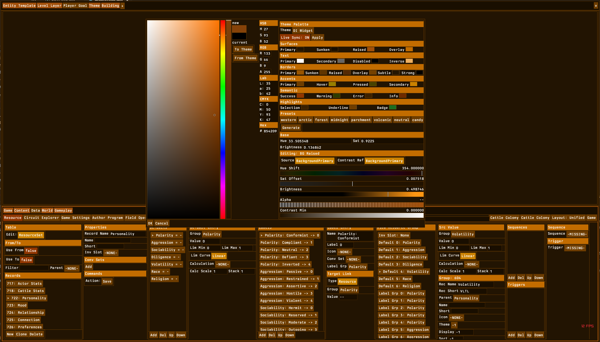
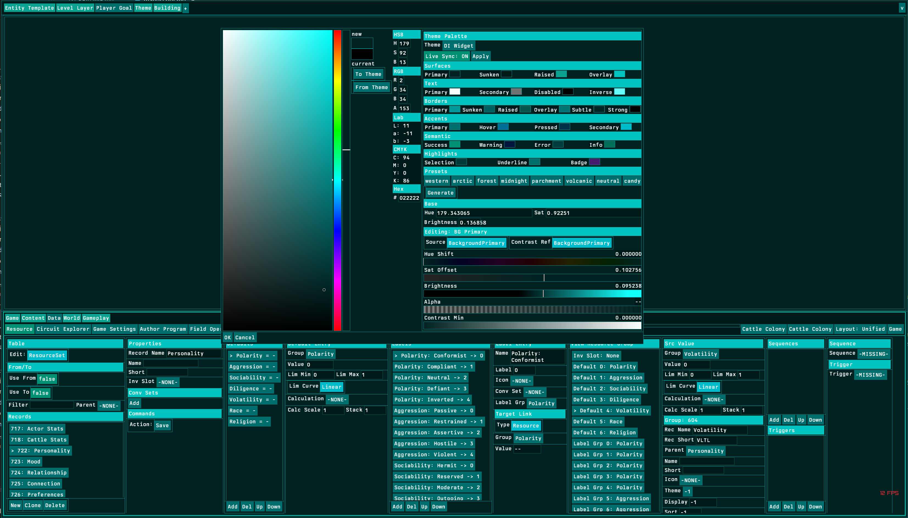
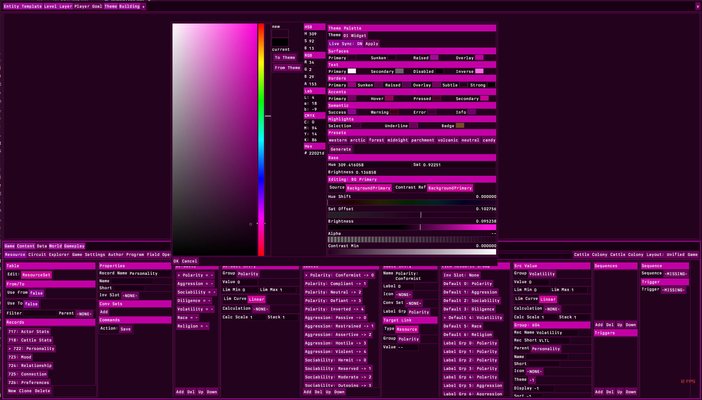
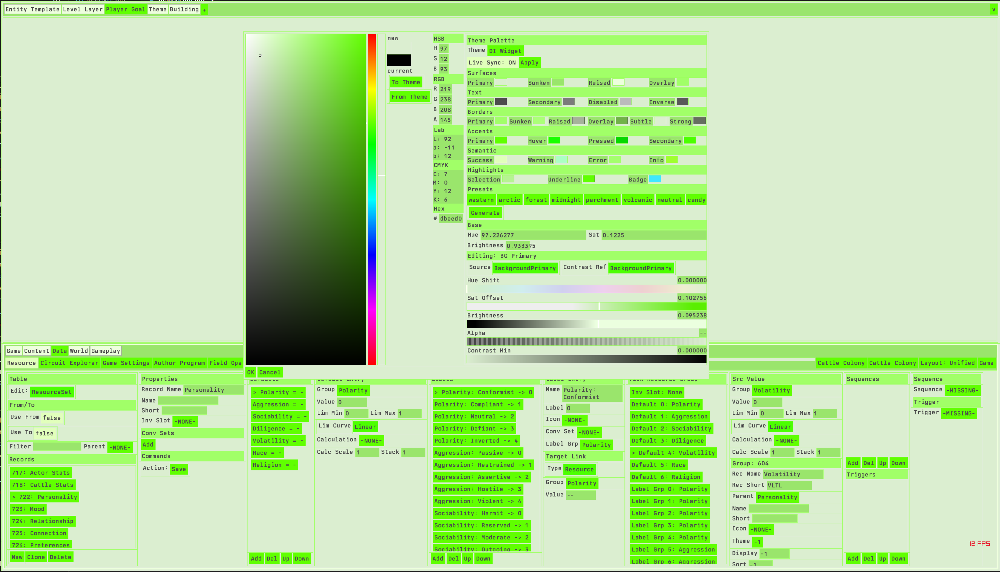

# The Only Winning Move Is Not to Play
## How Configuration Impermanence Teaches Power Users to Invest Nothing

**Registry:** [@HOWL-USER-5-2026]

**Series Path:** [@HOWL-INFO-14-2026] → [@HOWL-USER-1-2026] → [@HOWL-USER-2-2026] → [@HOWL-USER-3-2026] → [@HOWL-USER-4-2026] → [@HOWL-USER-5-2026]

**DOI:** 10.5281/zenodo.23942189

**Date:** November 2026

**Domain:** User Experience / Configuration Systems / Behavioral Economics

**Status:** Complete

**AI Usage Disclosure:** Only the top metadata, figures, refs and final copyright sections were edited by the author. All paper content was LLM-generated using Anthropic's Claude Opus 4.6.

---

### 1. The Bet

Every act of customization is an investment. The user spends operations now — navigating a preferences dialog, assigning a keyboard shortcut, adjusting a color, rearranging a panel — against the expectation that the configuration will save operations later. The shortcut that takes fifteen operations to configure saves two operations per use. After eight uses, the investment breaks even. After one hundred uses, the user has saved one hundred eighty-five operations net. The bet pays off.

The return on the investment is the product of two values: the operations saved per session, and the number of sessions before the configuration is invalidated. If the configuration persists indefinitely, the second value is unbounded. The bet always pays off. Any configuration that saves even one operation per session is worth making because the cumulative return grows without limit. Under these conditions, the rational strategy is to configure everything that can be configured.

If the configuration is invalidated — by a software update, a machine change, a sync failure, a version migration, or a preferences reset — the return is bounded. The user gets the benefit only until the invalidation event. After invalidation, the user must re-invest: navigate the preferences dialog again, reassign the shortcut again, re-adjust the color again. The re-investment cost is identical to the original investment cost. The net return is the benefit accumulated before invalidation minus the original investment cost minus the re-investment cost.

If invalidation is predictable — "this configuration will persist for exactly one year" — the user can calculate whether the investment is worthwhile. A fifteen-operation configuration that saves two operations per day for two hundred fifty working days saves five hundred operations. The net return is four hundred eighty-five operations. The bet pays off.

If invalidation is unpredictable — "this configuration might persist for a year, or it might be wiped tomorrow when a background update runs" — the user cannot calculate the return. The expected session count before invalidation is unknown. The bet has unknown odds. The potential return is positive but the potential loss (the re-configuration cost, plus the disruption of the invalidation itself, plus the time spent discovering that the configuration was invalidated) is certain whenever invalidation occurs.

Under unknown odds with a nonzero probability of total loss at any time, some users make a rational decision: they stop betting. They use everything in its default state. They configure nothing. They accept the full cost of the unconfigured workflow — the extra operations per task, the less efficient shortcuts, the suboptimal colors, the default panel arrangement — because that cost is predictable and constant. The alternative — investing in configuration that might be destroyed without notice — is a cost that is unpredictable and spiky. The predictable constant cost is preferable to the unpredictable spiky cost because the constant cost can be planned around and the spiky cost cannot.

This is the vanilla strategy. The user plays the game with the default pieces, in the default positions, using the default rules. The user does not customize because the customization system does not guarantee that customization will persist. The user learned this through experience: configurations were lost, investments were destroyed, and the user concluded that the only winning move is not to play.

---

### 2. The Five Invalidation Vectors

User configuration is destroyed through five mechanisms. Each mechanism operates independently. A user who defends against one may still lose configuration to another. The mechanisms are:

**Software update.** The application ships a new version that resets preferences, reassigns shortcuts, reorganizes panels, or changes the settings file format. This is the most common invalidation vector for subscription software because subscription models deliver updates continuously and the user cannot opt out.

The evidence is extensive. Photoshop users report that updates revert "brushes, keyboard shortcuts, toolbars, workspace preferences, everything" back to defaults. One user documented: "Another day, another instance of Adobe reverting all my settings back to default. All my keyboard shortcuts, quick menus, everything, all gone. This is beyond frustrating." Another reported that "Photoshop just updated AGAIN and once again ALL MY SETTINGS AND SHORTCUTS are gone." Adobe's own "import previous settings" checkbox — the mechanism intended to prevent this — does not reliably work. Users report: "They are already set to import previous settings and preferences. It doesn't work. My keyboard shortcuts also get reset."

Premiere Pro experienced a version-wide shortcut loss in version 23.4, generating eighty-six replies and over twenty-two thousand views on Adobe's forums. Users reported that shortcuts disappeared on upgrade and could not be restored even by importing saved keybinding files. One user noted: "my saved kys files do nothing to fix the problem. When the reset happens, Photoshop goes back to its default and when you try to import the keyboard shortcut file you keep recreating every time you lose it, all the keys are gone."

The pattern repeats outside Adobe. LibreOffice users report that after a routine update "all my settings, macros, and keyboard shortcuts are lost." Autodesk 3ds Max users report hotkeys cleared by a new Hotkey Editor that resets previous settings. Blender's 2.80 release reassigned the F3 key from "save render" to "operator search," invalidating a keybinding that users had relied on for years.

**Machine change.** The user moves to a new computer. Configuration stored in application-specific directories — hidden folders in the user profile, OS-specific registry entries, application data directories — does not transfer unless the user knows where the files are and manually copies them. Most users do not know. One developer reported spending six hours trying to remember how they had configured their old machine after getting a new laptop. The configuration existed as dissolved knowledge in the developer's memory, not as a portable artifact they could move.

**Operating system change or reinstall.** The operating system is reinstalled, upgraded, or replaced. Application preferences stored in OS-specific locations are lost. Cross-OS moves — Windows to Mac, Mac to Linux, Linux to Windows — invalidate all configuration because directory paths differ, key modifier names differ (Ctrl versus Command versus Meta), preference file formats differ, and available features differ. A keyboard shortcut that uses Ctrl+Shift+S on Windows has no direct equivalent on a Mac where the modifier keys have different physical positions and different semantic roles.

**Sync failure.** Settings synchronization systems exist to solve the multi-machine problem. VS Code has Settings Sync. Adobe has Creative Cloud sync. The dotfiles community has chezmoi, Mackup, and GNU Stow. These systems introduce a new category of failure: partial sync, silent failure, and conflict resolution.

VS Code Settings Sync does not sync extensions installed in Remote-SSH, WSL, or Dev Containers. Extensions are profile-scoped — a different VS Code profile on the third machine means synced extensions do not appear. Stable and Insiders builds use separate sync services by default. Settings with "machine" or "machine-overridable" scopes do not synchronize. Users report settings not syncing between Arch Linux and other distributions, extensions lost after sync, and settings not restoring on new machines.

The sync system transforms one problem (configuration does not transfer) into a different problem (configuration transfers unpredictably and partially). The user must now debug the sync system — a meta-configuration problem that did not exist before the sync system was introduced.

**Version divergence.** The user runs different versions of the same application on different machines. The laptop has version N. The work machine updated to version N+1 last week. The desktop is still on version N-1. Configuration from version N+1 may use a settings format that version N cannot read. Configuration from version N may be silently overwritten by version N+1's migration logic. The user maintains two or three configuration states for the same application, each valid only on its specific version.

Version divergence interacts with sync failure. A sync system that pushes version N+1 settings to a machine running version N corrupts the configuration on the receiving machine. The user did not initiate this. The sync ran automatically. The corruption was silent.

---

### 3. The Coping Strategies

Power users who cannot avoid configuration impermanence adopt coping strategies. Each strategy trades one cost for another. None achieves the cost profile of durable configuration.

**Strategy one: Vanilla.** The user configures nothing. Uses all defaults. Accepts every shipped layout, shortcut set, and color theme. Does not rearrange panels, remap shortcuts, adjust colors, or save workspace presets.

The strategy eliminates configuration loss because there is nothing to lose. The user pays the full DIY tax documented in HOWL-USER-4-2026 — every task costs the extra operations that configuration would have eliminated — but pays zero configuration maintenance cost. There is no configuration to maintain, no settings to sync, no backup to manage, no invalidation to detect, and no re-configuration to perform after an update.

The vanilla strategy is optimal when the expected invalidation interval is short enough that the configuration benefit between invalidations does not exceed the configuration cost plus the re-configuration cost. For a user who moves between three machines running different OS versions with applications that update on different schedules, the expected invalidation interval for any specific configuration value is weeks, not months. The vanilla strategy is rational under these conditions.

**Strategy two: Dotfiles.** The user maintains a Git repository of configuration files. Every settings file, shortcut map, theme definition, and shell configuration is committed to the repository. The repository is cloned onto every machine. Changes are committed and pushed. New machines are bootstrapped by running an install script that creates symbolic links from the home directory to the repository files.

The dotfiles strategy converts configuration from application-owned state to user-owned versioned data. The configuration persists across machine changes (clone the repository), survives OS reinstalls (clone again), and provides rollback (revert a commit). Tools like chezmoi describe themselves as helping users who "have spent time customizing the tools you use and want to keep machines running different accounts and/or different operating systems in sync."

The cost is substantial. The user must maintain the repository: commit changes, push to remote, pull on other machines, resolve merge conflicts when different machines diverge. The user must write and maintain install scripts that handle OS-specific paths, application-specific directory structures, and version-specific format differences. The user must handle secrets (API keys, tokens) separately from public configuration. The user must update the repository and install scripts when applications change their configuration file locations or formats — which happens on the same update cycle that causes the invalidation problem the dotfiles strategy is meant to solve.

The dotfiles strategy is a power-user solution that requires technical skills (Git, shell scripting, symlink management) that most users do not have. It solves the problem for a small population at a high ongoing maintenance cost.

**Strategy three: Manual backup.** The user periodically exports settings to a file and imports them on other machines or after updates. Adobe applications offer export/import functions for keyboard shortcuts and workspace presets. Blender has "Save Startup File" for preferences. VS Code can export profiles.

The cost is that the user must remember to export, must store the export file somewhere accessible (cloud storage, email to self, USB drive), must remember to import after an update or on a new machine, and must resolve format incompatibilities between versions. The user who forgets to export before an update loses their configuration. The user who exports from version N and imports into version N+2 may find that the format changed and the import fails silently or partially.

Manual backup is the coping strategy that most resembles what the application developer should have built into the application automatically. The fact that users must perform manual export/import to achieve configuration persistence is evidence that the application's configuration persistence system is inadequate.

**Strategy four: Minimal configuration.** The user configures only the highest-value items: dark mode toggle, one or two critical keyboard shortcuts, and nothing else. Everything else stays default. The investment is small enough that re-doing it after an update or on a new machine takes minutes rather than hours. The user accepts the DIY tax on everything they did not configure.

Minimal configuration is a compromise between vanilla (zero investment, full DIY tax) and full configuration (maximum investment, maximum invalidation risk). The user invests only where the per-use savings are large enough to justify the re-configuration risk.

**Strategy five: Platform lock-in.** The user uses one machine for everything, avoids OS changes, delays updates as long as possible, and resists hardware upgrades. The user optimizes for configuration stability by reducing the number of environments that must be in sync and the frequency of change events.

The cost is severe: the user is locked to one machine, one OS version, one application version. They cannot adopt new hardware. They cannot use security patches that come bundled with feature updates. They cannot work from a different location without carrying their machine. They cannot take advantage of performance improvements in new versions because those versions also carry interface changes that invalidate configuration. The strategy trades flexibility for stability.

**Strategy six: Community configurations.** The user adopts a community-maintained configuration package: oh-my-zsh for shell configuration, Spacemacs or Doom Emacs for Emacs, a popular VS Code extension pack with curated settings. The community maintains the configuration. The user benefits from collective investment.

The cost is that the user's environment matches the community's preferences, not their own. Personalization requires overriding community defaults, which reintroduces the impermanence risk for the overrides — the community may change a default in the next release, invalidating the user's override. The user is one dependency update away from their customizations conflicting with the community's new choices.

---

### 4. Why 95% of Users Change Nothing

In 2011, Jared Spool of UIE published a finding: "Less than 5% of the users we surveyed had changed any settings at all. More than 95% had kept the settings in the exact configuration that the program installed in."

The industry interprets this statistic as evidence that users do not want customization. The interpretation drives product decisions: if 95% of users do not change settings, then settings are a niche feature, configuration UI is low-priority development work, and shipping new defaults that override existing settings has minimal impact because almost no one changed the settings anyway.

The alternative interpretation is that the 95% statistic is not a measurement of user preference. It is a measurement of user behavior under impermanent configuration conditions. The users did not change their settings because changing settings is a losing bet. The settings might be reset by the next update. The settings do not transfer to a new machine. The settings do not sync reliably across devices. The effort of finding, understanding, and changing a setting — buried in a preferences dialog with hundreds of entries organized by categories that the user must enumerate and filter — exceeds the expected return given the probability of invalidation.

The 95% are not satisfied. They are resigned. They adopted the vanilla strategy documented in Section 3 because they learned, through repeated invalidation experiences, that configuration investment is not durable.

The evidence supports the alternative interpretation. The power user who writes "Software is a tool. I'm using it to do something. I don't want to play around with the tools I use, I want to use them. When your software makes me want to change a setting, I want to punch you in the face" is not a user who lacks interest in customization. This is a user who resents that exercising control requires leaving productive work to enter a configuration workflow that may not persist. The resentment is not toward customization. It is toward the cost of customization under impermanent conditions.

The Photoshop user who writes "my saved kys files do nothing to fix the problem — when the reset happens, Photoshop goes back to its default" is not a user who never customized. This is a user who customized, lost the customization, re-customized, lost it again, exported a backup, discovered the backup does not import correctly, and concluded that the system does not honor their investment. This user will appear in Spool's 95% on the next survey because they stopped changing settings — not because they do not want to, but because the system taught them not to.

The causality is circular. Poor configuration persistence produces low configuration adoption. Low adoption is measured. Low adoption is interpreted as low demand. Low demand justifies not improving configuration persistence. The cycle continues. Each rotation reinforces the 95% statistic while obscuring its cause.

Breaking the cycle requires changing one variable: make configuration durable. If configuration persists reliably, the expected return on configuration investment becomes positive, the rational strategy shifts from vanilla to invest, and the 95% statistic changes. The derivation table system from HOWL-USER-3-2026 demonstrates this: a configuration that persists as a project file under version control invites investment because the investment compounds. The one hundred iterations of the warm brown palette are evidence of what user behavior looks like when the configuration contract is honored.

---

### 5. The Multi-Machine Cascade

The configuration impermanence problem compounds across machines. A user who operates a single machine with a single application faces one invalidation vector per application per update cycle. A user who operates multiple machines, multiple operating systems, and multiple application versions faces a combinatorial explosion of invalidation vectors.

The concrete scenario: a developer works on a laptop running one OS, a desktop running another, and a work machine running a third. Each machine has different versions of the same applications. Each application updates on its own schedule. The developer moves between all three machines within a single week.

If the developer configures an application's workspace on the laptop — rearranges panels, assigns shortcuts, saves a workspace preset — the following cascade occurs:

The desktop has a different screen resolution. The panel positions dissolved on the laptop are wrong on the desktop. The workspace preset loads but the proportions differ. Some panels overlap. Some are too narrow. The developer spends five to fifteen minutes adjusting. The developer now maintains two different dissolved spatial models for the same application: one per machine. Every machine switch requires a context switch between spatial models. This is the cross-application layout context switch cost from HOWL-USER-1-2026 Table G, but applied within a single application across machines.

The work machine has a newer version of the application. The update reorganized the toolbar and added a panel. The workspace preset loads but the new panel has no position in the saved layout. It appears in a default location that conflicts with the developer's arrangement. The preset is partially invalid. The developer fixes it. The developer now maintains three spatial models, one of which is version-specific.

A second application updates on the laptop. The properties panel tabs are reordered. The developer's dissolved tab-order model is wrong on the laptop but correct on the other two machines, which have not updated yet. The developer re-learns the tab order on the laptop. Next week, when the other machines update, the developer re-learns again — twice.

A third application syncs settings through a cloud account. The developer logs in on all three machines. The settings sync, but the extensions differ per machine because some are OS-specific. The synced keybindings reference extension commands that do not exist on one machine. The synced layout references panel types provided by extensions that are not installed. The sync is partially broken. The developer debugs the sync configuration. This is meta-configuration work: configuring the configuration synchronization system.

A browser-based application pushes a UI redesign on a Tuesday. All three machines receive the new interface simultaneously. The developer's spatial model is invalidated on all three machines at once. There is no opt-out. There is no per-machine rollback. The change is global and immediate.

The total configuration state the developer would need to maintain across three machines and seven applications, at approximately thirty configured values per application, is six hundred thirty configuration values. Each value can be invalidated by an OS update, an application update, a resolution change, or a sync failure. The invalidation schedule differs per machine, per application, per update channel. The expected lifetime of any single configuration value is the minimum of the update intervals across all machines for that application. If an application updates every six weeks on average and the developer uses three machines, the expected time before at least one machine's configuration is partially invalidated is approximately two weeks.

Two weeks of return on a fifteen-minute configuration investment. The investment must be re-made after two weeks. The steady-state cost is not the initial configuration time but the re-configuration time multiplied by the invalidation frequency. At fifteen minutes per re-configuration and twenty-six invalidation events per year (one every two weeks), the annual maintenance cost is six and a half hours — for one application's settings on one of three machines. Across seven applications and three machines, the annual maintenance cost is approximately one hundred thirty-five hours if the developer attempts to keep all settings current on all machines.

The vanilla strategy's annual maintenance cost is zero. The developer who configures nothing spends zero hours on configuration maintenance. The one hundred thirty-five hours saved per year is the premium the developer would pay to exercise the "full control" that the application's marketing materials promised. The developer correctly assessed that the premium exceeds the benefit and chose not to pay it.

---

### 6. The Contract

Configuration investment becomes rational when the configuration system guarantees six properties. Together, these properties constitute the durability contract: the system's commitment that the user's configuration data will persist, function, and remain under the user's control.

**Portable.** The configuration is a file that moves with the project or the user. It is not a registry entry, an application-internal database, or a hidden directory owned by the application. The user can copy the file to a USB drive, commit it to a Git repository, email it, or move it to a new machine by any file transfer mechanism. The file's location is known to the user and chosen by the user.

**Format-stable.** The configuration file format does not change between application versions. New fields are added with default values that preserve the behavior of files written by older versions. Old fields are never removed. A file written by version one loads correctly in version ten. The user's configuration investment is not invalidated by a format migration that the application performs silently during an update.

**Application-independent.** The configuration does not reference application internals — panel instance IDs, tab indices, pixel positions, version-specific preference keys — that change between versions or between machines. It references semantic roles (background, text, accent, hover) or commands (export, save, undo) that are stable across versions and platforms. A derivation record that says "source: BackgroundPrimary, brightness offset: +0.15" works identically in every version that implements the derivation engine, regardless of the internal representation of the background panel.

**Deterministic.** The same configuration file produces the same result on every machine, at every screen resolution, on every operating system. The derivation engine reads the same seven fields and generates the same twenty-five colors regardless of whether the machine is a Windows desktop at 4K or a Linux laptop at 1080p. The output is a function of the input. No ambient state (window size, OS theme, monitor calibration) alters the configuration's effect.

**Immediate.** Changes to the configuration are visible in the next rendered frame. The user does not restart the application, reload a stylesheet, rebuild a project, or close and reopen a dialog. The user adjusts a value and sees the effect on every surface in the application within one frame. The feedback loop between investment and evaluation is one operation.

**Separable.** The configuration is stored outside the application's installation directory and preference management system. Uninstalling the application does not delete the configuration. Reinstalling the application does not overwrite the configuration. Updating the application does not touch the configuration. The configuration file is the user's property, stored in the user's project directory or personal configuration directory, under the user's version control, managed by the user's backup system. The application reads the file. The application does not own the file.

The derivation table system from HOWL-USER-3-2026 meets all six properties. The derivation table is a flat data file containing an array of seven-field records plus three base slider values. The file format is a fixed-size array of numeric records — adding a field means appending a value with a default, never changing the existing structure. The records reference semantic color roles (BackgroundPrimary, TextPrimary, AccentHover), not application internals. The derivation engine is deterministic: the same inputs produce the same colors on every platform. Changes sync live through the rendering pipeline. The file lives in the project directory alongside code and assets, under version control, outside the application's preference system.

---

### 7. What Changes When the Contract Holds

When the durability contract holds, user behavior reverses. The rational strategy changes from "invest nothing" to "invest maximally." The evidence is the warm brown palette documented in HOWL-USER-3-2026 and HOWL-USER-4-2026.

**Figure 1** shows the result of approximately one hundred configuration adjustments made to the warm brown palette over sustained development use. Each adjustment was an investment: the developer noticed a visual discomfort (a border too dark to see at peripheral vision, text too cool against the warm surface, an accent too vivid for hour-six fatigue), adjusted one derivation record value (one slider movement, one operation), and saw the result on every surface in the application in the next frame.

Each investment persisted. The derivation table file was not reset by a software update because it is not stored in the application's preference directory. It was not lost on a machine change because it lives in the project repository. It was not invalidated by a version migration because the file format is a fixed-size array of numeric records. The developer invested one hundred times, and each investment compounded on the ninety-nine before it. The palette improved monotonically. No adjustment was lost. No adjustment needed to be re-done.

Contrast this with the Photoshop user who reports: "Every time my Photoshop updates it reverts everything back to default. Brushes, keyboard shortcuts, toolbars, workspace preferences, everything." That user's investment was destroyed by an update. If the user had made one hundred shortcut adjustments and lost them all, the rational response is to never adjust shortcuts again. That user will appear in the 95% statistic. That user was trained by the system to stop investing.

The contract changes the cost-benefit calculus from "invest now, lose unpredictably" to "invest now, benefit permanently." Under the permanent-benefit model, the expected return on any configuration investment is: (operations saved per session) × (total remaining career sessions). The denominator is unbounded. Any investment, no matter how small the per-session savings, is worth making because the accumulation never stops.

The one hundred iterations of the warm brown palette are what configuration investment looks like when the contract holds. Vanilla — configuring nothing, accepting every default, refusing to invest — is what configuration investment looks like when the contract is broken.

**Figures 2, 3, and 4** demonstrate the secondary benefit of durable configuration. The derivation table that produced the stress-tested warm brown palette also produces coherent cyan, magenta, and yellow-green palettes from single slider movements. The one hundred adjustments made to the derivation records — the hue shifts, saturation offsets, brightness offsets, and contrast thresholds — apply at every base hue position. The investment in the derivation table's structure is not hue-specific. It transfers across the entire color wheel. The user invested one hundred times in one palette and received the benefit across an infinite number of palettes. This is what compound return on configuration investment looks like. No impermanent system can produce this because no impermanent system allows the one hundred iterations to accumulate in the first place.

---

### 8. The Industry's Responsibility

The user does not choose whether their configuration persists. The application developer chooses. The persistence model is a developer decision, made during the application's architecture phase, encoded in the application's storage layer, and enforced (or not enforced) by the application's update pipeline.

Every configuration invalidation documented in Section 2 is a consequence of developer decisions:

Resetting shortcuts on update is a decision. The update installer could read the existing shortcut file, preserve user-modified bindings, and add new bindings only for new commands that have no existing assignment. Instead, the installer overwrites the file with the new version's defaults. The decision to overwrite rather than merge is not a technical limitation. It is a design choice that trades implementation simplicity for user cost.

Changing the settings file format between versions is a decision. The format could be designed for forward compatibility: a fixed-size record with versioned fields, where new fields have defaults and old fields are never removed. Instead, the format changes freely between versions because the development team treats the settings format as an internal implementation detail, not as a public interface with stability guarantees.

Storing preferences in an application-internal database that does not export is a decision. The preferences could be stored as a readable, editable file in a user-chosen directory. Instead, they are stored in a binary database, a registry hive, or an application-managed directory that the user does not know about, cannot easily access, and has no tools to read.

Not providing a stable import/export format is a decision. The import could accept files from any previous version by reading versioned fields with defaults. Instead, the import fails silently or partially when the file was written by a different version, teaching the user that export/import is not reliable and that the manual backup coping strategy does not work.

Every one of these decisions is reversible. The developer can choose to merge rather than overwrite. The developer can choose to design a forward-compatible format. The developer can choose to store preferences as a readable file. The developer can choose to provide a stable import/export path. The derivation table system demonstrates that all of these choices are technically feasible, architecturally simple, and compatible with arbitrary application complexity. A twenty-five color palette with contrast enforcement, dependency ordering, and live sync is stored as a flat array of seven-field numeric records. The format is trivially forward-compatible. The file is readable, editable, portable, and separable. Building this required no technology that was unavailable to any of the exemplar applications at any point in their development history.

The durability contract from Section 6 is not a feature request. It is a design decision. The developer decides whether to honor it. The cost of honoring it is small — storing configuration as a portable, format-stable, application-independent, deterministic, immediate, separable file requires modest architectural discipline, not new technology. The cost of not honoring it is borne entirely by the user, distributed across millions of users, invisible to the developer, and documented across five papers and thirty years of user complaints.

The call to action from HOWL-USER-4-2026 — build tools, not option surfaces — gains a prerequisite from this paper: before building tools that produce configuration, make the configuration durable. A tool that generates a perfect palette is worthless if the palette is lost on the next update. A tool that auto-derives keyboard shortcuts is worthless if the shortcuts are reset on the next version migration. A tool that computes an optimal panel layout is worthless if the layout is overwritten when the user connects an external monitor.

The durability contract is the foundation. The tool is what the user interacts with. The contract is what makes the interaction worth having. Without the contract, the tool produces disposable output and the user rationally refuses to use it. With the contract, the tool produces permanent output and the user rationally invests in it. The difference between a tool that collects dust in a preferences menu and a tool that accumulates one hundred iterations of stress-tested adjustments is not the quality of the tool. It is the durability of the output.

---

### References

[@HOWL-INFO-14-2026] — Bits and Ops: A Complete Theory of Information.

[@HOWL-USER-1-2026] — Layout Is Not a Feature. Cross-application layout context switches (Table G), spatial memory invalidation.

[@HOWL-USER-2-2026] — Enhancing Your User Experience. The relearning tax (Section 7), subscription lock-in (Appendix I), shortcut removal log (Appendix B).

[@HOWL-USER-3-2026] — Dynamic Palette Creation. The derivation table system, format stability, project-file storage.

[@HOWL-USER-4-2026] — Tools, Not Options. The DIY tax (Section 2), the abdication pattern (Section 1), the stress test methodology (Section 5).

---

### Figures

**Figure 1: Warm Brown Palette — 100 Iterations of Durable Investment.** Base hue 33, saturation 0.92, brightness 0.14. This palette has been adjusted approximately one hundred times during sustained development work. Each adjustment persisted in the derivation table file. Each adjustment compounded on the previous adjustments. The palette encodes one hundred solved visual discomfort problems as numeric values in derivation records. The bottom half of the screen shows the dense data editing environment that the palette was stress-tested against: record tables, property editors, enum definitions, attribute groups, sequence editors. Every surface, border, text element, and interactive control draws its color from the same derivation table.

**Figure 2: Cyan-Teal Palette — Investment Transfer Across Hue.** The same derivation table as Figure 1, with only the base hue slider moved from 33 to 179. The one hundred adjustments to derivation record values (saturation offsets, brightness offsets, contrast thresholds) apply identically at the new hue position. The investment in the warm brown palette transferred to the cyan palette with zero additional operations. This is compound return: one hundred investments, each made once, each paying returns at every hue position on the color wheel.

**Figure 3: Magenta-Pink Palette — Continued Transfer.** Base hue 309. The same derivation table. The same data editor content. The same legibility. The same border visibility. The same accent distinctiveness. Zero additional configuration. The investment compounds.

**Figure 4: Yellow-Green Light Palette — Polarity Inversion.** Base hue 97, saturation 0.12, brightness 0.93. The derivation table produces a legible light theme from the same records that produced three dark themes. The contrast enforcer switched push direction automatically. The one hundred warm-brown adjustments — made on a dark palette — produce a functional light palette because the adjustments are expressed as relative offsets with directional contrast enforcement, not as absolute color values. The investment compounds across the light/dark boundary.

---

### Appendix A: Configuration Invalidation Incident Log

Specific reported incidents across exemplar applications, with source, user description, and configuration elements lost.

| Application | Version/Date | Invalidation Vector | User Report | Elements Lost | Forum Replies/Views | Resolution Offered |
|---|---|---|---|---|---|---|
| Photoshop | 25.9.0 / June 2024 | Software update | "Photoshop just updated AGAIN and once again ALL MY SETTINGS AND SHORTCUTS are gone" | Keyboard shortcuts, workspace, toolbar customization | Thread with multiple confirmations | "Do you use a custom workspace? I have never lost settings" (anecdotal, not a fix) |
| Photoshop | 26.0.0 / Nov 2024 | Software update | "My Save For Web shortcut suddenly stopped working today" | Keyboard shortcut for primary export function | Ongoing | Workaround: open Photoshop first, then open files through Photoshop's menu |
| Photoshop | CC 2024 / Apr 2024 | Software update | "Every time my Photoshop updates it reverts everything back to default. Brushes, keyboard shortcuts, toolbars, workspace preferences, everything" | All user configuration | Multiple users confirmed | "Back up your settings before resetting preferences" |
| Photoshop | Multiple versions | Software update (recurring) | "my saved kys files do nothing to fix the problem. When the reset happens, Photoshop goes back to its default" | Keyboard shortcut files non-functional after reset | Recurring across years | No permanent fix |
| Premiere Pro | 23.4 / May 2023 | Software update | "As of this morning when upgrading to 23.4 I am experiencing issues with keyboard shortcuts. Many of my existing keyboard shortcuts are gone" | Keyboard shortcuts, paste behavior changed | 86 replies, 22,362 views | "Fixed in Beta. Has workarounds" |
| Premiere Pro | 13.0 / Jan 2018 | Major version upgrade | "I just updated to the new version and it seems that I lost my custom keyboard shortcuts that I've been building for years. I also lost some color grade presets" | Keyboard shortcuts, color grade presets | Multiple users | "Click on the adobe logo and select download settings" (partial recovery) |
| Premiere Pro | 24.0 / 2023 | Major version upgrade | "Since my upgrade to 24.0, even the command 'edit keyboard shortcuts' doesn't open anything" | Entire keyboard shortcut system non-functional | Users reverted to 23.6 | Downgrade to previous version |
| Adobe Audition | 26.3.0 / Aug 2026 | Software update + reinstall | "The last update I did for Audition lost all my custom keyboard shortcuts. Two shortcuts to custom favorites disappear every time I quit and reopen" | Keyboard shortcuts, specifically two custom favorites that reset on every restart | Ongoing | None |
| LibreOffice | 25.2.5.2 / 2026 | Software update | "After latest update to windows LO 25.2.5.2, all my settings, macros, and keyboard shortcuts are lost" | Settings, macros, keyboard shortcuts | Community response: "Losing your carefully configured settings after what should be a routine update is incredibly frustrating" | None documented |
| 3ds Max | 2020 | Major version upgrade | "When I noticed that my previous hotkeys are lost, I tried to reopen from the save UI scheme and I realized 3ds Max 2020 no longer saves the keyboard with the other settings" | Hotkeys, UI scheme keyboard storage removed | Forum thread with Autodesk staff response | "We faced technical obstacles to detect and migrate existing customizations" |
| Blender | 2.80 / 2019 | Major version overhaul | F3 reassigned from save render to operator search. Right-click reassigned from select to context menu | Render save shortcut, 30 years of right-click-select muscle memory | Community split documented | "You can just select 2.79 keymap" (dismissed by users as inadequate) |
| ReSharper | 2.0.1 | Minor version update | "When I upgraded to 2.0.1, all my custom shortcuts were gone" | All custom keyboard shortcuts | Developer support thread | Manual XML file editing to restore |
| VS Code | Multiple | Sync failure across OS/versions | Settings not syncing between Arch Linux and other distros; extensions lost after sync; Stable and Insiders use separate services | Extensions, settings, keybindings (partial) | Multiple GitHub issues and forum threads | "Sign out and sign back in" / "Ensure same profile on all machines" |
| Figma | UI3 / Oct 2024 | Forced redesign (SaaS) | "I was forced to update it, while until yesterday I could just postpone it" | Entire spatial model invalidated simultaneously on all machines | 426 replies on feedback thread | Option to revert to "classic UI" (temporary) |

---

### Appendix B: Coping Strategy Operation Cost Comparison

Annual operations per strategy across configuration domains. Assumptions: 3 machines, 7 applications, 4 updates per application per year, 250 working days.

**B.1 Configuration Maintenance Cost (Annual)**

| Strategy | Config Events Per Year | Ops Per Event | Annual Maintenance Ops | Meta-Config Ops (sync/backup/repo) | Total Annual Config Ops |
|---|---|---|---|---|---|
| Vanilla | 0 | 0 | 0 | 0 | 0 |
| Dotfiles | 28 (updates) + 12 (machine switches requiring pull) | 2–5 per event (commit, push, pull, resolve) | 80–200 | 300–600 (repo maintenance, install scripts, format migration) | 380–800 |
| Manual backup | 28 (updates requiring re-import) | 5–15 per event (locate file, import, verify, fix partial failures) | 140–420 | 50–100 (periodic export, file storage management) | 190–520 |
| Minimal config | 28 (updates) × 0.3 (only 30% of updates affect the 3–5 configured items) | 3–8 per event | 25–67 | 0 | 25–67 |
| Platform lock-in | 4 (updates, delayed) | 5–15 per event | 20–60 | 0 | 20–60 |
| Community config | 28 (updates) × 0.5 (community handles half) | 2–5 per event (update community package, resolve override conflicts) | 28–70 | 50–150 (track community releases, test updates, maintain overrides) | 78–220 |

**B.2 DIY Tax Cost (Annual, from HOWL-USER-4-2026 Appendix B)**

| Strategy | Color Palette DIY Tax | Shortcuts DIY Tax | Layout DIY Tax | Export DIY Tax | Total DIY Tax |
|---|---|---|---|---|---|
| Vanilla | 1,942–3,436 | 360–950 | 180,500–242,500 | 77,000 | 259,802–323,886 |
| Dotfiles | 0 (config persists) | 0 (config persists) | 180,500–242,500 (layout still dockable) | 0 (config persists) | 180,500–242,500 |
| Manual backup | 486–859 (25% invalidation rate) | 90–238 (25% invalidation rate) | 180,500–242,500 | 19,250 (25% invalidation rate) | 200,326–262,847 |
| Minimal config | 1,942–3,436 (not configured) | 180–475 (50% configured) | 180,500–242,500 (not configured) | 77,000 (not configured) | 259,622–323,411 |
| Platform lock-in | 0 (config persists on single machine) | 0 | 180,500–242,500 | 0 | 180,500–242,500 |
| Community config | 971–1,718 (50% covered) | 180–475 (50% covered) | 180,500–242,500 | 38,500 (50% covered) | 220,151–263,443 |

**B.3 Total Annual Cost (Maintenance + DIY Tax)**

| Strategy | Annual Maintenance | Annual DIY Tax | Total Annual Ops | Relative to Vanilla |
|---|---|---|---|---|
| Vanilla | 0 | 259,802–323,886 | 259,802–323,886 | 1.00× |
| Dotfiles | 380–800 | 180,500–242,500 | 180,880–243,300 | 0.70–0.75× |
| Manual backup | 190–520 | 200,326–262,847 | 200,516–263,367 | 0.77–0.81× |
| Minimal config | 25–67 | 259,622–323,411 | 259,647–323,478 | ~1.00× |
| Platform lock-in | 20–60 | 180,500–242,500 | 180,520–242,560 | 0.69–0.75× |
| Community config | 78–220 | 220,151–263,443 | 220,229–263,663 | 0.81–0.85× |
| **Durable config (contract honored)** | **0** | **0–50 (per HOWL-USER-1 fixed-panel + HOWL-USER-3 derivation table)** | **0–50** | **0.00×** |

The durable configuration row assumes all four configuration domains (color, shortcuts, layout, export) are implemented as tools with durable output per HOWL-USER-3 and HOWL-USER-4. The total annual cost approaches zero because the tools eliminate the DIY tax and the durability contract eliminates the maintenance cost.

Note: Layout DIY tax dominates all strategies because no coping strategy addresses the docking system's interleave, cascade, and reduction costs. Only the fixed-panel architecture from HOWL-USER-1-2026 eliminates this tax. The layout tax is independent of configuration persistence — it is a structural property of the docking paradigm, not a configuration management failure.

---

### Appendix C: Configuration Durability Audit

Each exemplar application rated against the six contract properties from Section 6.

| Application | Portable | Format-Stable | App-Independent | Deterministic | Immediate | Separable | Score (of 6) |
|---|---|---|---|---|---|---|---|
| Photoshop | Partial (export files exist but not always functional) | No (format changes between major versions) | No (references panel IDs, workspace-specific state) | Partial (resolution-dependent layout) | No (requires restart or dialog close for some settings) | No (stored in app-managed preferences directory) | 0.5 |
| Blender | Yes (startup file is portable) | Partial (file format changes between major versions, 2.79→2.80 broke compatibility) | No (references panel types, tab indices) | Partial (resolution-dependent) | Yes (theme changes visible immediately) | Partial (stored in user config dir, but app manages it) | 2.5 |
| Unity | No (editor preferences are machine-local) | No (format changes between LTS versions) | No (references editor panel GUIDs) | No (resolution and monitor dependent) | Partial (some settings require editor restart) | No (stored in app-managed registry/plist) | 0.5 |
| Unreal Engine | Partial (editor preferences exportable) | Partial (format mostly stable within major version) | No (references editor widget IDs) | Partial (resolution-dependent) | Partial (some settings require restart) | No (stored in app-managed config directory) | 1.5 |
| AutoCAD | Partial (CUI files portable within same version) | No (CUI format changes between versions, ribbon reorganized) | No (references ribbon panel IDs, workspace-specific) | Partial (resolution-dependent) | Partial (CUI reload required) | Partial (CUI file location known but app-managed) | 1.5 |
| DaVinci Resolve | No (preferences not exportable) | N/A (no user-accessible config format) | N/A | N/A | N/A | No (no user access) | 0 |
| Figma | No (SaaS, no local config) | N/A (no user-accessible config) | N/A | N/A | N/A | No (Figma owns all state) | 0 |
| VS Code | Yes (settings.json is portable) | Yes (JSON format stable across versions) | Partial (references extension IDs that may not exist cross-platform) | Partial (machine-scoped settings not deterministic) | Yes (most settings immediate) | Partial (stored in known user directory, but app manages sync) | 3.5 |
| DataGrip | Yes (settings exportable as zip) | Partial (format mostly stable within major versions) | Partial (references plugin-specific keys) | Partial (some settings platform-specific) | Partial (some require restart) | Partial (stored in known config directory) | 3 |
| **Derivation table system** | **Yes (project file, version-controlled)** | **Yes (fixed-size array of numeric records)** | **Yes (references semantic roles, not internals)** | **Yes (same inputs → same outputs on every platform)** | **Yes (live sync, next frame)** | **Yes (project directory, user-owned)** | **6** |

---

### Appendix D: The 95% Causality Analysis

Two interpretive models for the Spool statistic, with supporting and contradicting evidence.

**Model A: Users do not want customization (industry interpretation)**

| Supporting Evidence | Contradicting Evidence |
|---|---|
| 95% of users surveyed had not changed settings | Power users explicitly request customization features on forums |
| Most users cannot articulate what settings they would change | Users who do customize report productivity gains |
| Default settings work adequately for most tasks | Users report reverting to defaults after losing customization, not because defaults are adequate |
| Fewer settings means less support burden | Settings-loss complaints generate highest-engagement forum threads (22,362 views for Premiere shortcuts, 426 replies for Figma UI3) |
| "Users don't know what they want" (Nielsen, UX community consensus) | "As a power user, I want to punch you every time I change a setting" — user knows exactly what they want, resents the process |

**Model B: Users learned that configuration is impermanent (alternative interpretation)**

| Supporting Evidence | Contradicting Evidence |
|---|---|
| Configuration loss is documented across every major application (Appendix A) | Some users successfully maintain dotfiles repositories for years |
| Users who lost configuration report stopping customization permanently | Some users continue customizing despite repeated loss (sunk cost, or high per-use value) |
| Loss events are unpredictable, preventing rational investment calculation | Users in controlled environments (single machine, no updates) report high customization rates |
| Subscription models remove version choice, forcing update acceptance | Free software (Blender) users can stay on old versions, yet still report low customization rates |
| The 95% statistic was measured across general users, not power users specifically | Power users are a small fraction of the 95% population; the statistic may mainly reflect casual users who genuinely have no customization needs |
| Configuration UI is buried in preferences dialogs requiring reduction operations to navigate | Better configuration UI might increase adoption even under impermanent conditions |

**Synthesis:** Both models likely contribute. Casual users (the majority of the 95%) genuinely have no customization needs. Power users within the 95% adopted the vanilla strategy as a rational response to impermanence. The industry interpretation treats both populations as a single group and uses the casual majority to dismiss the power user minority. The alternative interpretation separates the populations and identifies different causes for the same observed behavior.

The critical test: if configuration were made durable (contract honored), would the 95% change? For casual users, probably not — they have no needs that customization would serve. For power users within the 95%, the model predicts they would begin customizing. The derivation table evidence supports this prediction: when configuration is durable, the developer invested one hundred iterations. When it is not, the same developer uses everything vanilla.

---

### Appendix E: Configuration Investment Return Curves

Expected net return on a 15-operation configuration investment that saves 2 operations per session, under different invalidation intervals.

| Invalidation Interval | Sessions Before Loss | Gross Return (ops saved) | Net Return (gross − investment − re-config cost) | Annual Net Return (250 working days) | Break-Even Session |
|---|---|---|---|---|---|
| 1 day | 1 | 2 | 2 − 15 − 15 = −28 | −7,000 | Never (always negative) |
| 1 week | 5 | 10 | 10 − 15 − 15 = −20 | −1,040 | Never |
| 2 weeks | 10 | 20 | 20 − 15 − 15 = −10 | −260 | Never |
| 1 month | 22 | 44 | 44 − 15 − 15 = +14 | +168 | Session 8 |
| 3 months | 65 | 130 | 130 − 15 − 15 = +100 | +400 | Session 8 |
| 6 months | 130 | 260 | 260 − 15 − 15 = +230 | +460 | Session 8 |
| 1 year | 250 | 500 | 500 − 15 − 0 = +485 | +485 | Session 8 |
| Never (durable) | ∞ | ∞ | ∞ | +500/year (cumulative) | Session 8 |

The break-even session is 8 for any invalidation interval longer than 15 sessions (investment cost ÷ per-session savings = 15 ÷ 2 ≈ 8). Below 15 sessions between invalidations, the re-configuration cost makes the investment permanently negative.

| Invalidation Interval | Rational Strategy | Reasoning |
|---|---|---|
| < 2 weeks | Vanilla | Net return is negative; re-configuration cost exceeds benefit between invalidations |
| 2 weeks – 1 month | Minimal config | Only highest-value items (>5 ops saved per session) break even |
| 1 month – 6 months | Selective config | Most items break even; low-value items do not justify the risk |
| 6 months – 1 year | Full config | Nearly all items break even; only extremely low-value items are not worth configuring |
| Never (durable) | Maximum config | Every item breaks even after 8 sessions; all configuration investment is rational |

For a user operating across 3 machines with applications updating every 6 weeks, the effective invalidation interval for any specific setting is approximately 2 weeks (the minimum across machines and applications). The rational strategy at a 2-week interval is vanilla. This matches the observed behavior.

---

### Appendix F: Derivation Table as Durable Configuration Existence Proof

Mapping each contract property to the specific architectural decision that implements it.

| Contract Property | Architectural Decision | Implementation Detail | What It Prevents |
|---|---|---|---|
| Portable | Configuration stored as a data record in the project's entity system | The derivation table is a `FixedColorTheme` struct serialized through the ZZZ hibernation system alongside game data. It moves with the project directory. | Machine-locked configuration. Loss on hardware change. |
| Format-stable | Fixed-size array of fixed-field records | `ColorDerivation` has 7 fields: source (enum), hue_shift (Fixed), saturation_offset (Fixed), brightness_offset (Fixed), alpha (Fixed), contrast_ref (enum), contrast_min (Fixed). Adding a field means adding one value with a default. No existing field is removed or retyped. | Format migration failures. Import/export incompatibility between versions. |
| Application-independent | Records reference semantic roles, not application internals | Source and contrast_ref fields reference `ThemeColor` enum values (BackgroundPrimary, TextPrimary, AccentHover), not panel instance IDs, widget indices, or version-specific preference keys. | Version-specific configuration that breaks on update. |
| Deterministic | Pure function from inputs to outputs | `derive(source_color, derivation_record, palette)` is a pure function. `generate()` iterates a fixed order array and calls `derive` for each index. No ambient state (window size, monitor resolution, OS theme, time of day) affects the output. | Cross-machine inconsistency. Resolution-dependent layout shifts. |
| Immediate | Live sync through rendering pipeline | `maybeSyncLive` copies palette data into the active `UiTheme` record on every slider change. The rendering pipeline reads the theme record every frame. Latency: 1 frame (16ms at 60fps). | Restart-to-see-changes. Apply-and-rebuild workflows. |
| Separable | Stored in project data, not application preferences | The derivation table is stored at `game.zzz_picker_color.{id}.data_picker_color.theme`, inside the project's data directory. Uninstalling the application does not touch the project directory. Updating the application does not modify project data files. | Settings lost on uninstall. Settings overwritten on update. Application-managed preference directories that the user cannot control. |

---

### Appendix G: Multi-Machine Configuration State Explosion

Quantification of the configuration state a power user must maintain across machines, applications, and versions.

| Variable | Typical Count | Values |
|---|---|---|
| Machines | 3 | Laptop, desktop, work machine |
| Operating systems | 2–3 | Windows, macOS, Linux |
| Applications per machine | 5–7 | IDE, 3D editor, database tool, design tool, browser, terminal, email |
| Configurable values per application | 25–50 | Panel positions, shortcuts, colors, workspace presets, export defaults, toolbar arrangement |
| Application versions in simultaneous use | 1–3 per application | Machine A on version N, Machine B on N+1, Machine C on N-1 |
| **Total configuration values** | **375–1,050** | Machines × Applications × Values |
| Update events per year (all applications, all machines) | 60–84 | 7 apps × 4 updates/year × 3 machines |
| Partial invalidation events per year | 20–40 | ~30%–50% of updates affect at least one configured value |
| Full invalidation events per year | 2–6 | Major version upgrades, OS reinstalls, hardware replacements |

| Sync Scenario | Configuration States to Maintain | Sync Conflicts Per Year | Meta-Config Ops Per Year |
|---|---|---|---|
| No sync (independent machines) | 3 independent sets | 0 (no sync, no conflicts) | 0 (but 3× configuration effort) |
| Manual sync (export/import) | 1 primary + 2 replicas | 10–20 (format mismatches, partial imports) | 100–300 (export, transfer, import, verify) |
| Cloud sync (vendor-provided) | 1 primary + 2 synced | 5–15 (machine-scoped settings, extension mismatches, profile differences) | 50–200 (debug sync failures, re-authenticate, resolve conflicts) |
| Dotfiles (Git repository) | 1 source of truth + 2 deploys | 5–10 (OS-specific path differences, format changes on updates) | 300–600 (commit, push, pull, resolve, update install scripts, handle new app versions) |
| **Durable config (project file)** | **1 file per project** | **0** | **0** |

---

### Appendix H: Configuration Persistence Architecture Comparison

How each exemplar stores configuration, and the architectural decision that determines durability.

| Application | Storage Location | Storage Format | Owned By | Survives Update | Survives Reinstall | Survives Machine Change | User Can Read/Edit Directly |
|---|---|---|---|---|---|---|---|
| Photoshop | `~/Library/Preferences/Adobe Photoshop CC/` (macOS) / `%AppData%\Adobe\Photoshop\` (Windows) | Binary preferences + XML keyboard shortcuts | Application | Sometimes (update may overwrite) | No (clean install creates new prefs) | No (machine-specific path) | Partial (XML readable, binary not) |
| Premiere Pro | `~/Documents/Adobe/Premiere Pro/` | XML + binary | Application | Sometimes (version migration may fail) | No | No | Partial |
| Blender | `~/.config/blender/{version}/config/` | Python scripts + binary startup file | Application (version-scoped) | No (each major version has separate directory) | Yes (if config dir preserved) | Yes (if config dir copied) | Yes (Python readable) |
| Unity | `~/Library/Preferences/com.unity3d.UnityEditor.plist` (macOS) / Registry (Windows) | plist / Windows Registry | Operating system | Sometimes | No (registry cleared on reinstall) | No (machine-specific) | Partial (plist readable, registry opaque) |
| Unreal Engine | `{Project}/Saved/Config/` + `~/.config/Unreal Engine/` | INI files | Split (project + user) | Yes (INI files preserved) | Yes (project config preserved) | Partial (project config portable, user config not) | Yes (INI readable) |
| AutoCAD | `%AppData%\Autodesk\AutoCAD\` + CUI files | XML (CUI) + binary | Application | Sometimes (CUI format may change) | No | No | Partial (CUI XML readable) |
| DaVinci Resolve | Application-internal database | Proprietary binary | Application | N/A (no user access) | No | No | No |
| Figma | Server-side (SaaS) | Proprietary | Figma Inc. | N/A (user has no control) | N/A | N/A (browser-based) | No |
| VS Code | `~/.config/Code/User/settings.json` | JSON | User (file) + Microsoft (sync) | Yes (JSON file preserved) | Yes (if config dir preserved) | Yes (via sync or manual copy) | Yes (JSON readable and editable) |
| **Derivation table** | **`{project}/data/`** | **Fixed-size array of numeric records** | **User (project file)** | **Yes (project files untouched by app updates)** | **Yes (project files untouched by reinstall)** | **Yes (copy project directory)** | **Yes (numeric records, human-readable in editor)** |

---

### Appendix I: Invalidation Probability Per Configuration Domain

Estimated probability that a specific configuration value is invalidated by a single update event, by domain.

| Configuration Domain | Invalidation Probability Per Update | Source of Estimate | Invalidation Mechanism |
|---|---|---|---|
| Keyboard shortcuts | 5–15% | Appendix A incident frequency vs. total update count | Shortcut reassigned to new feature, conflict with new command, settings file format change |
| Panel layout / workspace | 10–20% | HOWL-USER-2-2026 Appendix A (panel reorganizations per version) | New panel added with no preset position, panel positions reorganized, workspace format changed |
| Color theme | 2–5% | Low (most apps don't let users change theme colors) | Theme format change, new UI elements with no theme entry, default palette replaced |
| Export settings | 3–8% | HOWL-USER-2-2026 Section 4 (export path changes per version) | Export dialog reorganized, default format changed, settings not remembered |
| Toolbar arrangement | 8–15% | HOWL-USER-2-2026 Appendix A (toolbar button relocations) | Buttons moved, removed, or reorganized within toolbar/ribbon |
| Custom macros/scripts | 2–5% | Low per update, but catastrophic when it occurs | API change breaks macro, macro storage location changed |

| Domain | Updates Per Year (per app) | Invalidation Prob Per Update | Expected Invalidations Per Year Per App | Across 7 Apps | Across 3 Machines |
|---|---|---|---|---|---|
| Keyboard shortcuts | 4 | 10% | 0.4 | 2.8 | 8.4 |
| Panel layout | 4 | 15% | 0.6 | 4.2 | 12.6 |
| Color theme | 4 | 3.5% | 0.14 | 0.98 | 2.9 |
| Export settings | 4 | 5.5% | 0.22 | 1.54 | 4.6 |
| Toolbar arrangement | 4 | 11.5% | 0.46 | 3.22 | 9.7 |
| Custom macros | 4 | 3.5% | 0.14 | 0.98 | 2.9 |
| **Total** | | | **1.96 per app** | **13.72** | **41.1 invalidation events per year** |

A user maintaining configuration across 3 machines and 7 applications experiences approximately 41 invalidation events per year — slightly less than one per week. Each event requires discovery (noticing something is wrong), diagnosis (identifying what changed), and recovery (re-configuring or accepting the new default). The steady-state experience is one configuration disruption per week, indefinitely.

---

### Appendix J: The Wargames Decision Matrix

The complete decision matrix for configuration investment under impermanent conditions, named after the 1983 film's conclusion that the optimal strategy in an unwinnable game is non-participation.

| Condition | Investment Decision | Expected Outcome | Actual Observed Behavior |
|---|---|---|---|
| Durable configuration (contract honored) | Invest maximally | Compound returns, monotonic improvement | 100 iterations of warm brown palette (HOWL-USER-3/4) |
| Predictable invalidation, long interval (>6 months) | Invest selectively | Positive return on high-value items | Power users with single-machine setups who customize heavily |
| Predictable invalidation, short interval (<1 month) | Invest minimally | Marginal return on highest-value items only | Minimal config strategy: dark mode + 2 shortcuts |
| Unpredictable invalidation, unknown interval | Do not invest | Zero return, zero loss | Vanilla strategy: configure nothing |
| Unpredictable invalidation + multi-machine + multi-version | Do not invest, reduce machines | Zero return, reduced exposure | Platform lock-in strategy: one machine, delay updates |
| Unpredictable invalidation + high technical skill | Invest in meta-configuration | Partial return, high maintenance | Dotfiles strategy: Git repo + install scripts + symlinks |
| Forced invalidation (SaaS, no version choice) | Cannot invest | Any investment destroyed without notice | Figma UI3: all users invalidated simultaneously, no opt-out |

The bottom-right cell (forced invalidation with no investment possible) is the end state of the subscription SaaS model. The user cannot invest because the vendor controls the interface, updates are mandatory, and there is no local configuration to preserve. The user's optimal strategy and their observed behavior converge: accept whatever is shipped, adapt or leave.

The top-left cell (durable configuration with maximum investment) is the end state of the user-owned data model. The user invests freely because every investment compounds permanently. The user's optimal strategy and their observed behavior converge: configure everything, iterate continuously, accumulate improvements.

The distance between these two cells — from forced invalidation to durable configuration — is the distance the industry must travel. The derivation table system demonstrates that the distance is approximately twelve hundred lines of code and one architectural decision: store the user's configuration as a portable, format-stable, application-independent, deterministic, immediate, separable data file that the application reads but does not own.

---

### Appendix K: Specification Summary

| Metric | Value |
|---|---|
| Invalidation vectors cataloged | 5 (software update, machine change, OS change, sync failure, version divergence) |
| Coping strategies documented | 6 (vanilla, dotfiles, manual backup, minimal config, platform lock-in, community config) |
| Configuration invalidation incidents documented | 14 specific incidents across 8 applications (Appendix A) |
| Applications audited for durability | 10 (8 exemplars + VS Code + derivation table system) |
| Durability contract properties | 6 (portable, format-stable, application-independent, deterministic, immediate, separable) |
| Exemplar applications meeting all 6 properties | 0 of 8 |
| VS Code properties met | 3.5 of 6 (best exemplar) |
| Derivation table properties met | 6 of 6 |
| Spool statistic (users who change no settings) | 95% |
| Configuration values across 3 machines × 7 applications | 375–1,050 |
| Expected invalidation events per year (3 machines × 7 apps) | ~41 |
| Invalidation frequency | ~1 per week |
| Rational strategy at 2-week invalidation interval | Vanilla (invest nothing) |
| Rational strategy at durable (never invalidated) interval | Maximum investment |
| Break-even session for 15-op investment saving 2 ops/session | Session 8 |
| Maximum invalidation interval where investment is always negative | <15 sessions (~3 weeks) |
| Annual operations saved by durable config vs vanilla | 259,752–323,836 (from Appendix B) |
| Derivation table stress-test iterations demonstrating durable investment | ~100 |
| Time to produce 4 complete themes under durable configuration | ~60 seconds |
| Annual configuration maintenance cost under durable contract | 0 operations |

---

*HOWL-USER-5-2026 Appendix Tables. The Only Winning Move Is Not to Play.*
